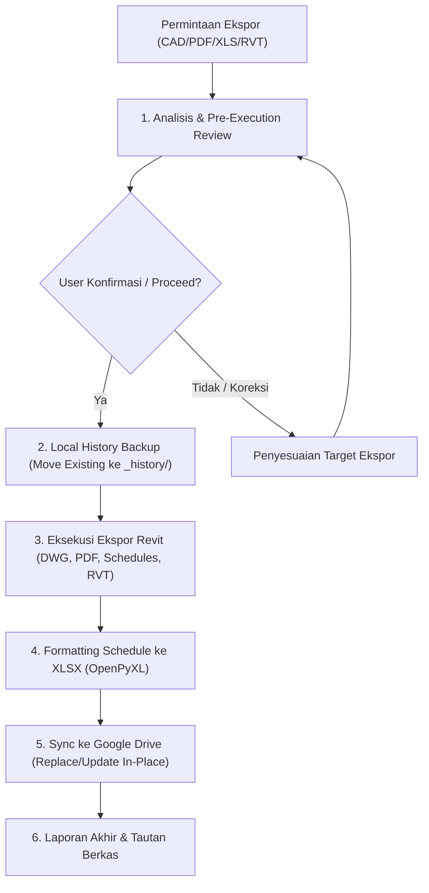

# Revit Deliverable Exporter Skill

Skill ini mengatur Standard Operating Procedure (SOP) resmi untuk melakukan ekspor paket penyerahan berkas BIM (*BIM Deliverables Handover*) dari Autodesk Revit ke format **CAD (DWG)**, **PDF**, **Excel (XLSX)**, dan **Revit Model (RVT)**, serta sinkronisasi otomatis ke **Google Drive**.

---

## 1. Aturan Baku & Protokol Keamanan Berkas



### Mandat 1: Review Terlebih Dahulu Sebelum Eksekusi (Pre-Execution Review Gate)
AI **DILARANG KERAS** langsung mengeksekusi ekspor berkas atau menimpa file tanpa persetujuan.
Sebelum eksekusi dimulai, sajikan tabel review terstruktur:
1. **Daftar Berkas & Target Format**: Nama Sheet/View/Schedule, format yang diminta (CAD, PDF, XLS, RVT).
2. **Lokasi Tujuan**: Path folder lokal & URL/ID folder tujuan di Google Drive.
3. **Status Arsip Lokal**: Sebutkan apakah ada file lama di lokal yang akan dipindahkan ke folder `_history/`.
4. **Peringatan Wajib Google Drive**: Berikan notifikasi tegas kepada pengguna jika ada file dengan nama yang sama di Google Drive:
   > ⚠️ **Pemberitahuan Google Drive**: Jika terdapat berkas dengan nama yang sama pada Google Drive tujuan, berkas tersebut akan **langsung di-replace (diperbarui di tempat / in-place update)** agar tautan berkas tetap konsisten dan tidak menimbulkan duplikasi.

### Mandat 2: Folder Backup History Lokal Berdasarkan Tanggal Modified (Zero Local Data Loss)
Untuk menjaga integritas data lokal:
1. Folder lokal tujuan **WAJIB memiliki sub-folder `_history/`**.
2. Jika ada berkas lama dengan nama yang sama (kasus replace atau merge ulang):
   * Berkas lama **DILARANG DIHAPUS**.
   * Berkas lama **WAJIB DI-PINDAHKAN (MOVED)** ke dalam:
     ```text
     [TargetDir]/_history/[YYYY-MM-DD]/[NamaFile]_MOD_[YYYYMMDD_HHMMSS].[ext]
     ```
   * Tag timestamp diambil **langsung dari tanggal modified asli** file tersebut (`LastModifiedTime`), bukan waktu saat ini.

### Mandat 3: Sinkronisasi Google Drive (In-Place Replace & Preserve Links)
1. Jika file belum ada di Google Drive: Upload sebagai file baru (`gdrive mutate upload <file> --parent <folder_id>`).
2. Jika file dengan nama yang sama sudah ada di Google Drive:
   * Lakukan replace in-place (`gdrive mutate update <file_id> <file>`).
   * Hal ini menjaga agar file ID, komentar, riwayat revisi, dan *shareable link* Drive tidak putus atau berubah.

---

## 2. Standar Format Ekspor Berkas

| Kategori Berkas | Format | Mesin / Tool Eksekusi | Standar Kualitas |
| :--- | :---: | :--- | :--- |
| **Gambar Kerja (Sheets)** | **PDF** | `PDFExportOptions` | Vector resolution, 100% Zoom, Sheet Number naming, True Color |
| **Gambar CAD** | **DWG** | `DWGExportOptions` | Layer Standard AIA/ISO, `MergedViews = True`, koordinat shared/internal |
| **Jadwal Volume (QTO)** | **XLSX** | `sched.Export` $\rightarrow$ `deliverable_orchestrator.py` | Konversi dump Revit ke Excel ber-header Navy, bordered, autofit columns |
| **Model Arsip** | **RVT** | `doc.SaveAs` / Detach from Central | Model detached, audit purged links, siap kirim ke pihak ketiga |

---

## 3. Langkah Operasional (Step-by-Step SOP)

### Langkah 1: Kumpulkan Data & Buat Manifest Review
Kumpulkan daftar sheet dan schedule yang akan diekspor dari Revit melalui:
* `aigrav_get_sheets()`
* `aigrav_get_schedules()`

Simpan konfigurasi ke dalam manifest sementara `deliverable_manifest.json`:
```json
{
  "project_name": "GUDANG_LOGISTIK_A",
  "local_output_dir": "D:\\AIGRAV\\Deliverables\\2026-11-Export",
  "gdrive_folder_id": "1A2B3C4D5E6F7G8H",
  "formats": ["pdf", "cad", "xls"],
  "items": [
    { "type": "sheet", "number": "A101", "name": "DENAH LANTAI 1" },
    { "type": "sheet", "number": "S101", "name": "DENAH STRUKTUR SLAB & SLOOF" },
    { "type": "schedule", "name": "C.3.1.1 Schedule Kolom Baja", "target_filename": "QTO_KOLOM_BAJA" }
  ]
}
```

Jalankan orkestrator untuk memeriksa status lokal dan Google Drive:
```powershell
python "d:\AIGRAV\.agents\skills\revit-deliverable-exporter\scripts\deliverable_orchestrator.py" review --manifest "manifest.json"
```

### Langkah 2: Sajikan Kotak Review Kepada Pengguna
Tampilkan ringkasan kepada pengguna dalam format:
```markdown
### 📋 Review Rencana Ekspor & Penyerahan Berkas BIM
* **Nama Proyek**: GUDANG_LOGISTIK_A
* **Folder Lokal**: `D:\AIGRAV\Deliverables\2026-11-Export\`
* **Folder Google Drive ID**: `1A2B3C4D5E6F7G8H`
* **Format Diminta**: PDF, DWG (CAD), XLSX (Schedule)

#### Daftar Berkas yang Akan Dihasilkan:
| Nama Item / Sheet | Tipe | Format Target | Status Lokal | Status Google Drive |
| :--- | :---: | :---: | :---: | :---: |
| A101 - DENAH LANTAI 1 | Sheet | PDF, DWG | Berkas Baru | Siap Upload |
| S101 - DENAH STRUKTUR | Sheet | PDF, DWG | ⚠️ Konflik (Ada Versi Lama) | ⚠️ Ditemukan (Akan di-Replace) |
| C.3.1.1 Schedule Kolom | QTO | XLSX | ⚠️ Konflik (Ada Versi Lama) | Siap Upload |

> ℹ️ **Rencana Backup Lokal**: 2 berkas lama di lokal akan dipindahkan ke `_history/2026-11-10/` dengan tag modified date aslinya.
> ⚠️ **Pemberitahuan Google Drive**: Berkas `GUDANG_LOGISTIK_A_S101.dwg` sudah ada di Google Drive dan **akan langsung di-replace in-place**.
```

Tunggu konfirmasi pengguna (*User Approval*).

### Langkah 3: Arsipkan Berkas Lama di Lokal
Setelah disetujui, jalankan proses pemindahan ke history:
```powershell
python "d:\AIGRAV\.agents\skills\revit-deliverable-exporter\scripts\deliverable_orchestrator.py" archive --manifest "manifest.json"
```

### Langkah 4: Eksekusi Ekspor dari Revit
Jalankan ekspor melalui Revit Bridge (`AIGRAV.Skills.MasterExporter`) / Revit Python:
1. **Ekspor Gabungan Sheet (PDF & CAD)**: Panggil `aigrav_export_all_deliverables` dengan argumen `"pdfFilePath|cadDirectory"` (otomatis menempatkan `000 - COVER` di Halaman 1 dan `DG-001 - DAFTAR GAMBAR` di Halaman 2, diikuti urutan parameter `NO`), atau `aigrav_export_single_sheet` untuk lembaran revisi tertentu.
2. **Ekspor Schedule (QTO)**: Panggil `aigrav_export_all_schedules` (otomatis mengecualikan jadwal non-konstruksi seperti `DAFTAR GAMBAR` dan `Keynote Legend`).
3. **Format Jadwal ke XLSX (Single atau Multi-Tab WBS Workbook)**:
   * Single schedule:
   ```powershell
   python "d:\AIGRAV\.agents\skills\revit-deliverable-exporter\scripts\deliverable_orchestrator.py" format-schedule --input "temp_dir\schedule.txt" --output "target_dir\QTO.xlsx" --title "Schedule Kolom"
   ```
   * Multi-tab WBS QTO Workbook (`All Schedules` + tab per jadwal, otomatis exclude `DAFTAR GAMBAR` & `Keynote Legend`):
   ```powershell
   python "d:\AIGRAV\.agents\skills\revit-deliverable-exporter\scripts\deliverable_orchestrator.py" build-qto-workbook --tsv-dir "temp_tsv_dir" --output "target_dir\QTO_Workbook.xlsx"
   ```

### Langkah 5: Sinkronisasi ke Google Drive
Sinkronisasikan setiap berkas ke Google Drive:
* Jika file baru:
  ```powershell
  python "d:\AIGRAV\.agents\skills\revit-deliverable-exporter\scripts\deliverable_orchestrator.py" sync-drive --file "D:\AIGRAV\Deliverables\A101.pdf" --folder-id "1A2B3C4D5E6F7G8H"
  ```
* Jika file sudah ada di Drive (replace in-place):
  ```powershell
  python "d:\AIGRAV\.agents\skills\revit-deliverable-exporter\scripts\deliverable_orchestrator.py" sync-drive --file "D:\AIGRAV\Deliverables\S101.dwg" --folder-id "1A2B3C4D5E6F7G8H" --file-id "DRIVE_FILE_ID_123"
  ```

---

## 4. Format Laporan Akhir (Handover Completion)

Setiap akhir eksekusi, sajikan tabel rekapitulasi:
```markdown
### 🚀 Laporan Penyelesaian Ekspor & Upload Deliverable
- [x] Pre-Execution Review Disetujui
- [x] Local History Backup Berhasil (`_history/` terisi aman)
- [x] Ekspor Revit Sukses (PDF, DWG, XLSX)
- [x] Sinkronisasi Google Drive Selesai

#### Rekapitulasi Berkas:
| Berkas | Ukuran | Status Lokal | Status Google Drive |
| :--- | :---: | :---: | :---: |
| [A101.pdf](file:///D:/AIGRAV/Deliverables/A101.pdf) | 1.8 MB | ✅ Tersimpan | ✅ Terunggah Baru |
| [A101.dwg](file:///D:/AIGRAV/Deliverables/A101.dwg) | 4.2 MB | ✅ Tersimpan | ✅ Terunggah Baru |
| [QTO_Kolom.xlsx](file:///D:/AIGRAV/Deliverables/QTO.xlsx) | 85 KB | ✅ Tersimpan | ✅ Terunggah Baru |
| [S101.dwg](file:///D:/AIGRAV/Deliverables/S101.dwg) | 3.9 MB | ✅ Versi Baru (Lama di _history) | 🔄 In-Place Replaced |

📁 **Tautan Google Drive**: https://drive.google.com/drive/folders/1A2B3C4D5E6F7G8H
```