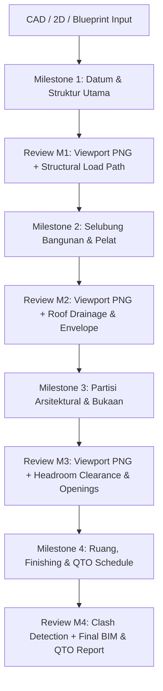

# Revit Milestone-Based Modeling Skill

This skill defines the official orchestration workflow for generating comprehensive Revit BIM models from CAD drawings, conceptual blueprints, or spatial requirements.

---

## 1. Architectural Philosophy: The Hybrid Milestone Model

To combine the **atomic safety and speed of Antigravity** with the **step-by-step transparency and reviewability of iterative modeling**, building creation MUST NOT be executed as 50 micro-steps (which creates 50 fragmented undo records and extreme network latency) nor as a blind monolithic black box.

Instead, the workflow is partitioned into **4 Deterministic Macro-Milestones**:

---

## 2. The 4 Standard Macro-Milestones

### Milestone 1 (M1): Datum, Substructure & Superstructure Skeleton
* **Focus:** Establishing the physical skeleton and structural load path.
* **Elements Created:**
  1. Datum: Levels (`create_level`) and Grid Matrix (`create_grid_matrix` / `create_grid`).
  2. Substructure: Pondasi Strauss / Footplate / Pile Cap & Sloof.
  3. Superstructure: Kolom Utama (`create_column`) dan Balok Induk/Anak (`create_beam`).
* **Atomic Boundary:** Single `TransactionGroup("AIGRAV M1 - Datum & Structure")`.
* **Sanity Gate & Checkpoint:**
  - Call `aigrav_capture_revit_viewport()` in 3D Isometric.
  - Audit: Tumpuan menerus kolom, dimensi bentang balok ($h \approx L/10\text{--}L/14$), tidak ada *floating columns*.
* **Output to User:** Viewport Screenshot + Verdict Kelayakan Struktur.

---

### Milestone 2 (M2): Building Envelope, Slabs & Roofing
* **Focus:** Enclosing the building volume and protecting it from weather.
* **Elements Created:**
  1. Pelat Lantai: Ground Floor & Mezzanine/Upper Floors (`create_floor`).
  2. Dinding Luar: Exterior Perimeter Walls (`create_wall`) dengan material komposit bata/plester.
  3. Sistem Atap: Rafter / Kuda-Kuda, Gording, dan Atap Penutup (`create_roof` / By-Face / Adaptive).
* **Atomic Boundary:** Single `TransactionGroup("AIGRAV M2 - Envelope & Slabs")`.
* **Sanity Gate & Checkpoint:**
  - Call `aigrav_capture_revit_viewport()` from Exterior Perspective.
  - Audit: Kemiringan atap (*roof slope*), talang air (*water ponding prevention*), teritisan (*overhang*), dan tumpuan pelat lantai.
* **Output to User:** Viewport Screenshot + Verdict Kelayakan Selubung & Drainase.

---

### Milestone 3 (M3): Architectural Partitions, Openings & Circulation
* **Focus:** Spatial ergonomics, human circulation, and functional access.
* **Elements Created:**
  1. Dinding Pembatas: Interior Partition Walls (`create_wall`).
  2. Bukaan: Pintu (`create_family_instance` doors) dan Jendela (`create_family_instance` windows) hosted in walls.
  3. Sirkulasi Vertikal: Tangga (`Stairs`), Bordes, Handrail, dan Void Bukaan Lantai.
* **Atomic Boundary:** Single `TransactionGroup("AIGRAV M3 - Partitions & Openings")`.
* **Sanity Gate & Checkpoint:**
  - Call `aigrav_capture_revit_viewport()` from Floor Plan & Section/Internal View.
  - Audit: *Headroom clearance* minimal $2.20\text{ m}$ (kantor/hunian) atau $3.50\text{ m}$ (pabrik), kusen pintu tidak menabrak kolom struktur utama, tangga ergonomis ($2\text{O} + \text{A} = 60\text{--}64\text{ cm}$).
* **Output to User:** Viewport Screenshot + Verdict Kelayakan Arsitektur & Ergonomi.

---

### Milestone 4 (M4): Spatial Tagging, Finishes & QTO Verification
* **Focus:** BIM data enrichment, quantity takeoff, and clash compliance.
* **Elements Created / Audited:**
  1. Ruang: `Room.Create` + Room Tags + Perhitungan Luas Bersih (Nett Area).
  2. Material Finishes: Skim coat, keramik, pengecatan, floor hardener.
  3. Solid Clash Detection: Panggil `aigrav_detect_spatial_clashes` (pastikan nol benturan struktur vs arsitektur).
  4. QTO Schedules: Pembuatan schedule kuantitas resmi berstandar AIGRAV (`Lokasi` di Kolom A).
* **Atomic Boundary:** Single `TransactionGroup("AIGRAV M4 - Rooms & QTO")`.
* **Sanity Gate & Checkpoint:**
  - Call `aigrav_check_model_health()`.
  - Audit: Tidak ada unresolved warnings, material transparan $\ge 50\%$, tabel QTO terkalibrasi.
* **Output to User:** Final Full BIM Report + Tabel Rekapitulasi Kuantitas (QTO).

---

## 3. Operational Rules for Agents

1. **Never Skip Ahead**: Milestone $N+1$ cannot begin until Milestone $N$ has passed its Sanity Gate.
2. **One Undo per Milestone**: Each milestone must commit its transactions inside an atomic group so the user can roll back exactly one milestone with a single `Ctrl+Z`.
3. **Capture Viewport Before Transition**: Do not proceed to the next milestone without presenting the visual viewport proof to the user.
4. **Fast Escalation on Structural Defect**: If Milestone 1 reveals a floating column or impossible load path, STOP immediately, present the issue, and provide an engineering recommendation.
