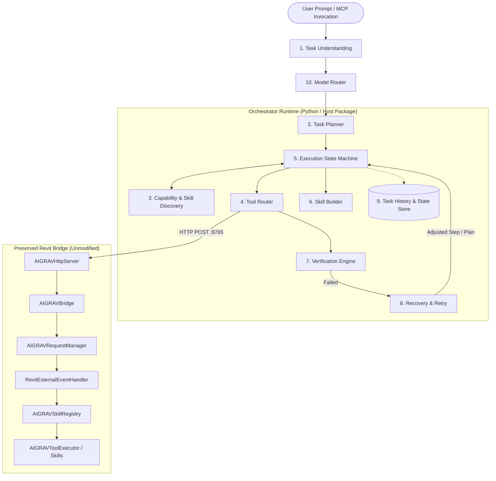
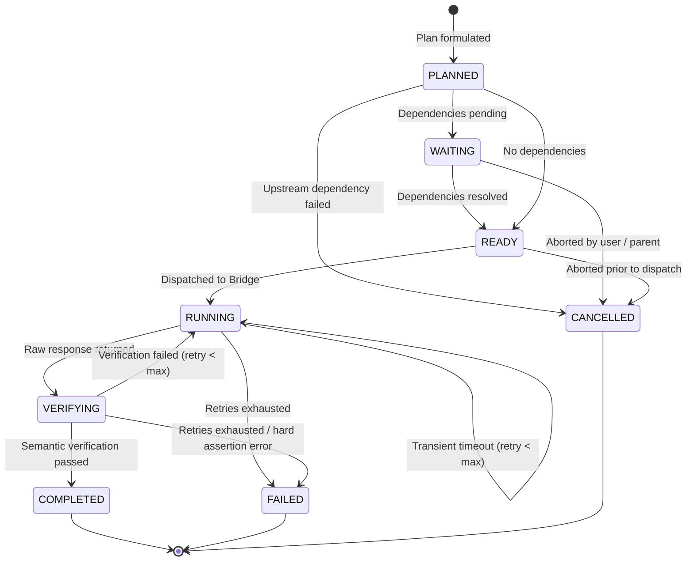

# AIGRAV Agent Orchestrator Architecture Specification

**Document Version:** 1.0.0  
**Status:** Architecture Proposal / Pre-Implementation Audit  
**Target Environment:** Revit 2026 (.NET 10.0-windows) & FastMCP Python 3.14  

---

## 1. Executive Architectural Overview

The AIGRAV Agent Orchestrator extends the existing AIGRAV ecosystem with autonomous, deterministic, and verifiable multi-step execution. Rather than reinventing the wheel or introducing unnecessary runtime boundaries, the Orchestrator preserves the existing communication and synchronization infrastructure:

```
[Agent / User Client]
         │
         ▼
[AIGRAV Agent Orchestrator] ── (Task Understanding, DAG Planner, State Machine, Model Router)
         │
         ▼  (HTTP POST :8765 / JSON-RPC)
[Existing Revit Pipeline: AIGRAVHttpServer]
         │
         ▼  (Enqueue & Raise)
[Existing Revit Pipeline: AIGRAVBridge + ExternalEvent]
         │
         ▼  (Revit UI Thread Context)
[Existing Revit Pipeline: RevitExternalEventHandler]
         │
         ▼  (Priority Match: 2000 -> 0 -> -1000)
[Existing Skill Registry: AIGRAVSkillRegistry]
    ├── Priority 2000: AIGRAVSkillManagementSkill (Hot Reload)
    ├── Priority 1500: AIGRAV.Skills.QTO (External)
    ├── Priority 0: Custom / JIT Skills
    └── Priority -1000: AIGRAVLegacyBimSkill (Fallback to AIGRAVToolExecutor)
```

### Core Architecture Invariants
1. **Never bypass the existing Revit Bridge**: All Revit interactions must traverse `AIGRAVBridge.ExecuteToolAsync` -> `AIGRAVRequestManager` -> `IExternalEventHandler.Execute(UIApplication app)` on the main UI thread.
2. **Zero In-Process Revit DLL Sprawl**: The core orchestrator lives in a lightweight orchestrator package (co-located in Python alongside MCP or a dedicated CLI runner), keeping Revit's memory footprint clean and avoiding extra Revit plugin dependencies.
3. **Never equate "no exception" with "success"**: Every model modification requires a two-phase verification: syntactic confirmation of element identity followed by semantic read-verification from Revit's database.

---

## 2. Logical Module Breakdown



### 2.1 Module 1: Task Understanding
* **Role**: Parses user natural language into structured engineering intent, identifying target parameters, element categories, levels, and operational classification (Read-Only vs. Modifying vs. Destructive).
* **Location**: `MCP/TestServer/orchestrator/task_understanding.py`.
* **Output**: Immutable `TaskIntent` schema.

### 2.2 Module 2: Task Planner
* **Role**: Decomposes `TaskIntent` into a directed acyclic graph (DAG) of discrete, executable `Step` objects.
* **Location**: `MCP/TestServer/orchestrator/planner.py`.
* **Features**:
  * Resolves variable dependencies across steps using `{{step_id.output.path}}` references.
  * Injects corresponding verification rules into each mutating step.

### 2.3 Module 3: Capability and Skill Discovery
* **Role**: Maintains an updated catalog of all tools and skills supported by the running Revit session.
* **Location**: `MCP/TestServer/orchestrator/discovery.py`.
* **Integration**:
  * Queries `aigrav_skill_status` and `aigrav_discover_skills` from the live bridge.
  * Reads built-in tool metadata from `server.py` `TOOLS` dictionary.
  * Caches tool metadata and refreshes when `aigrav_reload_skills` is triggered.

### 2.4 Module 4: Tool Router
* **Role**: Maps an individual step's target to the appropriate execution endpoint and dispatches it over HTTP.
* **Location**: `MCP/TestServer/orchestrator/router.py`.
* **Routing Table**:
  * Native / Legacy Tools (`aigrav_get_*`, `aigrav_create_*`) -> Dispatched to `http://127.0.0.1:8765/`.
  * Management Tools (`aigrav_reload_skills`, etc.) -> Dispatched to `http://127.0.0.1:8765/`.
  * Missing Tool -> Escalated to Module 6 (Skill Builder).

### 2.5 Module 5: Execution State Machine
* **Role**: Drives step execution, monitors transitions across 8 deterministic states (`PLANNED`, `READY`, `RUNNING`, `WAITING`, `VERIFYING`, `COMPLETED`, `FAILED`, `CANCELLED`), and commits checkpoints on each transition.
* **Location**: `MCP/TestServer/orchestrator/state_machine.py`.

### 2.6 Module 6: Skill Builder
* **Role**: Dynamically synthesizes and builds new external C# skills when a required specialized capability is not present in Revit.
* **Location**: `MCP/TestServer/orchestrator/skill_builder.py`.
* **Workflow**:
  * Emits C# source code implementing `AIGRAV.Contracts.IAIGRAVSkill`.
  * Triggers isolated compile (`dotnet build`) targeting `net10.0-windows`.
  * Copies output DLL to `RevitBridge/Skills/`.
  * Invokes `aigrav_reload_skills` via the Bridge to hot-load into Revit without restarting.

### 2.7 Module 7: Verification Engine
* **Role**: Validates every executed operation against pre-defined syntactic and semantic acceptance criteria.
* **Location**: `MCP/TestServer/orchestrator/verifier.py`.
* **Rules**:
  * Creation operations must return an integer element ID, followed by an immediate query verifying element existence, category, and coordinate match.
  * Parameter modifications must read back parameter values to verify match.
  * Deletions must confirm element absence.
  * Inspects `aigrav_find_warnings` for newly introduced Revit warnings.

### 2.8 Module 8: Recovery and Retry
* **Role**: Handles transient failures, lock contention, and plan deviation.
* **Location**: `MCP/TestServer/orchestrator/recovery.py`.
* **Policies**:
  * Transient errors (timeouts, busy queues): Exponential backoff retry (up to 3 attempts).
  * Missing family / parameter errors: 0 retries; triggers compensatory rollback or requests alternative plan parameters.

### 2.9 Module 9: Task History & Checkpoints
* **Role**: Persists step states, input/output logs, duration telemetry, and element IDs to disk.
* **Location**: `MCP/TestServer/orchestrator/history.py`.
* **Storage**: JSON checkpoint records stored in `KnowledgeBase/TaskHistory/{task_id}.json`.

### 2.10 Module 10: Model Router
* **Role**: Directs sub-tasks to appropriate LLM tiers based on complexity and cost.
* **Location**: `MCP/TestServer/orchestrator/model_router.py`.
* **Tiers**:
  * Fast / Low-Cost Tier (e.g., Flash / Mini): Intent classification, JSON argument formatting, verification assertions.
  * High-Reasoning Tier (e.g., Pro / Opus / Reasoning models): Multi-step DAG planning, C# skill code synthesis, failure root-cause analysis.

---

## 3. Communication Contract & Wire Protocol

The Orchestrator communicates with the Revit Bridge strictly via JSON payloads over HTTP:

```http
POST http://127.0.0.1:8765/
Content-Type: application/json

{
  "tool": "aigrav_create_column",
  "argument": "type=UC203x203x46;x=0;y=0;level_id=31102"
}
```

Response format from `AIGRAVHttpServer`:
```json
{
  "Success": true,
  "Result": "Column created successfully. Id: 450123"
}
```

---

## 4. State Machine Transition Diagram


