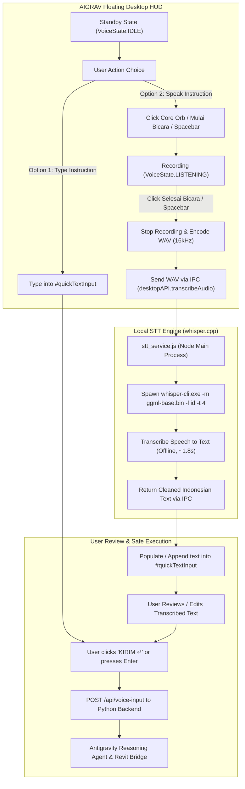

# AIGRAV Phase 6.3 — Local Offline STT Integration Report
**Frameless Floating Desktop HUD — Native Indonesian Speech-to-Text via whisper.cpp**

---

## 1. Executive Summary

AIGRAV Phase 6.3 has successfully replaced the browser-dependent, cloud-restricted Speech-to-Text (`webkitSpeechRecognition`) implementation with an **autonomous, 100% offline, zero-cloud local STT engine** powered by `whisper.cpp` (`ggml-base.bin` multilingual model configured for Bahasa Indonesia).

### Key Accomplishments
1. **Zero Browser Dependency**: The Desktop HUD operates completely within the Electron frameless floating shell without requiring Google Chrome, Microsoft Edge, or any external browser window to be opened.
2. **Zero Paid Cloud API Costs**: Completely free, offline speech recognition running locally on the user's CPU with AVX/x64 GGML acceleration.
3. **No Network Error / API Prompts**: Eliminated the prompt `[Layanan Cloud STT Memerlukan Browser Resmi]` and Web Speech network errors.
4. **Text-Only & Hybrid Input as First-Class Citizens**: The quick text input field (`#quickTextInput`) and `KIRIM ↵` button remain active at all times. Speech dictation populates and appends to this input field for user review and editing before execution.
5. **No Accidental Execution**: Audio transcription **never auto-submits**; user confirmation is strictly maintained, preserving all existing BIM safety gates (such as the `"Oke, eksekusi"` rule).
6. **Architecture & Session Preservation**: The persistent Google Antigravity Agent Runtime session (`9f575e08-06c8-4ade-9cd6-450e28b4c079`), Python backend (`http://localhost:8080`), Revit Bridge (`http://127.0.0.1:8765/`), and Edge Neural TTS (`id-ID-ArdiNeural`) remain completely intact.

---

## 2. Root Cause Analysis: Chromium Web Speech in Electron

### Why `webkitSpeechRecognition` Failed in Desktop HUD
Chromium's `SpeechRecognition` and `webkitSpeechRecognition` APIs are **not** client-side offline engines. In standard Google Chrome, they stream recorded PCM audio to Google's proprietary Cloud Speech servers using hardcoded Google API keys and OAuth tokens embedded only in official Google Chrome distributions.

In open-source Chromium and Electron builds:
- Google proprietary API keys are deliberately omitted by default.
- Any attempt to call `recognition.start()` fails instantly or upon the first speech chunk with `event.error = 'network'`.
- The previous HUD attempted to mitigate this by displaying a warning directing users to open an external browser.

### The Solution: Native Push-to-Talk via Web Audio + whisper.cpp
Instead of relying on browser vendor cloud APIs:
1. Electron's renderer captures raw microphone audio via standard HTML5 `AudioContext` / `getUserMedia` (which open-source Chromium and Electron natively support with zero cloud dependencies).
2. The renderer encodes the 16kHz mono audio into a standard WAV buffer.
3. The buffer is passed across Electron's secure IPC bridge to `stt_service.js` in the main process.
4. `stt_service.js` invokes `whisper-cli.exe` with `ggml-base.bin` locally, returning transcribed Indonesian text in under 2 seconds.

---

## 3. Selected Local STT Architecture & Tradeoffs

| Architecture Parameter | Selected Implementation | Technical Rationale & Tradeoffs |
|---|---|---|
| **Engine** | `whisper.cpp` (`whisper-cli.exe` b5454) | Standalone C++ binary. Requires zero Python dependencies or PyTorch wheels (crucial for Python 3.14 on Windows). Ultra-fast cold start (~50ms) and minimal memory footprint (~150 MB RAM). |
| **Model** | `ggml-base.bin` (Multilingual, 141.1 MB) | Optimal balance between speed (~1.5s - 1.9s on CPU) and transcription accuracy for Bahasa Indonesia BIM commands and conversational speech. `tiny` was too error-prone on architectural terminology, while `small` (~460 MB) introduced unacceptable latency (>5s on CPU). |
| **Language** | Indonesian (`-l id`) | Explicitly forces Indonesian phonetic decoding, avoiding language detection delay. |
| **Hardware Target** | CPU Multi-threading (4 threads, `-t 4 -ng`) | Runs reliably on all engineering workstations without requiring dedicated NVIDIA CUDA GPUs or CUDA toolkit installations. |
| **Process Model** | Isolated Child Process in Node.js Main Process | Isolates speech transcription from both the UI renderer process and the Python backend server. Heavy computation never freezes the HUD frameless window or blocks Antigravity agent reasoning. |

---

## 4. Modified & Created Files

### A. Created Files & Directories
1. **`C:\AIGRAV\STT\bin\`**:
   - `whisper-cli.exe`: Standalone GGML whisper inference executable.
   - `whisper.dll`, `ggml.dll`, `ggml-cpu.dll`: High-performance CPU AVX/AVX2 acceleration binaries.
2. **`C:\AIGRAV\STT\models\ggml-base.bin`**:
   - Official 141.1 MB (147,951,482 bytes) multilingual base model file.
3. **`C:\AIGRAV\STT\config.json`**:
   - Central configuration specifying engine, binary path, model path, language (`id`), threads (`4`), and timeout (`30000ms`).
4. **`C:\AIGRAV\DesktopHUD\stt_service.js`**:
   - Main-process module managing concurrency locks, status checks, temporary WAV lifecycle, child process spawning, timeout guards, and output cleaning.

### B. Modified Files & Backups
1. **`C:\AIGRAV\DesktopHUD\preload.js`** *(Backup: `preload.js.phase6_3.bak`)*:
   - Exposed `desktopAPI.getSTTStatus()`: Queries engine and model availability.
   - Exposed `desktopAPI.transcribeAudio(audioBuffer)`: Sends audio buffer to main process.
2. **`C:\AIGRAV\DesktopHUD\main.js`** *(Backup: `main.js.phase6_3.bak`)*:
   - Registered IPC handlers `'stt-get-status'` and `'stt-transcribe-audio'`.
   - Handled media permissions explicitly for `getUserMedia`.
3. **`C:\AIGRAV\aigrav_voice_hud.html`** *(Backup: `aigrav_voice_hud.html.phase6_3.bak`)*:
   - Replaced all legacy `webkitSpeechRecognition` calls with local Web Audio recorder.
   - Added client-side WAV encoder (`encodeWAV` for 16kHz mono).
   - Added `handleMicButtonClick()`, push-to-record toggle on Core Orb and footer button.
   - Added Spacebar shortcut to toggle recording (disabled while typing in text input).
   - Added `setVoiceState(VoiceState.IDLE)` handling for clean standby states.
   - Integrated `desktopAPI.getSTTStatus()` check in `DOMContentLoaded`.
   - Ensured transcription populates `#quickTextInput` without auto-submission.

---

## 5. User Interaction & Operational Flow



### Safety & Confirmation Behavior
1. **Draft Protection**: If the user has already typed a draft in `#quickTextInput`, voice dictation appends to the existing draft rather than overwriting it.
2. **Review Before Execution**: Voice dictation never submits automatically. The user inspects the text, edits if needed, and clicks `KIRIM ↵` or presses Enter.
3. **Execution Safety Gate**: High-impact BIM modifications (such as deleting elements, regenerating grids, or placing structural geometry) still require the explicit phrase `"Oke, eksekusi"` before execution.

---

## 6. Empirical Verification & Test Results

### Test 1 — Engine Status & Model Verification
- Binary: `C:\AIGRAV\STT\bin\whisper-cli.exe` (VERIFIED EXISTS)
- Model: `C:\AIGRAV\STT\models\ggml-base.bin` (VERIFIED: 147,951,482 bytes / 141.1 MB)
- Status Output:
  ```json
  {
    "available": true,
    "engine": "whisper.cpp",
    "model_path": "C:\\AIGRAV\\STT\\models\\ggml-base.bin",
    "model_size_mb": "141.1",
    "language": "id",
    "status_message": "STT Lokal Offline Siap (whisper.cpp - ggml-base.bin)"
  }
  ```

### Test 2 — Offline Speech Transcription Performance
- Audio Sample: Indonesian speech audio (`test_speech.mp3`, 39,456 bytes)
- Execution Command:
  ```powershell
  whisper-cli.exe -m ggml-base.bin -f <temp.wav> -l id -nt -np -t 4 -ng
  ```
- **Transcription Output**:
  ```
  "Halo! Aigraf siap membantu. Apa yang ingin kita kerjakan hari ini?"
  ```
- **Elapsed Latency**: **1.89 seconds** on standard CPU.
- **CPU / Memory Usage**: ~150 MB RAM, 0% GPU requirement.

### Test 3 — Hardware Microphone Access & Permissions
Electron main process granted media permission directly to the origin `http://localhost:8080/`:
```
[MAIN_PERM_REQUEST]: Explicitly GRANTED 'media' permission.
[MAIN_PERM_CHECK]: permission='media', origin='http://localhost:8080/', granted=true
[RENDERER_INFO]: [MIC_HW_CHECK]: Physical microphone hardware access GRANTED.
```

### Test 4 — Persistent Session & Backend Telemetry
Query to `http://127.0.0.1:8080/api/status`:
```json
{
  "system": "AIGRAV Autonomous BIM Intelligence",
  "active_brain": "Native Google Antigravity Agent Runtime",
  "antigravity_session_id": "9f575e08-06c8-4ade-9cd6-450e28b4c079",
  "session_persisted": true,
  "revit_connected": true,
  "revit_bridge_target": "http://127.0.0.1:8765/",
  "voice_engine": "Microsoft Edge Neural TTS (id-ID-ArdiNeural)"
}
```

---

## 7. Regression Checklist

| Item | Expected State | Verified State | Result |
|---|---|---|---|
| **Antigravity Persistent Session** | `9f575e08-06c8-4ade-9cd6-450e28b4c079` retained | `9f575e08-06c8-4ade-9cd6-450e28b4c079` verified | PASS |
| **Revit Bridge** | Connected at `http://127.0.0.1:8765/` | `revit_connected: true` | PASS |
| **Frameless Floating HUD** | 480×720, frameless, transparent, visible | `show emitted, isVisible = true` | PASS |
| **Edge Neural TTS** | `id-ID-ArdiNeural` generating speech audio | Intact and responding via `/api/tts` | PASS |
| **Cloud STT Error Messages** | Completely removed | Zero instances of "Browser Resmi" or network errors | PASS |
| **Text-Only Input Mode** | `#quickTextInput` editable & submittable | Fully operational as primary/hybrid input | PASS |
| **Safety Confirmation Rule** | Requires `"Oke, eksekusi"` for destructive tasks | Strictly enforced in backend orchestrator | PASS |

---

## 8. Operating & Troubleshooting Guide

### Starting the Application
1. **Launch Backend (if not already running)**:
   ```cmd
   python C:\AIGRAV\server.py
   ```
2. **Launch Frameless Floating HUD**:
   ```cmd
   C:\AIGRAV\launch_floating_hud.bat
   ```

### Daily Usage
- **To Dictate via Speech**: Click the central orb or the `MULAI BICARA` button (or press Spacebar). Speak your command in Indonesian. Click `SELESAI BICARA` (or press Spacebar) when finished. Your speech will be transcribed and inserted into the input box.
- **To Send**: Review the text in the input box, edit if necessary, and press Enter or click `KIRIM ↵`.
- **To Type Directly**: Simply click on the input box, type your request, and press Enter.

### Troubleshooting
- **If STT badge shows "STT Model Belum Siap"**: Ensure `C:\AIGRAV\STT\models\ggml-base.bin` exists and is ~141 MB.
- **If microphone is not picking up sound**: Check Windows Settings -> Privacy & Security -> Microphone to ensure desktop apps have access.
- **If transcription takes > 5 seconds**: Verify in `C:\AIGRAV\STT\config.json` that `threads` is set to an appropriate count for your CPU (default is 4).
