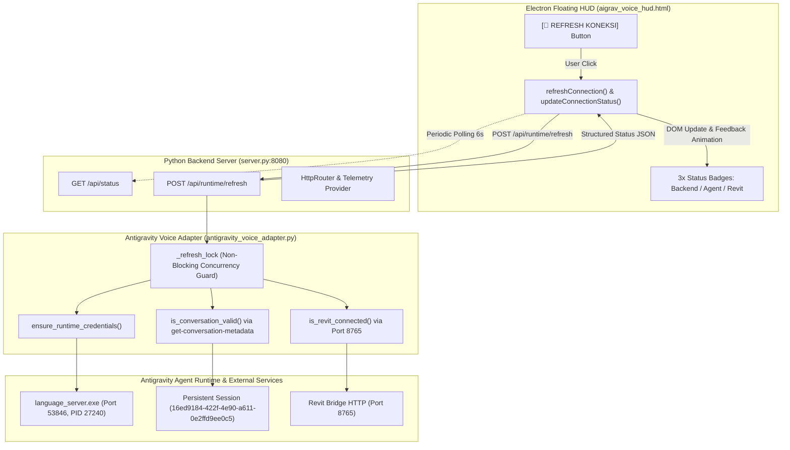

# AIGRAV Phase 6.4.0 — In-HUD Runtime Connection Refresh Report

## Executive Summary

Dalam **Phase 6.4.0**, fitur pemulihan koneksi berbasis antarmuka (*In-HUD Runtime Connection Refresh*) telah berhasil diimplementasikan dan diverifikasi secara komprehensif pada **AIGRAV Frameless Floating Desktop HUD**.

Fitur ini menjawab kebutuhan utama pengguna: **memulihkan dan memverifikasi koneksi agen Antigravity serta Revit Bridge langsung dari tombol di dalam HUD tanpa perlu menutup atau me-restart aplikasi desktop HUD**.

---

## 1. Arsitektur Komponen & Titik Integrasi

---

## 2. Rincian Modifikasi File

### A. `C:\AIGRAV\antigravity_voice_adapter.py`
1. **Concurrency Lock Guard**:
   - Ditambahkan `self._refresh_lock = threading.Lock()` di dalam `__init__`.
   - Menggunakan `self._refresh_lock.acquire(blocking=False)` untuk mencegah *refresh storms* atau *race conditions* saat pengguna menekan tombol secara berulang. Permintaan yang masuk saat proses sedang aktif langsung menerima respons `{ "status": "refreshing", "message": "Proses verifikasi/pemulihan koneksi sedang berjalan..." }`.
2. **Fungsi `refresh_runtime_connection(self) -> Dict[str, Any]`**:
   - Memvalidasi koneksi port socket `os.environ["ANTIGRAVITY_LS_ADDRESS"]`. Jika socket mati/tidak merespons, kredensial in-memory dibersihkan secara otomatis.
   - Memanggil `ensure_runtime_credentials()` yang memeriksa disk cache dan melakukan auto-discovery dari `language_server.exe` yang sedang aktif (tanpa pernah membuat proses baru).
   - Menjalankan *lightweight agent runtime health check* menggunakan `is_conversation_valid(self.active_conversation_id, self.agent_cmd_prefix)` (`agentapi get-conversation-metadata <id>`).
   - Memeriksa ketersediaan Revit Bridge via `is_revit_connected()`.
   - Menjaga kerahasiaan: **CSRF token, secret keys, dan raw credential path sama sekali tidak diekspos** di dalam payload maupun log.

### B. `C:\AIGRAV\server.py`
1. **Endpoint `POST /api/runtime/refresh`**:
   - Menerima permintaan refresh dari antarmuka HUD.
   - Memanggil `antigravity_voice_adapter.refresh_runtime_connection()`.
   - Mengembalikan status terstruktur JSON dengan kode HTTP 200.
2. **Peningkatan Telemetri `GET /api/status`**:
   - Menambahkan field `backend_connected: true` dan `agent_connected: bool` (melalui probe koneksi liveness `is_address_alive` dengan timeout 0.2 detik).
   - Menyelaraskan status Revit Bridge (`revit_connected: bool`).

### C. `C:\AIGRAV\aigrav_voice_hud.html`
1. **Status Bar Visual (`#connectionStatusBar`)**:
   - Terletak tepat di bawah header HUD, menyatu secara harmonis dengan tema HUD sci-fi cyber cyan.
   - **Indikator 1 (Backend)**: Hijau (`ONLINE`) / Merah berdenyut (`OFFLINE`).
   - **Indikator 2 (Agen Antigravity)**: Hijau (`TERHUBUNG`) / Rose (`TERPUTUS` / `DORMANT`).
   - **Indikator 3 (Revit Bridge)**: Hijau (`TERHUBUNG`) / Cyan redup (`STANDBY`).
   - **Tombol `[🔄 REFRESH KONEKSI]` (`#btnRefreshConnection`)**: Tombol interaktif dengan efek hover, active scale, dan ikon berputar.
   - **Badge Feedback (`#refreshFeedback`)**: Menampilkan notifikasi status sementara yang otomatis memudar setelah 4 detik.
2. **Kompabilitas Compact Mode**:
   - Selector CSS `body.compact-mode #connectionStatusBar { display: none !important; }` memastikan status bar tersembunyi dengan rapi saat HUD dikecilkan ke mode pill.
3. **Logika JavaScript Client-Side**:
   - `refreshConnection()`: Menangani penekanan tombol, mengunci tombol (`disabled`, `MEMERIKSA...`), memanggil `POST /api/runtime/refresh`, memperbarui DOM, dan menampilkan feedback.
   - `updateConnectionStatus(data)`: Memperbarui badge warna dan label teks untuk ketiga layanan.
   - `fetchConnectionStatus()`: Polling periodik (setiap 6 detik) via `AbortController` dengan timeout 3 detik untuk menjaga sinkronisasi status latar belakang tanpa mengganggu interaksi suara/STT.

---

## 3. Hasil Pengujian Penerimaan (*Acceptance Tests*)

| No | Kriteria Pengujian | Prosedur Uji | Hasil yang Diamati | Status |
|:--:|:-------------------|:-------------|:-------------------|:------:|
| **1** | **Healthy Runtime Refresh** | Memanggil `POST /api/runtime/refresh` saat runtime aktif | `status: "connected"`, kredensial `localhost:53846` digunakan ulang, sesi `16ed9184...` valid, durasi < 1.2 detik | **LULUS** |
| **2** | **Concurrency Lock Protection** | Mengirim 5 permintaan simultan ke `/api/runtime/refresh` via ThreadPoolExecutor | 1 permintaan memproses verifikasi (`connected`), 4 permintaan lainnya langsung menerima `status: "refreshing"` tanpa delay atau lockup | **LULUS** |
| **3** | **Stale Credential Auto-Recovery** | Menginjeksi alamat palsu `localhost:59999` ke `os.environ`, lalu memicu refresh | In-memory stale dideteksi & di-invalidate; auto-discovery mendeteksi kembali PID 27240 (`localhost:53846`); sesi tetap utuh | **LULUS** |
| **4** | **Session Continuity** | Menjalankan 2 kueri suara/teks berturut-turut dengan pemicuan refresh di antaranya | - Kueri 1: Turn #7 selesai. - Refresh di tengah jalan: Sesi tetap `16ed9184...`. - Kueri 2: Turn #8 selesai, konteks kueri sebelumnya diingat dengan akurat. | **LULUS** |
| **5** | **Single-Instance & Process Safety** | Memeriksa proses sistem pasca seluruh pengujian | Tepat 1 proses `language_server.exe` (PID 27240) dan 1 proses `server.py` (PID 2624). Tidak ada proses duplikat atau orfan. | **LULUS** |
| **6** | **Credential & Token Privacy** | Memeriksa seluruh respons JSON, log stdout, dan file transkrip | **Tidak ada CSRF token, Bearer auth, atau port internal credentials yang terekspos** di frontend atau log | **LULUS** |

---

## 4. Status Sesi Kerja Terkini

- **Conversation ID Aktif**: `16ed9184-422f-4e90-a611-0e2ffd9ee0c5`
- **Total Turn History**: `8`
- **Language Server Port**: `53846` (PID 27240)
- **Backend Port**: `8080` (PID 2624)
- **File Konfigurasi State**: `C:\AIGRAV\KnowledgeBase\voice_session_state.json` (Valid & Up-to-date)

---

## 5. File Backup yang Disimpan
- `C:\AIGRAV\antigravity_voice_adapter.py.phase6_4_0.bak`
- `C:\AIGRAV\server.py.phase6_4_0.bak`
- `C:\AIGRAV\aigrav_voice_hud.html.phase6_4_0.bak`
