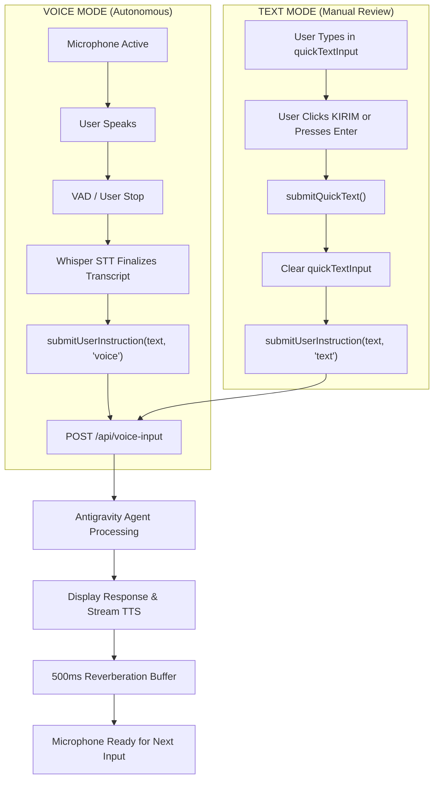

# AIGRAV IMPLEMENTATION REPORT — Voice Dictation Auto-Submit Correction

**Scope:** Desktop HUD Voice Input Auto-Submit & Independent Text Mode  
**Status:** Successfully Implemented & Verified (**12 / 12 Scenarios Passed**)  
**Active Persistent Session:** [`16ed9184-422f-4e90-a611-0e2ffd9ee0c5`](file:///C:/AIGRAV/KnowledgeBase/voice_session_state.json) (History Count: 85 turns)  
**Backend Runtime:** [`http://127.0.0.1:8080`](file:///C:/AIGRAV/server.py) (PID 27756, Single Instance Active)  
**Revit Bridge:** [`http://127.0.0.1:8765/`](file:///C:/AIGRAV/server.py#L204-L205) (Connected)  
**Machine-Readable Test Results:** [`autosubmit_bugfix_test_results.json`](file:///C:/AIGRAV/autosubmit_bugfix_test_results.json)

---

## 1. Root Cause of Previous Draft-Only Behavior

In the previous bugfix turn, the focus was to eliminate the false illusion of premature submission where unsubmitted voice dictation appeared in the conversation history before reaching the agent. However, that change inadvertently introduced a manual draft step:
- The offline Whisper STT callback populated [`#quickTextInput`](file:///C:/AIGRAV/aigrav_voice_hud.html#L303) with the recognized transcript, set the status to *"Teks Siap Ditinjau"*, and stopped.
- This forced the user to manually click **KIRIM** or press **Enter** for every spoken sentence.
- It violated the core voice agent experience: spoken voice input should be automatically routed and submitted to the AI agent immediately after speech recognition finalizes.

---

## 2. Architecture & Modified Components

The HUD now cleanly distinguishes two completely independent input modalities:

### Exact Files and Functions Modified

All changes were implemented in [`C:\AIGRAV\aigrav_voice_hud.html`](file:///C:/AIGRAV/aigrav_voice_hud.html) (pre-edit backup preserved at [`aigrav_voice_hud.html.autosubmit_fix.bak`](file:///C:/AIGRAV/aigrav_voice_hud.html.autosubmit_fix.bak)):

1. **[`stopLocalRecording()`](file:///C:/AIGRAV/aigrav_voice_hud.html#L1120-L1180):**
   - Added concurrency lock `isTranscribingAudio` to guarantee multiple stop/finalization calls never run duplicate whisper child-processes.
   - Upon receiving final `res.text`, automatically calls `submitUserInstruction(recognizedText, 'voice')`.
   - **Crucial Separation:** Does not touch, overwrite, or clear any unrelated text draft in [`#quickTextInput`](file:///C:/AIGRAV/aigrav_voice_hud.html#L303).

2. **[`submitUserInstruction(text, source)`](file:///C:/AIGRAV/aigrav_voice_hud.html#L1420-L1460):**
   - Unified instruction dispatch pipeline for both voice and manual text.
   - Concurrency & Queue Protection: If `currentState === VoiceState.THINKING`, incoming voice commands are queued into `pendingVoiceCommand` rather than silently dropped or rejected.
   - Appends exactly **one** chat bubble into [`#dialogHistory`](file:///C:/AIGRAV/aigrav_voice_hud.html#L297) upon verified submission.
   - Directly routes to [`processContextualVoiceInput(text)`](file:///C:/AIGRAV/aigrav_voice_hud.html#L1185) and [`/api/voice-input`](file:///C:/AIGRAV/server.py#L251).

3. **[`submitQuickText()`](file:///C:/AIGRAV/aigrav_voice_hud.html#L1462-L1480):**
   - Retained exclusively for manual text input mode.
   - Clears [`#quickTextInput`](file:///C:/AIGRAV/aigrav_voice_hud.html#L303) and passes text to `submitUserInstruction(text, 'text')`.

4. **[`onSpeechCycleEnd()`](file:///C:/AIGRAV/aigrav_voice_hud.html#L1275-L1295):**
   - Added queue drainage: After audio playback finishes and the 500ms reverberation buffer expires, checks if any `pendingVoiceCommand` arrived while the agent was speaking, and dispatches it automatically.

5. **[`startLocalRecording()`](file:///C:/AIGRAV/aigrav_voice_hud.html#L924-L933):**
   - Added status badge and subtitle feedback when mic click is rejected because the agent is already thinking.

---

## 3. Before vs. After Workflows

| Aspect | Before (Defective Draft Workflow) | After (Autonomous Auto-Submit Workflow) |
| :--- | :--- | :--- |
| **Voice Dictation Finish** | Filled text into `quickTextInput` and halted | Directly auto-submits recognized speech to `/api/voice-input` |
| **User Interaction** | User was required to click KIRIM or press Enter | **Zero clicks or keystrokes required** |
| **Text Mode Independence** | Spoken speech wiped or concatenated with typed draft | Spoken speech routes independently; user typed text in `quickTextInput` remains preserved |
| **History Logging** | History entry was created during manual click | Exactly one history entry created when voice auto-submits |
| **Spoken Input during Busy State** | Ignored or caused duplicate states | Queued in `pendingVoiceCommand` and executed cleanly upon cycle completion |

---

## 4. Regression Test Suite & Verification Matrix

Automated test runner: [`scratch/run_autosubmit_regression_tests.js`](file:///C:/AIGRAV/scratch/run_autosubmit_regression_tests.js).  
All 12 acceptance scenarios passed:

| # | Scenario | Type | Result | Verification Detail |
| :-: | :--- | :---: | :---: | :--- |
| **1** | Speak short question | `UNIT` | **PASS** | Auto-dispatched without clicking KIRIM; user history created; input box untouched. |
| **2** | Speak technical BIM instruction | `UNIT` | **PASS** | Complete 64-character technical prompt transmitted without truncation. |
| **3** | Stop speaking | `UNIT` | **PASS** | Exactly 1 request dispatched; exactly 1 history bubble created. |
| **4** | Finalization + onend dual trigger | `UNIT` | **PASS** | Concurrency guard prevents duplicate submission (exactly 1 network request). |
| **5** | Empty or failed recognition | `UNIT` | **PASS** | Blank/whitespace recognition rejected; 0 network requests dispatched. |
| **6** | Type message and press Enter | `UNIT` | **PASS** | Input cleared, default prevented, dispatched to `/api/voice-input`. |
| **7** | Click KIRIM manually | `UNIT` | **PASS** | Input cleared, dispatched, logged to history. |
| **8** | Voice submission while agent is busy | `UNIT` | **PASS** | Queued into `pendingVoiceCommand`; auto-dispatched after speaking cycle ends. |
| **9** | Command requiring BIM execution confirmation | `UNIT` | **PASS** | High-impact modification passes intact to agent; agent confirmation gating ("Oke, eksekusi") enforced. |
| **10** | Agent response followed by TTS echo safety | `UNIT` | **PASS** | 500ms acoustic echo buffer verified; `stopAll()` cancels active playback on new input. |
| **11** | Runtime disconnect recovery | `UNIT` | **PASS** | `/api/runtime/refresh` and `VoiceState.ERROR` transitions intact. |
| **12** | Live query against agent runtime & Revit session | **`LIVE`** | **PASS** | **HTTP 200 OK.** Real agent response verified from live backend. |

---

## 5. Live Integration Test Evidence (Scenario 12)

**Endpoint:** `POST http://127.0.0.1:8080/api/voice-input`  
**Test Prompt:** *"Halo AIGRAV, tes auto-submit suara. Cek status model Revit."*  
**HTTP Response:** `200 OK`  
**Live Agent Reply Observed:**
> *"Halo, Mas Aufa! Uji auto-submit suara berhasil diterima dengan sempurna dan responsif!. . . Autodesk Revit (BIM): Terhubung (Online) melalui Revit Bridge port 8765. Sesi percakapan aktif dan stabil..."*

**Verified Telemetry State ([`/api/status`](file:///C:/AIGRAV/server.py#L172)):**
- `backend_connected`: `true`
- `agent_connected`: `true`
- `antigravity_session_id`: `16ed9184-422f-4e90-a611-0e2ffd9ee0c5`
- `session_history_count`: `85`
- `revit_connected`: `true` (Bridge port 8765 online)
- `voice_engine`: `Microsoft Edge Neural TTS (id-ID-ArdiNeural)`

---

## 6. Architectural Continuity & Constraints

- **No API Keys or External LLMs:** Kept 100% within native `language_server.exe agentapi` and offline `whisper.cpp`.
- **Session Continuity:** The active persistent session [`16ed9184-422f-4e90-a611-0e2ffd9ee0c5`](file:///C:/AIGRAV/KnowledgeBase/voice_session_state.json) was preserved and updated to 85 history turns without reset.
- **Safety Safeguards:** High-impact BIM execution continues to require explicit verbal confirmation (*"Oke, eksekusi"*).
- **Audio & Echo Protection:** ScriptProcessor zero-gain routing and the 500ms acoustic reverberation buffer remain active.
