# AIGRAV HOTFIX REPORT — Restore Voice-to-Agent Chat Dispatch

**Scope:** Desktop HUD Voice Auto-Submit Dispatch Fix & False Queueing Resolution  
**Status:** Successfully Implemented & Verified (**6 / 6 Live & Unit Tests Passed**, **12 / 12 Regression Scenarios Passed**)  
**Active Persistent Session:** [`16ed9184-422f-4e90-a611-0e2ffd9ee0c5`](file:///C:/AIGRAV/KnowledgeBase/voice_session_state.json) (History Count: 95 turns, Healthy & Online)  
**Backend Runtime:** [`http://127.0.0.1:8080`](file:///C:/AIGRAV/server.py) (PID 27756, Single Instance Active)  
**Revit Bridge:** [`http://127.0.0.1:8765/`](file:///C:/AIGRAV/server.py#L204-L205) (Online & Connected)  
**Test Result Artifacts:**  
- [`voice_dispatch_hotfix_test_results.json`](file:///C:/AIGRAV/voice_dispatch_hotfix_test_results.json)
- [`autosubmit_bugfix_test_results.json`](file:///C:/AIGRAV/autosubmit_bugfix_test_results.json)

---

## 1. Executive Summary & Observed Defect

In the Floating Desktop HUD, after speech recognition finalized a spoken utterance (such as saying *"Teses"*), the HUD displayed:
- **Backend:** `ONLINE`
- **Agent:** `TERHUBUNG`
- **Revit:** `TERHUBUNG`
- **State Badge:** `MODE: Antrean: Menunggu Agen...`
- **Subtitle:** `[Permintaan suara masuk antrean: "Teses."]`

Instead of immediately sending the recognized instruction to the Antigravity agent, the voice prompt was trapped in `pendingVoiceCommand` even though the backend and agent were completely idle. Because no request was ever dispatched, no response was returned, audio playback never occurred, `onSpeechCycleEnd()` was never invoked, and the queue was never drained—causing a permanent deadlock.

---

## 2. Root Cause Analysis

Tracing the execution flow in [`C:\AIGRAV\aigrav_voice_hud.html`](file:///C:/AIGRAV/aigrav_voice_hud.html) revealed the root cause:

1. **State Overload during Local Transcription:**  
   In `stopLocalRecording()`, line 1119 executed:
   ```javascript
   setVoiceState(VoiceState.THINKING, { customText: "TRANSKRIPSI..." });
   ```
   This set `currentState = VoiceState.THINKING` while Whisper STT was processing the local audio buffer.

2. **Flawed Concurrency Guard in Dispatch Pipeline:**  
   In `submitUserInstruction()`, line 1436 checked:
   ```javascript
   if (currentState === VoiceState.THINKING) {
     pendingVoiceCommand = cleaned;
     hudStateBadge.textContent = "Antrean: Menunggu Agen...";
     ...
     return true;
   }
   ```
   Because `stopLocalRecording()` had set `currentState` to `THINKING` during transcription, when Whisper completed and called `submitUserInstruction(recognizedText, 'voice')`, `currentState === VoiceState.THINKING` **always evaluated to true**.

3. **Deadlock Mechanism:**  
   The voice prompt was immediately diverted into `pendingVoiceCommand` before any HTTP request was made. Because no backend request was active, no response cycle could ever complete to trigger `onSpeechCycleEnd()`, permanently stranding the prompt in queue.

---

## 3. Implemented Fix & Architectural Separation

Rather than conflating UI visual states with backend network activity, the fix introduces an explicit boolean flag tracking genuine in-flight HTTP requests:

```mermaid
flowchart TD
    subgraph DEFECTIVE_FLOW["Previous Defective Flow"]
        StopRec1["stopLocalRecording()"] --> SetThinking["setVoiceState(THINKING) 'TRANSKRIPSI...'"]
        SetThinking --> STT1["Whisper STT finishes 'Teses.'"]
        STT1 --> CheckThinking{"currentState === THINKING?"}
        CheckThinking -- "Always TRUE!" --> TrapQueue["Trapped in pendingVoiceCommand<br/>MODE: Antrean: Menunggu Agen..."]
        TrapQueue --> Deadlock["NO request sent → NO audio → Queue NEVER drains"]
    end

    subgraph HOTFIX_FLOW["Restored Hotfix Flow"]
        StopRec2["stopLocalRecording()"] --> SetTrans["setVoiceState(THINKING) 'TRANSKRIPSI...'"]
        SetTrans --> STT2["Whisper STT finishes 'Teses.'"]
        STT2 --> RestoreIdle["setVoiceState(IDLE)"]
        RestoreIdle --> CheckInFlight{"isAgentRequestInFlight?"}
        CheckInFlight -- "FALSE (Agent Idle)" --> SendPost["POST /api/voice-input (Immediate)"]
        SendPost --> SetFlightTrue["isAgentRequestInFlight = true"]
        SetFlightTrue --> AgentWorks["Agent processes in Antigravity"]
        AgentWorks --> AgentResp["Status 200 OK + TTS chunks"]
        AgentResp --> SetFlightFalse["isAgentRequestInFlight = false"]
        CheckInFlight -- "TRUE (Genuinely Busy)" --> QueueUntilEnd["Queue in pendingVoiceCommand<br/>Drain on onSpeechCycleEnd()"]
    end
```



### Exact Code Modifications

All changes were implemented in [`C:\AIGRAV\aigrav_voice_hud.html`](file:///C:/AIGRAV/aigrav_voice_hud.html) (pre-edit backup preserved at [`aigrav_voice_hud.html.hotfix_dispatch.bak`](file:///C:/AIGRAV/aigrav_voice_hud.html.hotfix_dispatch.bak)):

1. **Explicit In-Flight State Tracking:**
   ```javascript
   let isAgentRequestInFlight = false;
   ```

2. **Reset Voice State to IDLE before Submission in `stopLocalRecording()`:**
   ```javascript
   // Clear transcription thinking state before submitting to prevent false queueing
   setVoiceState(VoiceState.IDLE);
   submitUserInstruction(recognizedText, 'voice');
   ```

3. **In-Flight Lifecycle in `processContextualVoiceInput()`:**
   ```javascript
   isAgentRequestInFlight = true;
   fetch('/api/voice-input', {
     method: 'POST',
     headers: { 'Content-Type': 'application/json' },
     body: JSON.stringify({ prompt: promptText, voice: selectedVoice, req_id: reqId, timestamp: Date.now() })
   })
   .then(res => res.json())
   .then(data => {
     isAgentRequestInFlight = false;
     ...
   })
   .catch(err => {
     isAgentRequestInFlight = false;
     ...
   });
   ```

4. **Corrected Guard in `submitUserInstruction()` and `submitQuickText()`:**
   ```javascript
   // Concurrency guard: Only if a backend agent request is genuinely in flight
   if (isAgentRequestInFlight) {
     console.warn(`[HUD_SUBMIT][${source}]: Agen sedang memproses permintaan aktif.`);
     if (source === 'voice') {
       pendingVoiceCommand = cleaned;
       hudStateBadge.textContent = "Antrean: Menunggu Agen...";
       ...
       return true;
     } else {
       ...
       return false;
     }
   }
   ```

---

## 4. Live Verification & Evidence

Two verification suites were executed against the live Python backend (`http://127.0.0.1:8080`) and Revit Bridge (`http://127.0.0.1:8765/`):

### A. Hotfix Dispatch Verification Suite (`scratch/run_live_dispatch_hotfix_tests.js`)

| Test Name | Type | Result | Evidence / Telemetry |
| :--- | :---: | :---: | :--- |
| **Unit 1: Voice auto-submit "Teses." immediately dispatches** | `UNIT` | **PASS** | `Not falsely queued: true`, `Badge: "Sedang berpikir"`, `Dispatched: true`, `Single History: true` |
| **Unit 2: Genuine busy state queues command & drains** | `UNIT` | **PASS** | `Queued while in-flight: true`, `Dispatched after cycle: true` |
| **Unit 3: Manual text submission baseline through submitQuickText** | `UNIT` | **PASS** | `Input cleared: true`, `Dispatched: true`, `History created: true` |
| **Live A: Manual text baseline query** | `LIVE` | **PASS** | Status: `200 OK`, Latency: `8858ms`, req_id: `req_live_text_1791786233651`<br/>*Reply: "Halo, Mas Aufa! Uji baseline teks berhasil diterima dan tercatat dengan baik..."* |
| **Live B: Voice auto-submit "Teses" reaches Agent** | `LIVE` | **PASS** | Status: `200 OK`, Latency: `7411ms`, req_id: `req_live_voice_1791786242509`<br/>*Reply: "Tes diterima dengan lancar, Mas Aufa! AIGRAV siap membantu—ada instruksi berikutnya?"* |
| **Live C: Telemetry, Session Continuity & Revit Bridge** | `LIVE` | **PASS** | Session: `16ed9184-422f-4e90-a611-0e2ffd9ee0c5`, Turns: `95`<br/>`Backend: true`, `Agent: true`, `Revit: true` |

### B. Full Regression Acceptance Suite (`scratch/run_autosubmit_regression_tests.js`)

All **12 / 12** scenarios passed:
1. Speak short question: automatically dispatched without clicking KIRIM (**PASS**)
2. Speak technical BIM instruction: complete transcript submitted (**PASS**)
3. Stop speaking: only one request dispatched (**PASS**)
4. Trigger both recognition finalization and onend: still only one request (**PASS**)
5. Empty or failed recognition: no request sent (**PASS**)
6. Type message and press Enter: existing text workflow still works (**PASS**)
7. Click KIRIM manually: existing text workflow still works (**PASS**)
8. Voice submission while agent is busy: no silent loss or duplicate execution (**PASS**)
9. Voice command requiring execution confirmation: safeguards remain active (**PASS**)
10. Agent response followed by TTS: response audio plays without microphone echo/overlap (**PASS**)
11. Runtime disconnected: existing recovery behavior remains intact (**PASS**)
12. Read-only query against live backend & agent runtime (**PASS**)

---

## 5. Architectural Integrity & Safety Guarantees

1. **Persistent Session Preserved:** Session ID [`16ed9184-422f-4e90-a611-0e2ffd9ee0c5`](file:///C:/AIGRAV/KnowledgeBase/voice_session_state.json) remains uninterrupted, incrementing cleanly from 85 to 95 turns across tests.
2. **Revit Bridge Intact:** Bridge on port `8765` remains connected with 0 restarts.
3. **Zero External API Costs:** Utilizes exclusively local Whisper STT, local Edge Neural TTS, and the native Antigravity agent runtime.
4. **Independent Modalities:** Manual text input via [`#quickTextInput`](file:///C:/AIGRAV/aigrav_voice_hud.html#L303) and KIRIM operates independently from autonomous voice auto-submission.
