# AIGRAV Comprehensive Rules & Operational Guidelines Inventory
**Dokumen:** `RULES_INVENTORY.md`  
**Tanggal Audit:** 11 November 2026  
**Auditor:** Lead BIM Engineer & Antigravity Autonomous Orchestrator  
**Lingkup Audit:** Seluruh file Markdown (`.md`) yang berfungsi sebagai instruksi, standar, SOP, skill, API reference, dan panduan operasional di lingkungan AIGRAV (`C:\AIGRAV`).

---

## 1. Ringkasan Eksekutif & Statistik Audit

Audit komprehensif ini dilakukan untuk menginventarisasi, memverifikasi, dan mengamankan seluruh aturan operasional, standar rekayasa BIM/struktur, dan protokol otomasi yang mengatur perilaku agen AI di lingkungan AIGRAV.

| Parameter Audit | Nilai / Status | Keterangan |
| :--- | :---: | :--- |
| **Total File Markdown Diinventarisasi** | **71 File** | Seluruhnya berformat `.md` asli tanpa modifikasi |
| **Aturan Induk (*Master Protocol*)** | 1 File | `C:\AIGRAV\AGENTS.md` (Dimuat permanen di `<user_rules>`) |
| **Panduan Root (*Master README*)** | 1 File | `C:\AIGRAV\README.md` (Panduan sistem & instalasi) |
| **SOP Skill & Referensi API (`.agents\skills`)** | 10 File | 7 file `SKILL.md` + 3 file technical references |
| **Protokol Rekayasa & Standar (`KnowledgeBase`)** | 18 File | Standar QTO, protokol eksekusi, limitasi API, database sambungan |
| **Panduan Operasional Modul (*Tooling READMEs*)** | 3 File | Desktop HUD, FastMCP TestServer, WhatsApp MCP |
| **Spesifikasi Arsitektur & Laporan Teknis (`archive`)** | 38 File | Spesifikasi DAG orchestrator, audit integrasi, dan laporan fase |
| **Pemeriksaan Keamanan & Rahasia (*Secret Scan*)** | **PASSED (0 Secrets)** | Nol API keys, passwords, credentials, tokens |
| **Integritas Struktur Direktori** | **100% Preserved** | Struktur direktori relatif dipertahankan secara utuh |

---

## 2. Catatan Aksesibilitas Direktori & Folder Khusus

Sesuai ketentuan audit, folder yang diminta pengguna namun tidak dapat diakses atau dibatalkan pencariannya dicatat secara eksplisit berikut ini:

| Direktori yang Diperiksa | Status Akses | Hasil Pemeriksaan & Tindakan |
| :--- | :---: | :--- |
| **`C:\AIGRAV\AGENTS.md`** | **Ditemukan (18.492 bytes)** | Berhasil diakses dan disalin. Merupakan master rule. |
| **`C:\AIGRAV\.agents\`** | **Ditemukan (10 file .md)** | Berhasil diakses penuh secara rekursif (seluruh nested skill & references). |
| **`C:\AIGRAV\.gemini\`** | **TIDAK DITEMUKAN / NON-EXISTENT** | Direktori ini **tidak ada di filesystem `C:\AIGRAV`** (`Test-Path` mengembalikan `False`). Konfigurasi global Gemini/Antigravity berada di `%USERPROFILE%\.gemini` (`C:\Users\sapuser\.gemini`), bukan di dalam workspace `C:\AIGRAV`. Folder ini tidak dianggap kosong melainkan tidak ada di root workspace. |
| **`C:\Users\sapuser\.gemini\antigravity\brain\`** | **Pencarian Dibatalkan (*Task Cancelled*)** | Pada pemindaian awal, task background (`task-5517`) yang memindai folder riwayat transkrip/brain dibatalkan secara sengaja guna mencegah latensi pembacaan log percakapan historis non-aturan. Folder ini hanya berisi artefak sesi dan log transkrip pengguna, bukan aturan operasional AIGRAV. |
| **Direktori Dikecualikan (*Sanitization Filter*)** | **Dikecualikan Sesuai Ketentuan** | `.git`, `bin`, `obj`, `venv`, `.venv`, `node_modules`, `audio_cache`, `__pycache__`, dan `.pytest_cache` tidak disertakan dalam bundle demi kebersihan arsip. |

---

## 3. Matriks Inventaris Lengkap File Aturan

### Kategori A: Aturan Induk & Panduan Utama (*Core Master Rules*)

| No | Nama File | Lokasi Asli | Mekanisme Pemuatan | Aturan Induk / Turunan | Tujuan & Ringkasan Aturan |
|:--:|:---|:---|:---:|:---|:---|
| 1 | `AGENTS.md` | `C:\AIGRAV\AGENTS.md` | **Otomatis (Permanen)** Dimuat pada setiap prompt via `<user_rules>` | **ROOT MASTER RULE** Semua skill di `.agents` adalah turunannya | Protokol Wajib (*Mandatory SOP*) AIGRAV: Mandat Senior BIM Engineer & Arsitek, eksekusi *single-threaded*, larangan *silent failure*, larangan mutlak `DirectShape`, *Zero-Overlap Slabs*, alur 3 fase (Pre-Review, 4 Milestone, Triple-Layer Validation dengan hak veto), standar kalibrasi baja SNI, serta safety gate post-eksekusi. |
| 2 | `README.md` | `C:\AIGRAV\README.md` | **Manual / Dokumen Acuan** | Referensi umum arsitektur suite AIGRAV | Ringkasan katalog komponen, daftar database SNI/sambungan, panduan instalasi 1-click prompt ("install aigrav"), eksekusi `install.bat`, dan verifikasi sistem `Verify-AIGRAV.ps1`. |

---

### Kategori B: SOP Skill & Referensi API (`C:\AIGRAV\.agents\skills\`)

| No | Nama File | Lokasi Asli | Mekanisme Pemuatan | Aturan Induk / Turunan | Tujuan & Ringkasan Aturan |
|:--:|:---|:---|:---:|:---|:---|
| 3 | `SKILL.md` | `C:\AIGRAV\.agents\skills\cad-to-revit-drafting-views\SKILL.md` | **On-Demand** (Saat import CAD / Drafting Views diminta) | Turunan dari `AGENTS.md` (Fase 1 & Fase 2) | Standar dan mesin otomasi ekstraksi ModelSpace CAD ke Drafting Views Revit, pemotongan DWG monokrom, transformasi koordinat bounding box title block, dan penempatan presisi pada ViewSheet. |
| 4 | `SKILL.md` | `C:\AIGRAV\.agents\skills\install-aigrav\SKILL.md` | **On-Demand** (Trigger: "install aigrav", "setup aigrav") | Panduan operasional deployment | Menjalankan instalasi otomatis AIGRAV, mendaftarkan Revit Add-in `AIGRAV.addin`, menyiapkan Python venv FastMCP, memverifikasi ketersediaan database baja/sambungan, dan memasang plugin. |
| 5 | `SKILL.md` | `C:\AIGRAV\.agents\skills\revit-adaptive-massing-modeling\SKILL.md` | **On-Demand** (Saat pemodelan bentuk bebas / lengkung diminta) | Turunan langsung `AGENTS.md` Bagian 1.3 (Pengganti Legal DirectShape) | SOP pemodelan panel, rangka, kanopi lengkung, dan fasad organik menggunakan *Adaptive Components* dan *Conceptual Massing (Model By Face)* beridentitas Family/Type resmi untuk menjamin integritas QTO. |
| 6 | `adaptive_component_api_guide.md` | `C:\AIGRAV\.agents\skills\revit-adaptive-massing-modeling\references\adaptive_component_api_guide.md` | **Referenced by Skill** (Dibaca saat skill adaptive massing aktif) | Turunan teknis dari `revit-adaptive-massing-modeling\SKILL.md` | Panduan teknis Revit API C# & Python untuk instansiasi adaptive component (`AdaptiveComponentInstanceUtils.CreateAdaptiveComponentInstance`), aktivasi symbol, dan penetapan titik kontrol $XYZ$. |
| 7 | `conceptual_massing_by_face_guide.md` | `C:\AIGRAV\.agents\skills\revit-adaptive-massing-modeling\references\conceptual_massing_by_face_guide.md` | **Referenced by Skill** (Dibaca saat skill adaptive massing aktif) | Turunan teknis dari `revit-adaptive-massing-modeling\SKILL.md` | Panduan teknis pembuatan massa konseptual in-place (`OST_Mass`) dan konversi face massa ke elemen sistem BIM (`FaceWall.Create`, `Roof.Create`, `CurtainSystem.Create`). |
| 8 | `SKILL.md` | `C:\AIGRAV\.agents\skills\revit-milestone-modeling\SKILL.md` | **On-Demand** (Pemodelan gedung penuh multi-elemen) | Turunan langsung `AGENTS.md` Bagian 3 (4 Makro-Milestone) | SOP orkestrasi pemodelan terstruktur 4 fase: Milestone 1 (Datum & Struktur), Milestone 2 (Selubung & Pelat), Milestone 3 (Partisi & Bukaan), Milestone 4 (Ruang & QTO), masing-masing dalam `TransactionGroup` atomik dengan inspeksi visual. |
| 9 | `SKILL.md` | `C:\AIGRAV\.agents\skills\revit-qto-schedule-audit\SKILL.md` | **On-Demand** (Saat audit atau pembuatan schedule kuantitas) | Turunan langsung `AGENTS.md` Bagian 6 (Protokol QTO Baku) | Standar hierarki penamaan schedule (`C.3.x.y`), tata letak kolom baku (Kolom A wajib `Lokasi`), filter anti-double counting (`Lokasi = ""`), kalkulasi subtotal footer, dan eliminasi schedule duplikat. |
| 10 | `qto_revit_api_guide.md` | `C:\AIGRAV\.agents\skills\revit-qto-schedule-audit\references\qto_revit_api_guide.md` | **Referenced by Skill** (Dibaca saat skill QTO audit aktif) | Turunan teknis dari `revit-qto-schedule-audit\SKILL.md` | Panduan API C# untuk manipulasi `ViewSchedule`: pengaturan urutan kolom (`SetFieldOrder`), penambahan field dinamis (`AddField`), konfigurasi format unit, sorting, dan grand totals. |
| 11 | `SKILL.md` | `C:\AIGRAV\.agents\skills\revit-slanted-wall-modeling\SKILL.md` | **On-Demand** (Pemodelan obelisk/menara miring & pelat berundak) | Turunan langsung `AGENTS.md` Bagian 1.4 & Bagian 7 | SOP pemodelan dinding miring (`WallCrossSection.SingleSlanted`) dan lantai donat multi-loop (`CurveLoop` Loop 0 luar, Loop 1..N void) untuk mengeliminasi trap horizontal, Z-fighting, dan spatial clash. |
| 12 | `SKILL.md` | `C:\AIGRAV\.agents\skills\revit-voute-connection-qto\SKILL.md` | **On-Demand** (Schedule voute / haunch sambungan baja) | Turunan langsung `AGENTS.md` Bagian 6.1 Point 6 | SOP ekstraksi potongan profil voute yang tertanam dalam custom connection via kategori `OST_StructConnectionProfiles` dengan kalibrasi volume solid eksak ($\rho = 7850\text{ kg/m}^3$). |

---

### Kategori C: Standar Rekayasa & Protokol Operasional (`C:\AIGRAV\KnowledgeBase\`)

| No | Nama File | Lokasi Asli | Mekanisme Pemuatan | Aturan Induk / Turunan | Tujuan & Ringkasan Aturan |
|:--:|:---|:---|:---:|:---|:---|
| 13 | `AIGRAV_Revit_Execution_Protocol.md` | `C:\AIGRAV\KnowledgeBase\AIGRAV_Revit_Execution_Protocol.md` | **Mandatory Workflow Reference** | Acuan operasional sejalan dengan `AGENTS.md` | Protokol eksekusi 2 fase: Pre-Execution Review (verifikasi gambar standar & database) dan dekomposisi paralel sub-agent (Reviewer, Executor, Auditor). |
| 14 | `QTO_Template_Reference.md` | `C:\AIGRAV\KnowledgeBase\QTO_Template_Reference.md` | **Official Baseline Standard** (AIGRAV-STD-QTO-REVIT-2026-V2) | Dokumen acuan resmi untuk `revit-qto-schedule-audit` | Spesifikasi template master 89 schedule terstruktur untuk seluruh zona pabrik (Waterline, Power House, Carton & Cups, Production Office, Chiller) dengan format kolom 100% presisi. |
| 15 | `NativeConnectionLimitationReport.md` | `C:\AIGRAV\KnowledgeBase\NativeConnectionLimitationReport.md` | **Technical Standard** | Acuan batas limitasi Revit API Advance Steel | Analisis limitasi native Revit Connection API dan perumusan transisi menuju C# bridge handler langsung untuk custom connections. |
| 16 | `ConnectionModelingPlan.md` | `C:\AIGRAV\KnowledgeBase\ConnectionModelingPlan.md` | **Operational Guideline** | Turunan modeling plan | Rencana geometris dan spesifikasi koordinat tumpuan baseplate serta endplate pada portal frame baja. |
| 17 | `PortalModelingPlan.md` | `C:\AIGRAV\KnowledgeBase\PortalModelingPlan.md` | **Operational Guideline** | Turunan modeling plan | Rencana pemodelan portal frame simetris bentang 24m (Grid 1 ke 2) dengan profil WF400 dan kemiringan rafter $9^\circ$. |
| 18 | `README.md` | `C:\AIGRAV\KnowledgeBase\SteelConnectionDatabase\README.md` | **Data Standard** | Dokumentasi database standar | Spesifikasi struktur JSON database sambungan standar resmi (STD-BJ-01 s/d 07 & STD-PDS-01 s/d 15) untuk baseplate, endplate, dan gusset. |
| 19 | `CustomBeamConnection_Report.md` | `C:\AIGRAV\KnowledgeBase\CustomBeamConnection_Report.md` | **Engineering Log** | Turunan teknis sambungan | Catatan teknis pengujian pemodelan sambungan balok kustom. |
| 20 | `CustomConnection_V1.7_Report.md` | `C:\AIGRAV\KnowledgeBase\CustomConnection_V1.7_Report.md` | **Engineering Log** | Turunan teknis sambungan | Catatan pengujian Custom Connection Authoring versi 1.7. |
| 21 | `SteelConnectionAuthoring_V1.1_Report.md` | `C:\AIGRAV\KnowledgeBase\SteelConnectionAuthoring_V1.1_Report.md` | **Engineering Log** | Dokumentasi evolusi API | Laporan implementasi authoring sambungan baja versi 1.1. |
| 22 | `SteelConnectionAuthoring_V1.7_Report.md` | `C:\AIGRAV\KnowledgeBase\SteelConnectionAuthoring_V1.7_Report.md` | **Engineering Log** | Dokumentasi evolusi API | Laporan penyempurnaan authoring sambungan baja versi 1.7. |
| 23 | `SteelConnectionAuthoring_V1.8.1_Report.md` | `C:\AIGRAV\KnowledgeBase\SteelConnectionAuthoring_V1.8.1_Report.md` | **Engineering Log** | Dokumentasi evolusi API | Laporan komprehensif authoring sambungan baja v1.8.1 dengan sub-komponen lengkap. |
| 24 | `SteelConnectionAuthoring_V1.8_Report.md` | `C:\AIGRAV\KnowledgeBase\SteelConnectionAuthoring_V1.8_Report.md` | **Engineering Log** | Dokumentasi evolusi API | Laporan pengembangan factory sambungan baja otomatis v1.8. |
| 25 | `SteelConnectionAuthoring_V1_Report.md` | `C:\AIGRAV\KnowledgeBase\SteelConnectionAuthoring_V1_Report.md` | **Engineering Log** | Dokumentasi evolusi API | Laporan baseline authoring sambungan baja versi 1.0. |
| 26 | `SteelConnectionEvent_V1.6_Report.md` | `C:\AIGRAV\KnowledgeBase\SteelConnectionEvent_V1.6_Report.md` | **Engineering Log** | Dokumentasi arsitektur event | Laporan implementasi Revit ExternalEvent untuk eksekusi sambungan baja v1.6. |
| 27 | `SteelConnectionLibrary_V1.2_Report.md` | `C:\AIGRAV\KnowledgeBase\SteelConnectionLibrary_V1.2_Report.md` | **Engineering Log** | Dokumentasi library family | Laporan pemindaian dan verifikasi library family sambungan baja v1.2. |
| 28 | `SteelConnectionLibrary_V1.3_Report.md` | `C:\AIGRAV\KnowledgeBase\SteelConnectionLibrary_V1.3_Report.md` | **Engineering Log** | Dokumentasi library family | Laporan pembaruan library family sambungan baja v1.3. |
| 29 | `SteelConnectionStandard_V1.4_Report.md` | `C:\AIGRAV\KnowledgeBase\SteelConnectionStandard_V1.4_Report.md` | **Engineering Log** | Standar implementasi | Standarisasi aturan penempatan sambungan baja v1.4. |
| 30 | `SteelConnectionTemplate_V1.5_Report.md` | `C:\AIGRAV\KnowledgeBase\SteelConnectionTemplate_V1.5_Report.md` | **Engineering Log** | Standar implementasi | Standarisasi template sambungan baja v1.5. |

---

### Kategori D: Panduan Operasional Modul & Tooling (*Module Tooling Guides*)

| No | Nama File | Lokasi Asli | Mekanisme Pemuatan | Aturan Induk / Turunan | Tujuan & Ringkasan Aturan |
|:--:|:---|:---|:---:|:---|:---|
| 31 | `README.md` | `C:\AIGRAV\DesktopHUD\README.md` | **Manual / Dokumen Operasional** | Panduan UI Desktop | Spesifikasi teknis, arsitektur Electron frameless, bounded IPC context isolation, dan panduan menjalankan Desktop Floating HUD. |
| 32 | `README.md` | `C:\AIGRAV\MCP\TestServer\README.md` | **Manual / Dokumen Operasional** | Panduan FastMCP Server | Panduan instalasi dan pengujian server Python FastMCP untuk antarmuka MCP Revit. |
| 33 | `README.md` | `C:\AIGRAV\WhatsAppMCP\README.md` | **Manual / Dokumen Operasional** | Panduan WhatsApp MCP | Panduan konfigurasi server MCP WhatsApp untuk notifikasi dan interaksi percakapan otomatis. |

---

### Kategori E: Spesifikasi Arsitektur & Laporan Teknis Terarsip (`C:\AIGRAV\archive\reports\`)

| No | Nama File | Lokasi Asli | Mekanisme Pemuatan | Aturan Induk / Turunan | Tujuan & Ringkasan Aturan |
|:--:|:---|:---|:---:|:---|:---|
| 34 | `AIGRAV_AgentOrchestrator_Architecture.md` | `C:\AIGRAV\archive\reports\AIGRAV_AgentOrchestrator_Architecture.md` | **Archived Architecture Spec** | Spesifikasi Fondasi Arsitektur | Menetapkan *Core Architecture Invariants*: Tidak pernah membypass Revit Bridge, zero in-process DLL sprawl, dan tidak pernah menganggap "no exception" sebagai sukses. |
| 35 | `AIGRAV_AgentOrchestrator_GapAnalysis.md` | `C:\AIGRAV\archive\reports\AIGRAV_AgentOrchestrator_GapAnalysis.md` | **Archived Technical Audit** | Analisis Kesenjangan Sistem | Audit komparatif kapabilitas eksisting versus kebutuhan autonomous orchestration. |
| 36 | `AIGRAV_AgentOrchestrator_ImplementationPlan.md` | `C:\AIGRAV\archive\reports\AIGRAV_AgentOrchestrator_ImplementationPlan.md` | **Archived Implementation Plan** | Strategi Eksekusi Minimal Slice | Perumusan vertical slice terkecil yang lolos benchmark Test A (read), Test B (audit), dan Test C (hot reload). |
| 37 | `AIGRAV_AgentOrchestrator_Phase2.1_Report.md` | `C:\AIGRAV\archive\reports\AIGRAV_AgentOrchestrator_Phase2.1_Report.md` | **Archived Report** | Laporan Progres Fase 2.1 | Verifikasi eksekusi read operation terpadu. |
| 38 | `AIGRAV_AgentOrchestrator_Phase2.2_Report.md` | `C:\AIGRAV\archive\reports\AIGRAV_AgentOrchestrator_Phase2.2_Report.md` | **Archived Report** | Laporan Progres Fase 2.2 | Verifikasi eksekusi inspeksi kolom dan audit parameter struktural. |
| 39 | `AIGRAV_AgentOrchestrator_Phase2_Report.md` | `C:\AIGRAV\archive\reports\AIGRAV_AgentOrchestrator_Phase2_Report.md` | **Archived Report** | Laporan Progres Fase 2 | Konsolidasi hasil pengujian fase 2. |
| 40 | `AIGRAV_Antigravity_Integration_Audit_Report.md` | `C:\AIGRAV\archive\reports\AIGRAV_Antigravity_Integration_Audit_Report.md` | **Archived Audit** | Audit Integrasi Sistem | Audit mendalam jalur komunikasi antara Antigravity dan Revit Bridge. |
| 41 | `AIGRAV_Antigravity_SDK_Auth_Feasibility.md` | `C:\AIGRAV\archive\reports\AIGRAV_Antigravity_SDK_Auth_Feasibility.md` | **Archived Feasibility Study** | Studi Kelayakan SDK | Evaluasi integrasi autentikasi Antigravity SDK. |
| 42 | `AIGRAV_Antigravity_Voice_Bridge_POC_Report.md` | `C:\AIGRAV\archive\reports\AIGRAV_Antigravity_Voice_Bridge_POC_Report.md` | **Archived POC Report** | Bukti Konsep Voice Bridge | Laporan pengujian bukti konsep komunikasi suara interaktif ke Revit. |
| 43 | `AIGRAV_DecisionReview_Phase3_Report.md` | `C:\AIGRAV\archive\reports\AIGRAV_DecisionReview_Phase3_Report.md` | **Archived Report** | Laporan Keputusan Fase 3 | Dokumentasi keputusan teknis arsitektur sistem pada fase 3. |
| 44 | `AIGRAV_Floating_HUD_Implementation_Report.md` | `C:\AIGRAV\archive\reports\AIGRAV_Floating_HUD_Implementation_Report.md` | **Archived Report** | Laporan Implementasi HUD | Laporan detail pembuatan antarmuka melayang Electron Floating HUD. |
| 45 | `AIGRAV_Gemini_Flash_Low_Persistence_Report.md` | `C:\AIGRAV\archive\reports\AIGRAV_Gemini_Flash_Low_Persistence_Report.md` | **Archived Diagnostic** | Diagnostik Model AI | Evaluasi latensi dan retensi konteks model Gemini Flash. |
| 46 | `AIGRAV_Phase5_Session_Audio_Fix_Report.md` | `C:\AIGRAV\archive\reports\AIGRAV_Phase5_Session_Audio_Fix_Report.md` | **Archived Bugfix Report** | Laporan Perbaikan Audio | Resolusi persistensi sesi audio pada pipeline suara. |
| 47 | `AIGRAV_Phase6_1_Microphone_STT_Report.md` | `C:\AIGRAV\archive\reports\AIGRAV_Phase6_1_Microphone_STT_Report.md` | **Archived Report** | Laporan Subsistem STT | Integrasi mikrofon dan pipeline Speech-to-Text lokal. |
| 48 | `AIGRAV_Phase6_2_Window_Visibility_Report.md` | `C:\AIGRAV\archive\reports\AIGRAV_Phase6_2_Window_Visibility_Report.md` | **Archived Report** | Laporan UI HUD | Pengaturan visibilitas jendela melayang terhadap Revit Viewport. |
| 49 | `AIGRAV_Phase6_3_1_and_6_3_2_Report.md` | `C:\AIGRAV\archive\reports\AIGRAV_Phase6_3_1_and_6_3_2_Report.md` | **Archived Report** | Laporan Diagnostik STT | Penyesuaian parameter sensitivitas mikrofon dan buffering audio. |
| 50 | `AIGRAV_Phase6_3_4_Diagnostic_Report.md` | `C:\AIGRAV\archive\reports\AIGRAV_Phase6_3_4_Diagnostic_Report.md` | **Archived Diagnostic** | Diagnostik Runtime STT | Pelacakan latensi transkripsi audio lokal. |
| 51 | `AIGRAV_Phase6_3_5_Startup_Diagnostic_Report.md` | `C:\AIGRAV\archive\reports\AIGRAV_Phase6_3_5_Startup_Diagnostic_Report.md` | **Archived Diagnostic** | Diagnostik Startup | Analisis urutan startup server bridge dan engine suara. |
| 52 | `AIGRAV_Phase6_3_6_Live_Startup_Diagnostic_Report.md` | `C:\AIGRAV\archive\reports\AIGRAV_Phase6_3_6_Live_Startup_Diagnostic_Report.md` | **Archived Diagnostic** | Diagnostik Real-Time | Uji coba live startup pada lingkungan produksi. |
| 53 | `AIGRAV_Phase6_3_7_Runtime_Recovery_Report.md` | `C:\AIGRAV\archive\reports\AIGRAV_Phase6_3_7_Runtime_Recovery_Report.md` | **Archived Recovery** | Pemulihan Runtime | Mekanisme *auto-recovery* saat websocket suara terputus. |
| 54 | `AIGRAV_Phase6_3_8_Session_Continuity_Audit.md` | `C:\AIGRAV\archive\reports\AIGRAV_Phase6_3_8_Session_Continuity_Audit.md` | **Archived Audit** | Audit Kontinuitas Sesi | Verifikasi retensi konteks antar giliran bicara (*turn-taking*). |
| 55 | `AIGRAV_Phase6_3_9_Runtime_Credential_Refresh_Report.md` | `C:\AIGRAV\archive\reports\AIGRAV_Phase6_3_9_Runtime_Credential_Refresh_Report.md` | **Archived Report** | Penyegaran Kredensial | Mekanisme refresh token otomatis tanpa memutus dialog. |
| 56 | `AIGRAV_Phase6_3_Local_STT_Report.md` | `C:\AIGRAV\archive\reports\AIGRAV_Phase6_3_Local_STT_Report.md` | **Archived Report** | Arsitektur STT Lokal | Evaluasi akurasi engine Whisper/Vosk offline. |
| 57 | `AIGRAV_Phase6_4_0_Runtime_Refresh_Report.md` | `C:\AIGRAV\archive\reports\AIGRAV_Phase6_4_0_Runtime_Refresh_Report.md` | **Archived Report** | Refresh Runtime | Pembaruan siklus hidup modul suara. |
| 58 | `AIGRAV_Phase6_4_1_Backend_Connectivity_Fix_Report.md` | `C:\AIGRAV\archive\reports\AIGRAV_Phase6_4_1_Backend_Connectivity_Fix_Report.md` | **Archived Bugfix Report** | Resolusi Koneksi Backend | Perbaikan timeout komunikasi TCP/HTTP pada port 8080 dan 8765. |
| 59 | `AIGRAV_Phase6_4_2_Low_Latency_TTS_Report.md` | `C:\AIGRAV\archive\reports\AIGRAV_Phase6_4_2_Low_Latency_TTS_Report.md` | **Archived Report** | Optimasi TTS | Reduksi latensi sintetis suara menjadi $< 300\text{ ms}$. |
| 60 | `AIGRAV_Phase6_4_3_First_Audio_Latency_Report.md` | `C:\AIGRAV\archive\reports\AIGRAV_Phase6_4_3_First_Audio_Latency_Report.md` | **Archived Benchmark** | Benchmark Latensi Audio | Pengukuran waktu pengiriman chunk audio pertama ke speaker. |
| 61 | `AIGRAV_Phase6_4_4_Streaming_TTS_Optimization_Report.md` | `C:\AIGRAV\archive\reports\AIGRAV_Phase6_4_4_Streaming_TTS_Optimization_Report.md` | **Archived Optimization** | Optimasi Streaming | Penerapan chunked audio streaming untuk feedback suara instan. |
| 62 | `AIGRAV_SharedIntelligence_VoiceInterface_Report.md` | `C:\AIGRAV\archive\reports\AIGRAV_SharedIntelligence_VoiceInterface_Report.md` | **Archived Report** | Arsitektur Shared Intelligence | Penyatuan antarmuka suara dengan memori kerja multi-agent. |
| 63 | `AIGRAV_STT_Accuracy_Regression_Report.md` | `C:\AIGRAV\archive\reports\AIGRAV_STT_Accuracy_Regression_Report.md` | **Archived Quality Audit** | Uji Regresi Akurasi STT | Evaluasi akurasi pengenalan istilah teknis BIM bahasa Indonesia. |
| 64 | `AIGRAV_Universal_Artifact_Explorer_Report.md` | `C:\AIGRAV\archive\reports\AIGRAV_Universal_Artifact_Explorer_Report.md` | **Archived Report** | Fitur Artifact Explorer | Implementasi penjelajah artefak visual dan dokumen pendukung di HUD. |
| 65 | `AIGRAV_VoiceHUD_BehaviorFix_Report.md` | `C:\AIGRAV\archive\reports\AIGRAV_VoiceHUD_BehaviorFix_Report.md` | **Archived Bugfix Report** | Perbaikan Interaksi HUD | Perbaikan perilaku klik, drag, dan fokus jendela Electron. |
| 66 | `AIGRAV_Voice_Agent_Integration_Report.md` | `C:\AIGRAV\archive\reports\AIGRAV_Voice_Agent_Integration_Report.md` | **Archived Integration Report** | Integrasi Agent Suara | Konsolidasi pipeline percakapan suara dengan Revit Command Dispatcher. |
| 67 | `AIGRAV_Voice_AutoSubmit_Fix_Report.md` | `C:\AIGRAV\archive\reports\AIGRAV_Voice_AutoSubmit_Fix_Report.md` | **Archived Bugfix Report** | Resolusi Auto-Submit | Pengaturan ambang keheningan (*silence threshold*) untuk pengiriman perintah otomatis. |
| 68 | `AIGRAV_Voice_Dictation_Bugfix_Report.md` | `C:\AIGRAV\archive\reports\AIGRAV_Voice_Dictation_Bugfix_Report.md` | **Archived Bugfix Report** | Resolusi Dikte Suara | Perbaikan formatting teks hasil transkripsi perintah teknis. |
| 69 | `AIGRAV_Voice_Dispatch_Hotfix_Report.md` | `C:\AIGRAV\archive\reports\AIGRAV_Voice_Dispatch_Hotfix_Report.md` | **Archived Hotfix Report** | Hotfix Perutean Perintah | Pencegahan race condition pada pengiriman perintah suara simultan. |
| 70 | `AIGRAV_Voice_QTO_Timing_Hotfix_Report.md` | `C:\AIGRAV\archive\reports\AIGRAV_Voice_QTO_Timing_Hotfix_Report.md` | **Archived Hotfix Report** | Hotfix Timing QTO | Penyesuaian timeout respons kalkulasi kuantitas masif. |
| 71 | `AIGRAV_Voice_Steel_Drawing_Improvement_Report.md` | `C:\AIGRAV\archive\reports\AIGRAV_Voice_Steel_Drawing_Improvement_Report.md` | **Archived Report** | Peningkatan Gambar Baja | Peningkatan instruksi visualisasi gambar kerja struktur baja. |

---

## 4. Hirarki & Pemetaan Hubungan Antar-Aturan (*Rule Dependency Graph*)

Hubungan ketergantungan dan turunan aturan digambarkan dalam diagram berikut:

```mermaid
graph TD
    Master["C:\AIGRAV\AGENTS.md<br>(MASTER OPERATING PROTOCOL)"] --> M1["revit-milestone-modeling/SKILL.md<br>(Orkestrasi 4 Makro-Milestone)"]
    Master --> M2["revit-qto-schedule-audit/SKILL.md<br>(Protokol Standar QTO Baja)"]
    Master --> M3["revit-slanted-wall-modeling/SKILL.md<br>(Slanted Wall & Donut Zero-Overlap)"]
    Master --> M4["revit-adaptive-massing-modeling/SKILL.md<br>(Adaptive & Massing - Anti DirectShape)"]
    Master --> M5["revit-voute-connection-qto/SKILL.md<br>(Voute & Profile QTO Kalibrasi Volume)"]
    Master --> M6["cad-to-revit-drafting-views/SKILL.md<br>(CAD Detail to ViewDrafting & Sheet)"]
    Master --> M7["install-aigrav/SKILL.md<br>(SOP Instalasi & Verifikasi Lingkungan)"]

    M2 --> RefQTO["references/qto_revit_api_guide.md"]
    M2 --> KB_QTO["KnowledgeBase/QTO_Template_Reference.md<br>(Baseline AIGRAV-STD-QTO-REVIT-2026-V2)"]
    
    M4 --> RefAdaptive["references/adaptive_component_api_guide.md"]
    M4 --> RefMassing["references/conceptual_massing_by_face_guide.md"]

    Master --> KB_Proto["KnowledgeBase/AIGRAV_Revit_Execution_Protocol.md<br>(Pre-Review & Multi-Agent)"]
    Master --> Arch_Spec["archive/reports/AIGRAV_AgentOrchestrator_Architecture.md<br>(Core Architectural Invariants)"]
```

---

## 5. Kesimpulan Audit & Rekomendasi Pemeliharaan

1. **Konsistensi Mandat**: Tidak ditemukan pertentangan antara aturan di `AGENTS.md` dengan turunan `SKILL.md`. Seluruh turunan skill secara disiplin menerapkan prinsip *Senior BIM Engineer*, *single-threaded write transaction*, dan *zero-overlap*.
2. **Kepatuhan Larangan DirectShape**: Seluruh dokumen panduan pemodelan bentuk kompleks (`revit-adaptive-massing-modeling`, `revit-slanted-wall-modeling`) secara eksplisit melarang `DirectShape` dan menyediakan kode resmi Revit API penggantinya.
3. **Standarisasi QTO Baku**: Seluruh pembuatan tabel kuantitas terikat pada template resmi `AIGRAV-STD-QTO-REVIT-2026-V2` dengan Kolom A mutlak `Lokasi` dan berat baja wajib tervalidasi terhadap database resmi `AIGRAV.SteelDatabase.csv`.
4. **Kebersihan Arsip**: Seluruh 71 file markdown bersih dari kredensial, token, maupun rahasia sistem (*Zero Secrets detected*).
