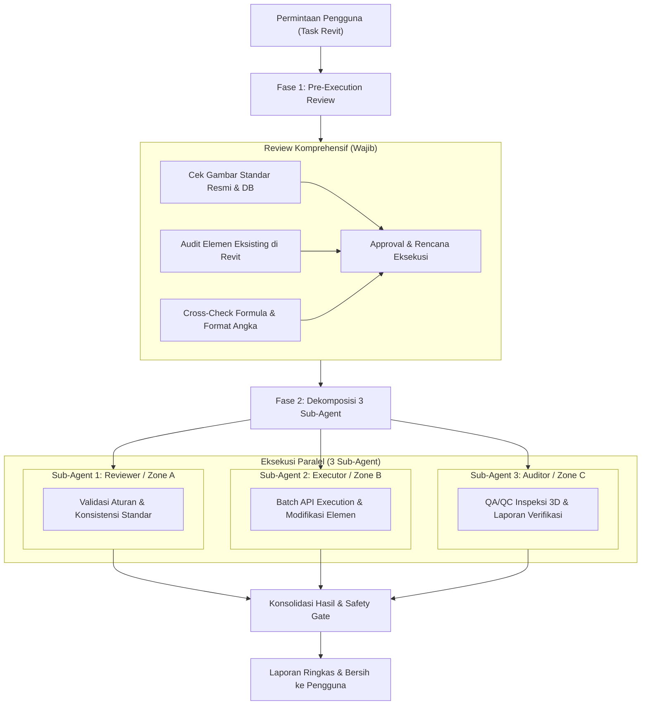

# Protokol Eksekusi Revit AIGRAV: Pre-Review & Multi-Agent Parallelism

**Versi**: 1.0  
**Status**: Wajib / Mandatory  
**Berlaku Untuk**: Seluruh operasi pemodelan, audit, modifikasi parameter, dan penyesuaian sambungan baja di Revit via AIGRAV.

---

## 1. Latar Belakang & Tujuan
Protokol ini dibuat untuk menjamin:
1. **Akurasi 100%**: Tidak ada lagi asumsi data atau kesalahan input manual; gambar standar resmi selalu diverifikasi sebelum eksekusi (*Zero-Defect Standard*).
2. **Kecepatan Eksekusi (High Throughput)**: Memanfaatkan kapabilitas multi-agent paralel Antigravity (3 sub-agent) sehingga tugas-tugas masif selesai 3x lebih cepat tanpa bottleneck sekuensial.
3. **QA/QC Terintegrasi**: Setiap perubahan divalidasi langsung oleh agen verifikator independen sebelum dilaporkan kepada pengguna.

---

## 2. Struktur Alur Kerja 2 Fase

---

## 3. Spesifikasi Peran 3 Sub-Agent

### Model 1: Spesialisasi Fungsional (Functional Specialization)
*Direkomendasikan untuk audit sambungan, perubahan parameter massal, renumbering, dan sinkronisasi standar.*

1. **Sub-Agent 1 (Standard & Specification Reviewer)**:
   - Meneliti dokumen gambar detail (`STD-BJ`, `STD-PDS`, spesifikasi teknis).
   - Memastikan tidak ada ambigu pada nama tipe, toleransi dimensi, tebal pelat, atau diameter baut/angkur.
   - Mengunci spesifikasi teknis yang sah.
2. **Sub-Agent 2 (Revit Bridge Transaction Executor)**:
   - Menjalankan perintah eksekusi batch melalui AIGRAV Bridge / Revit API.
   - Menangani manajemen transaksi (TransactionGroup, Commit, Rollback jika gagal).
   - Mengoptimalkan performa (meminimalkan regenerasi berlebih selama loop).
3. **Sub-Agent 3 (Geometry & Parameter QA/QC Auditor)**:
   - Memeriksa bounding box 3D dan orientasi elemen pasca-transaksi.
   - Memverifikasi kesesuaian nilai parameter yang telah diubah dengan kueri independen.
   - Memeriksa Revit Warnings / Errors baru yang mungkin muncul.

---

### Model 2: Partisi Zona / Spasial (Spatial Partitioning)
*Direkomendasikan untuk pembuatan model baru dalam skala besar (ratusan/ribuan elemen).*

1. **Sub-Agent 1**: Zona Struktur Bawah (Pondasi, Pedestal, Base Plate, Angkur).
2. **Sub-Agent 2**: Zona Struktur Utama (Kolom Baja, Rafter, Sambungan Endplate, Haunch).
3. **Sub-Agent 3**: Zona Struktur Sekunder (Gording CNP, Sagrod, Bracing Atap & Kolom, Klit).

---

## 4. Mekanisme Penerapan Otomatis
- File aturan ini didaftarkan di root workspace: `C:\AIGRAV\AGENTS.md`.
- Setiap kali pengguna memberikan instruksi terkait Revit, AIGRAV secara otomatis membaca dan mengadopsi protokol ini tanpa perlu diperintahkan ulang.
