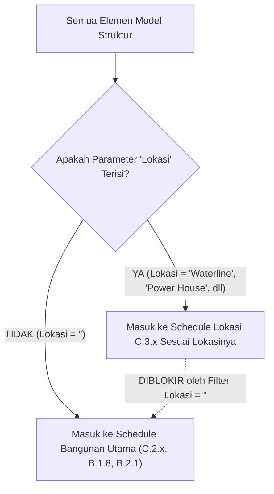

# DOKUMEN REFERENSI RESMI: TEMPLATE & STANDARISASI RESTRUKTURISASI SCHEDULE QTO (REVIT)
**Kode Dokumen:** `AIGRAV-STD-QTO-REVIT-2026-V2`  
**Status:** Approved & Implemented in Model `NTS-SI_01-PA-ST.rvt`  
**Revisi Terakhir:** 2026-11-05  

---

## 1. Pendahuluan & Prinsip Desain

Dokumen ini adalah template acuan baku (standard baseline) untuk pembuatan, audit, dan penataan tabel Quantity Takeoff (QTO) struktur baja pada Autodesk Revit melalui AIGRAV.

Tujuan utama standarisasi:
1. **Hirarki Terstruktur**: Penamaan mencerminkan hirarki logis `Lokasi > Kategori Elemen > Spesifikasi Profil / Tipe Sambungan`.
2. **Penanda Lokasi Jelas (Kolom A)**: Kolom `Lokasi` selalu ditempatkan pada kolom pertama (Kolom A / Kolom 0) dan tampil aktif (*unhidden*).
3. **Format Presisi Per Kategori**:
   - Pelat Sambungan menampilkan ketebalan & berat (5 kolom: Lokasi, Tipe Sambungan, Thickness (mm), Qty, Berat (Kg) dengan sortir per Thickness aktif subtotal footer).
   - Baut Sambungan hanya menampilkan kuantitas baut (3 kolom).
   - Baseplate menampilkan dimensi lengkap & keterangan (7 kolom).
4. **Isolasi Anti Double-Counting**: Schedule umum/Bangunan Utama difilter secara ketat `Lokasi = ""` sehingga tidak terjadi perhitungan ganda atas elemen-elemen yang sudah diklasifikasikan ke sub-lokasi.
5. **Kebersihan Project Browser**: Nol toleransi terhadap schedule sampah (`Copy 1`, `Copy 2`, dsb).

---

## 2. Hirarki Penomoran & Penamaan Master (Prefix `C.3`)

### Format Penamaan:
```text
C.3.[Kode Lokasi].[Nomor Urut] [Nama Lokasi] - [Kategori Item] [Spesifikasi Profil / Tipe Sambungan]
```

### Matriks Kode Lokasi:
| Kode Prefix | Nama Lokasi | Lingkup Elemen | Total Schedule Baku |
|:---:|:---|:---|:---:|
| `C.3.1.x` | **Waterline** | Balok Baja, Pelat Sambungan, Baut Sambungan | 21 Schedule |
| `C.3.2.x` | **Power House** | Kolom Baja, Balok Baja, Pelat, Baut, Baseplate, Angkur | 11 Schedule |
| `C.3.3.x` | **Carton & Cups Storage** | Kolom Baja, Balok Baja, Pelat, Baut, Baseplate, Angkur | 21 Schedule |
| `C.3.4.x` | **Production Office** | Kolom Baja, Balok Baja, Pelat, Baut, Baseplate (t=12 & t=19), Angkur | 14 Schedule |
| `C.3.5.x` | **Chiller Area 1** | Kolom Baja, Balok Baja, Pelat, Baut, Baseplate, Angkur | 11 Schedule |
| `C.3.6.x` | **Chiller Area 2** | Kolom Baja, Balok Baja, Pelat, Baut, Baseplate, Angkur | 11 Schedule |
| **TOTAL** | **Seluruh Lokasi** | **Model Lengkap** | **89 Schedule** |

---

## 3. Spesifikasi Template Format Tabel Schedule

### A. Template Pelat Sambungan (`OST_StructConnectionPlates`)
Digunakan untuk merekap seluruh pelat sambungan Advance Steel (*Endplate*, *Gusset Plate*, *Splice Plate*):

| Index | Nama Field Revit | Heading Kolom | Status Tampil | Fungsi & Catatan |
|:---:|:---|:---|:---:|:---|
| **0** | `Lokasi` | `Lokasi` | **Visible** | Kolom A sebagai penanda lokasi proyek |
| **1** | `Type of Connection` | `Tipe Sambungan` | **Visible** | Nama tipe sambungan (e.g. WF350-Endplate) |
| **2** | `Thickness` | `Thickness (mm)` | **Visible** | Ketebalan pelat dalam mm |
| **3** | `Count` | `Qty` | **Visible** | Kuantitas lembar pelat |
| **4** | `Weight` | `Berat (Kg)` | **Visible** | Total berat pelat terhitung (Kg) |
| - | `Width` | - | *Hidden* | - |
| - | `Length` | - | *Hidden* | - |
| - | `Comments` | - | *Hidden* | - |
| - | `Tipe Detail Sambungan` | - | *Hidden* | Tidak ditampilkan atas instruksi pengguna |

- **Pengaturan Sorting**:
  1. `Type of Connection` (Ascending, ShowHeader=False, ShowFooter=False)
  2. `Thickness` (Ascending, ShowHeader=False, **ShowFooter=True** - menampilkan subtotal Qty dan Berat per ketebalan pelat)
- **Pengaturan Grouping & Totals**: Itemize every instance = False, Grand totals = True (Title: "Total", Count=True, Totals=True).
- **Filter Baku**:
  1. `Lokasi` **Equal** `[Nama Lokasi]`
  2. `Type of Connection` **Contains** `[Nama Sambungan]`

---

### B. Template Baut Sambungan (`OST_StructConnectionBolts`)
Digunakan untuk merekap kuantitas butir bautAdvance Steel per tipe sambungan:

| Index | Nama Field Revit | Heading Kolom | Status Tampil | Fungsi & Catatan |
|:---:|:---|:---|:---:|:---|
| **0** | `Lokasi` | `Lokasi` | **Visible** | Kolom A sebagai penanda lokasi proyek |
| **1** | `Type of Connection` | `Tipe Sambungan` | **Visible** | Nama tipe sambungan |
| **2** | `Number` | `Qty` | **Visible** | Menghitung total butir baut fisik |
| - | `Comments` | - | *Hidden* | - |
| - | `Standard` | - | *Hidden* | - |
| - | `Diameter` | - | *Hidden* | - |

- **Pengaturan Sorting**: `Type of Connection` (Ascending), Itemize every instance = False, Grand totals = True.
- **Filter Baku**:
  1. `Lokasi` **Equal** `[Nama Lokasi]`
  2. `Type of Connection` **Contains** `[Nama Sambungan]`
- **Catatan Penting**: Sesuai instruksi, schedule baut **hanya sampai Qty tanpa kolom berat**.

---

### C. Template Baseplate Kolom (`OST_StructConnectionPlates`)
Digunakan untuk merekap pelat tumpuan/landasan kolom struktur:

| Index | Nama Field Revit | Heading Kolom | Status Tampil | Fungsi & Catatan |
|:---:|:---|:---|:---:|:---|
| **0** | `Lokasi` | `Lokasi` | **Visible** | Kolom A penanda lokasi |
| **1** | `Comments` | `Keterangan` | **Visible** | Keterangan pelat (e.g. Baseplate Kolom) |
| **2** | `Thickness` | `Thickness (mm)` | **Visible** | Ketebalan pelat dalam mm |
| **3** | `Width` | `Width (mm)` | **Visible** | Lebar pelat dalam mm |
| **4** | `Length` | `Length (mm)` | **Visible** | Panjang pelat dalam mm |
| **5** | `Count` | `Qty` | **Visible** | Kuantitas unit baseplate |
| **6** | `Weight` | `Berat (Kg)` | **Visible** | Total berat pelat landasan (Kg) |
| - | `Type of Connection` | - | *Hidden* | **Wajib di-hide** agar tidak muncul kolom kosong di Kolom A |

- **Pengaturan Sorting**: `Comments` -> `Thickness` -> `Width` -> `Length` (Ascending).
- **Filter Baku**:
  1. `Lokasi` **Equal** `[Nama Lokasi]`
  2. `Comments` **Contains** `Baseplate` (atau spesifik ketebalan seperti `t=12` / `t=19`)

---

### D. Template Balok & Kolom Baja (`OST_StructuralFraming` / `OST_StructuralColumns`)

| Index | Nama Field Revit | Heading Kolom | Status Tampil | Fungsi & Catatan |
|:---:|:---|:---|:---:|:---|
| **0** | `Lokasi` | `Lokasi` | **Visible** | Kolom A penanda lokasi |
| **1** | `Family and Type` | `Family and Type` | **Visible** | Tipe profil baja (e.g. WF 350x175x7x11) |
| **2** | `Length` | `Length (mm)` | **Visible** | Panjang elemen bentang |
| **3** | `Comments` | `Comments` | **Visible** | Catatan peruntukan elemen |
| **4** | `Count` | `Qty` | **Visible** | Jumlah batang elemen |
| **5** | `Weight` | `Berat (Kg)` | **Visible** | Total bobot baja struktural |

- **Filter Baku**:
  1. `Lokasi` **Equal** `[Nama Lokasi]`
  2. `Type` **Contains** `[Nama Profil]` (e.g. `WF 350`, `H 250`, `RCWF`)

---

### E. Template Angkur Kolom (`OST_StructuralFraming` / Hardware)

| Index | Nama Field Revit | Heading Kolom | Status Tampil | Fungsi & Catatan |
|:---:|:---|:---|:---:|:---|
| **0** | `Lokasi` | `Lokasi` | **Visible** | Kolom A penanda lokasi |
| **1** | `Comments` | `Comments` | **Visible** | Keterangan tipe angkur |
| **2** | `Diameter` | `Diameter (mm)` | **Visible** | Diameter angkur (e.g. Dia 19mm) |
| **3** | `Count` | `Qty` | **Visible** | Jumlah set angkur |
| **4** | `Length` | `Length (mm)` | **Visible** | Panjang tertanam angkur |

- **Filter Baku**: `Lokasi` **Equal** `[Nama Lokasi]`

---

## 4. Mekanisme Isolasi Anti Double-Counting (Zero Leakage)

Untuk memastikan tidak ada elemen dari lokasi khusus yang terhitung dua kali di dalam schedule umum (Bangunan Utama):



### Aturan Filter:
1. **Schedule Bangunan Utama** (`C.2.3`, `B.2.1`, `B.1.8`, `C.2.8` s/d `C.2.23`):
   - Tambahkan field `Lokasi` (hidden).
   - Pasang filter: `Lokasi` **Equal** `""` (string kosong).
   - **Hasil**: Begitu elemen diisi nilai lokasi (misal `Waterline`), elemen tersebut otomatis hilang dari schedule Bangunan Utama dan berpindah ke schedule lokasi.
2. **Schedule Lokasi** (`C.3.X.Y`):
   - Pasang field `Lokasi` di Kolom 0 (visible).
   - Pasang filter: `Lokasi` **Equal** `[Nama Lokasi]`.

---

## 5. Script & Command Eksekusi Otomatis

Seluruh logika template ini telah terintegrasi ke dalam skill `revit-qto-schedule-audit` dan dapat dijalankan kapan saja melalui baris perintah:

```powershell
# 1. Menjalankan audit menyeluruh seluruh schedule
powershell -ExecutionPolicy Bypass -File C:\AIGRAV\.agents\skills\revit-qto-schedule-audit\scripts\run_qto_audit.ps1 -Action audit

# 2. Membersihkan schedule copy sampah
powershell -ExecutionPolicy Bypass -File C:\AIGRAV\.agents\skills\revit-qto-schedule-audit\scripts\run_qto_audit.ps1 -Action cleanup

# 3. Menerapkan isolasi anti double-counting ke Bangunan Utama
powershell -ExecutionPolicy Bypass -File C:\AIGRAV\.agents\skills\revit-qto-schedule-audit\scripts\run_qto_audit.ps1 -Action anti-double-count

# 4. Inspeksi detail definisi schedule tertentu
powershell -ExecutionPolicy Bypass -File C:\AIGRAV\.agents\skills\revit-qto-schedule-audit\scripts\run_qto_audit.ps1 -Action inspect -TargetSchedule "C.3.5.5 Chiller Area 1 - Pelat Sambungan WF350-Endplate"
```

---

## 6. Riwayat Verifikasi & Hasil Akhir
- **Total Schedule Lokasi:** 89 Schedule (100% PASS)
- **Schedule Copy Tersisa:** 0 (Clean)
- **Status Kolom A Lokasi:** 100% Unhidden & Index 0
- **Format Pelat:** 4 Kolom (`Lokasi | Tipe Sambungan | Qty | Berat`)
- **Format Baut:** 3 Kolom (`Lokasi | Tipe Sambungan | Qty`)
- **Format Baseplate:** 7 Kolom (`Lokasi | Keterangan | Thickness | Width | Length | Qty | Berat`)
