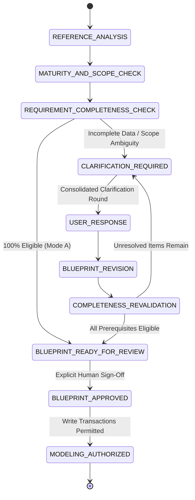
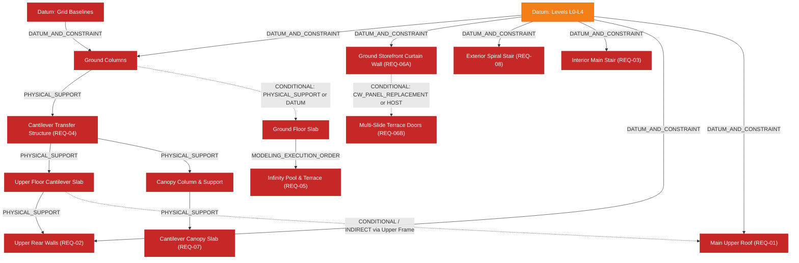

# AIGRAV — ARCHITECTURAL BLUEPRINT SPECIFICATION
**Document ID:** AIGRAV-SPEC-MF0-03  
**Status:** MF0_READY_FOR_INDEPENDENT_REVIEW  
**Date:** 2026-11-12  
**Target Platform:** Autodesk Revit 2026 / .NET 10 / C# Revit Bridge / FastMCP Python  
**Staging Path:** `C:\AIGRAV\_governance_review\modeling_fidelity\ARCHITECTURAL_BLUEPRINT_SPEC.md`  
**Classification:** MANDATORY REFERENCE-TO-BIM INTERMEDIATE SPECIFICATION  

---

## 1. Executive Summary & Architecture

The Architectural Blueprint is the mandatory intermediate specification bridging 2D conceptual references and Revit BIM element generation. Under `AIGRAV-POL-MF0-02`, no Revit write transaction may occur without an explicitly approved Blueprint.

The Blueprint enforces the core principle: **AIGRAV must understand the design before modeling. If required design information is incomplete, AIGRAV must ask the user first.**



---

## 2. Canonical Status Taxonomy & Attribute-Level Disaggregation

All Blueprint entries strictly separate five distinct status dimensions using canonical enums:

1. **Observation Status:** `OBSERVED`, `PARTIALLY_OBSERVED`, `NOT_OBSERVED_OCCLUDED`.
2. **Evidence Confidence:** `PROJECT_INPUT_VERIFIED`, `OBSERVED_FROM_REFERENCE`, `INFERRED_FROM_REFERENCE`, `ASSUMED_PENDING_USER_APPROVAL`, `DESIGN_INPUT_REQUIRED`, `CONFLICTING_DESIGN_INPUT`.
3. **Information Completeness:** `COMPLETE`, `INCOMPLETE_NON_CRITICAL`, `INCOMPLETE_CRITICAL`.
4. **Modeling Eligibility:** `MODEL_SCOPE_ELIGIBLE_PENDING_APPROVAL`, `BLOCKED`.
5. **Blueprint Approval State:** `REFERENCE_ANALYSIS`, `MATURITY_AND_SCOPE_CHECK`, `REQUIREMENT_COMPLETENESS_CHECK`, `CLARIFICATION_REQUIRED`, `USER_RESPONSE`, `BLUEPRINT_REVISION`, `COMPLETENESS_REVALIDATION`, `BLUEPRINT_READY_FOR_REVIEW`, `BLUEPRINT_APPROVED`, `MODELING_AUTHORIZED`.

> [!CRITICAL] NO SHORTHAND CONFIDENCE STRINGS & NO FALSE FACT CONVERSION
> Shorthand strings (e.g., using `OBSERVED` or `OCCLUDED` in place of confidence enums) are barred. All confidence declarations strictly utilize the six defined canonical values.
> Furthermore, when a user approves an inferred or provisional assumption, the item **retains its status as `ASSUMED_PENDING_USER_APPROVAL (USER_APPROVED)`**. It is **NEVER promoted to `PROJECT_INPUT_VERIFIED`**, ensuring downstream contractors and engineers can clearly identify verified project facts versus approved design assumptions.

---

## 3. Corrected Requirement Completeness Matrix (RCM) for `REG-MF-01`

Targeting the luxury contemporary tropical villa reference ([`media_1794454549303_c58acac6.jpg`](file:///C:/Users/sapuser/.gemini/antigravity/brain/5448a500-ccc9-46e5-89ab-30362c4d8eef/.user_uploaded/media_1794454549303_c58acac6.jpg)) under prompt *"kita test untuk melakukan model rumah modern ini di revit. gunakan standard pemodelan yang ada."*:

| Req ID | Target Subsystem | Observation Status | Canonical Evidence Confidence per Attribute | Information Completeness | Modeling Eligibility | Mapping to Active Question / Documented Blocking Dependency |
|---|---|---|---|---|---|---|
| **REQ-00** | **Target Model Maturity Selection** | `OBSERVED` | • Building Form: `OBSERVED_FROM_REFERENCE`<br>• Target Maturity: `DESIGN_INPUT_REQUIRED` | `INCOMPLETE_CRITICAL` | **`BLOCKED`** | **Mapped to Q0:** Multi-package maturity selection (Conceptual vs Coordination vs Documentation). |
| **REQ-01** | **Main Upper Roof & Drainage** | `PARTIALLY_OBSERVED` | • Roof Plane: `OBSERVED_FROM_REFERENCE`<br>• Fascia Trim: `OBSERVED_FROM_REFERENCE`<br>• Slope Angle: `DESIGN_INPUT_REQUIRED`<br>• Deck Material: `DESIGN_INPUT_REQUIRED` | `INCOMPLETE_CRITICAL` | **`BLOCKED`** | **Mapped to Q1:** Inquiry on approved roof engineering drawings vs provisional low-slope/flat alternatives. |
| **REQ-02** | **Upper Floor Program & Rear Facade** | `PARTIALLY_OBSERVED` | • Front Louvers: `OBSERVED_FROM_REFERENCE`<br>• Corner Glazing: `OBSERVED_FROM_REFERENCE`<br>• Room Layout: `DESIGN_INPUT_REQUIRED`<br>• Rear Wall Openings: `DESIGN_INPUT_REQUIRED` | `INCOMPLETE_CRITICAL` | **`BLOCKED`** | **Mapped to Q2:** Inquiry on approved architectural floorplans vs provisional master suite/multi-bedroom alternatives. |
| **REQ-03** | **Vertical Circulation & Main Stair** | `NOT_OBSERVED_OCCLUDED` | • Indoor Stair Location: `DESIGN_INPUT_REQUIRED`<br>• Stair Geometry: `DESIGN_INPUT_REQUIRED`<br>• Floor Opening: `DESIGN_INPUT_REQUIRED` | `INCOMPLETE_CRITICAL` | **`BLOCKED`** | **Mapped to Q3:** Inquiry on approved internal stair location vs provisional rear core alternative. |
| **REQ-04** | **Cantilever Structural System** | `PARTIALLY_OBSERVED` | • Cantilever Presence: `OBSERVED_FROM_REFERENCE`<br>• Column Position: `OBSERVED_FROM_REFERENCE`<br>• Structural Framing Type: `DESIGN_INPUT_REQUIRED`<br>• Member Dimensions: `DESIGN_INPUT_REQUIRED` | `INCOMPLETE_CRITICAL` | **`BLOCKED`** | **Mapped to Q4:** Inquiry on approved structural calculations vs provisional conceptual framing (no unsupported sizes suggested). |
| **REQ-05** | **Project Scope & Site/Pool Inclusion** | `OBSERVED` | • Pool Presence: `OBSERVED_FROM_REFERENCE`<br>• Project Scope: `DESIGN_INPUT_REQUIRED`<br>• Basin Specs: `DESIGN_INPUT_REQUIRED` | `INCOMPLETE_CRITICAL` | **`BLOCKED`** | **Mapped to Q5:** Explicit inquiry on project scope boundary (Full Site package vs Core Architectural Building only). |
| **REQ-06A** | **Ground Storefront Curtain Wall** | `OBSERVED` | • Presence & Layout: `OBSERVED_FROM_REFERENCE`<br>• Mullion Profiles: `DESIGN_INPUT_REQUIRED`<br>• Glass Performance Spec: `DESIGN_INPUT_REQUIRED` | `INCOMPLETE_CRITICAL` | **`BLOCKED`** | **Mapped to Q6:** Approved storefront schedule/mullion specs vs provisional standard aluminum grid module. |
| **REQ-06B** | **Multi-Slide Terrace Door Assemblies** | `OBSERVED` | • Panel Locations: `OBSERVED_FROM_REFERENCE`<br>• Hardware & Tracks: `DESIGN_INPUT_REQUIRED`<br>• Threshold Detail: `DESIGN_INPUT_REQUIRED` | `INCOMPLETE_CRITICAL` | **`BLOCKED`** | **Mapped to Q7:** Approved sliding door schedule/hardware specs vs provisional curtain wall panel door assembly. |
| **REQ-07** | **Intermediate Cantilever Canopy & Creepers** | `OBSERVED` | • Canopy Plane: `OBSERVED_FROM_REFERENCE`<br>• Creepers Presence: `OBSERVED_FROM_REFERENCE`<br>• Slab Thickness: `DESIGN_INPUT_REQUIRED`<br>• Structural Anchorage: `DESIGN_INPUT_REQUIRED` | `INCOMPLETE_CRITICAL` | **`BLOCKED`** | **Documented Dependency:** Blocked by `PHYSICAL_SUPPORT_DEPENDENCY` on Cantilever Transfer System (`REQ-04` / Q4). |
| **REQ-08** | **Exterior Spiral Staircase System** | `OBSERVED` | • Form & Presence: `OBSERVED_FROM_REFERENCE`<br>• Height & Diameter: `DESIGN_INPUT_REQUIRED`<br>• Tread Width & Riser: `DESIGN_INPUT_REQUIRED`<br>• Railing & Center Post: `DESIGN_INPUT_REQUIRED`<br>• Family / System Type: `DESIGN_INPUT_REQUIRED` | `INCOMPLETE_CRITICAL` | **`BLOCKED`** | **Mapped to Q8:** Approved spiral stair drawings/catalog vs provisional standardized contemporary spiral assembly. |

---

## 4. Non-Leading Consolidated Clarification Round (Mode B)

In strict adherence to Directive 2 and Directive 5 of `AIGRAV-POL-MF0-02`, **all questions inquire for approved project drawings or engineering data first**. Provisional alternatives are explicitly labeled as choices requiring user authorization, and all unsupported structural member sizes have been purged:

```text
================================================================================
AIGRAV ARCHITECTURAL CLARIFICATION ROUND (MODE B)
Project Reference: REG-MF-01 Contemporary Tropical Cantilever Pool Villa
Status: AWAITING USER RESPONSE (ALL REVIT MODELING STRICTLY BLOCKED)
================================================================================

We have completed the reference decomposition of the uploaded rendering. Before 
generating the Architectural Blueprint or opening any Revit write transactions, please 
clarify the following nine (9) items:

Q0. TARGET MODEL MATURITY LEVEL BY PACKAGE (REQ-00):
    Please specify your intended Level of Development (LOD) for the project packages:
    • Option A: Uniform BIM_COORDINATION_MODEL (LOD 300 reference) across all packages.
    • Option B: Split Maturity — Architectural Envelope at BIM_COORDINATION_MODEL (LOD 300) 
      while Structural Framing is held at CONCEPTUAL_REFERENCE_MODEL (LOD 200) pending 
      engineering design, and Site/Landscape is deferred.
    • Option C: Uniform CONCEPTUAL_REFERENCE_MODEL (LOD 200 reference) for massing evaluation only.
    • Option D: Other custom combination (please specify).

Q1. MAIN UPPER ROOF & DRAINAGE (REQ-01):
    The upper floating roof displays a thin white fascia overhang, but the top deck 
    and drainage layout are occluded.
    • Preferred Input: Do you have an approved architectural roof plan or drainage detail?
    • Missing Information Consequences: Without roof drawings, roof slope direction, internal 
      downpipe locations, and gutter details cannot be coordinated with structural framing.
    • Provisional Alternatives (Select one if approved drawings are unavailable):
      - Option 1A: Low-slope deck concealed behind parapet fascia, draining backward into 
        internal rainwater downpipes, with timber soffit cladding (provisional assumption).
      - Option 1B: Flat reinforced concrete roof slab with waterproofing membrane and 
        internal roof drain scuppers (provisional assumption).

Q2. UPPER FLOOR PROGRAM & REAR FACADE (REQ-02):
    The rendering reveals the front/side timber louvers and corner glass suite, but the 
    internal floorplan and rear elevation are occluded.
    • Preferred Input: Do you have an approved architectural floor plan for the upper level?
    • Missing Information Consequences: Without a floor plan, interior partitions, door 
      placements, structural wall alignments, and rear window openings remain unverified.
    • Provisional Alternatives (Select one if approved drawings are unavailable):
      - Option 2A: Master Bedroom Suite & Lounge across the front cantilever, with private 
        bathroom/walk-in wardrobe and matching window openings on the rear wall (provisional assumption).
      - Option 2B: Multi-bedroom layout (2-3 bedrooms) arranged along a rear corridor (provisional assumption).

Q3. VERTICAL CIRCULATION & MAIN INDOOR STAIR (REQ-03):
    An exterior black steel spiral staircase is visible serving the lower wing, but the 
    primary indoor staircase is occluded.
    • Preferred Input: Do you have an approved floor plan showing the indoor staircase?
    • Missing Information Consequences: Without stair layout, floor slab openings (shafts), 
      headroom clearances, and vertical circulation core cannot be coordinated.
    • Provisional Alternatives (Select one if approved drawings are unavailable):
      - Option 3A: Model an internal straight-run or switchback open-tread timber stair 
        along the central rear structural core (provisional assumption).
      - Option 3B: The villa relies primarily on exterior/veranda circulation (no indoor stair) (provisional assumption).

Q4. CANTILEVER STRUCTURAL SYSTEM (REQ-04):
    The building features an extensive forward cantilever over the ground terrace.
    • Preferred Input: Do you have an approved structural engineering design (calculations, 
      framing plans, or certified member schedules)?
    • Missing Information Consequences: Sizing structural members from a perspective rendering 
      violates professional engineering practice and introduces severe safety hazards.
    • Provisional Alternative: The project requires provisional conceptual structural modeling 
      (structural framing will be modeled as provisional placeholder elements requiring later 
      Professional Engineer verification; no final structural member sizes asserted).

Q5. PROJECT MODELING SCOPE & HARDSCAPE (REQ-05):
    The rendering depicts an infinity pool, sunken seating pit, and tropical palms.
    • Option 5A (Full Site Scope): Include building architecture + cantilever canopy + 
      infinity pool basin + sunken lounge terrace + primary landscape entourage.
    • Option 5B (Core Building Only): Restrict modeling strictly to the villa architectural 
      superstructure (levels, primary framing, exterior/interior walls, glazing, roofs, canopy, 
      and stairs).

Q6. GROUND STOREFRONT CURTAIN WALL SYSTEM (REQ-06A):
    The ground floor features an extensive continuous glass storefront enclosing the living volume.
    • Preferred Input: Do you have an approved storefront schedule, mullion profiles (e.g., 
      50x150mm anodized aluminum), or glass performance specifications (U-factor, SHGC)?
    • Missing Information Consequences: Without mullion specs, structural wind-load anchors, 
      thermal breaks, and exact grid division modules cannot be definitively scheduled.
    • Provisional Alternative (Select if approved drawings are unavailable): Model standard 
      native Revit Curtain Wall with provisional 1500mm module spacing and clear double-glazing 
      panels, explicitly designated as an assumption requiring architectural sign-off.

Q7. MULTI-SLIDE TERRACE DOOR ASSEMBLIES (REQ-06B):
    The living lounge opens onto the pool deck via wide-span multi-slide glazed door panels.
    • Preferred Input: Do you have an approved door schedule or manufacturer catalog specification 
      (panel count, pocketed vs. stacking tracks, sill threshold floor-drop, and hardware)?
    • Missing Information Consequences: In Revit, curtain wall door placement requires either 
      Curtain Wall Door Panel replacement or wall-hosted families; operational clearance and 
      weatherproofing sills cannot be coordinated without hardware dimensions.
    • Provisional Alternative (Select if approved drawings are unavailable): Model a 3-panel 
      multi-slide glass door assembly integrated as native Curtain Wall Door Panels, with 
      flush sill threshold, explicitly designated as a provisional assumption requiring verification.

Q8. EXTERIOR SPIRAL STAIRCASE SYSTEM (REQ-08):
    An exterior black spiral staircase is visible on the left terrace wing.
    • Preferred Input: Do you have an approved stair drawing or manufacturer catalog specification 
      (stair diameter, total rise, tread width, riser count, balustrade, and landing detail)?
    • Missing Information Consequences: Without stair dimensions, tread rise/run ratios, headroom 
      clearances, and structural connection brackets to the upper slab cannot be validated.
    • Provisional Alternative (Select if approved drawings are unavailable): Model a standardized 
      contemporary steel spiral stair with provisional 1800mm diameter and steel pipe center 
      column connecting Ground Terrace to Lower Roof Deck, subject to later engineering sign-off.

================================================================================
STATUS: AIGRAV IS WAITING FOR YOUR EXPLICIT RESPONSE TO Q0 THROUGH Q8.
ALL AFFECTED REVIT WRITE OPERATIONS REMAIN STRICTLY BLOCKED.
================================================================================
```

---

## 5. Repaired Dependency Graph & Exact 14-Edge Dependency Table

### 5.1 Verification of the Five Distinct Dependency Types
To eliminate confusion between physical building mechanics, CAD database structures, and procedural algorithms, AIGRAV rigorously enforces five distinct dependency types:

1. **`PHYSICAL_SUPPORT_DEPENDENCY` (Gravity/Structural Load Path):**  
   Represents physical load transfer in the constructed building (e.g., column bearing girder, girder bearing slab).  
   *Distinction:* A physical support does not dictate Revit database hosting. For example, a floor slab bears physically on structural beams, but in the Revit API database, `Floor` is created independently with a level constraint and does not reference `Beam` as a parent host.
2. **`REVIT_HOST_DEPENDENCY` (Revit Database API Parent-Child Hosting):**  
   Represents a strict Revit API database contract where a child element cannot exist without a valid parent host element ID (e.g., `doc.Create.NewFamilyInstance(..., hostWall, ...)` for standard doors/windows).  
   *Distinction:* Doors in Basic Walls require a `REVIT_HOST_DEPENDENCY`. However, doors in Curtain Walls are placed via **Curtain Wall Panel replacement** (`CurtainCell.Panel`), which is a panel substitution within the curtain grid rather than a standard wall-hosted insertion.
3. **`DATUM_AND_CONSTRAINT_DEPENDENCY` (Coordinate & Level Datums):**  
   Represents elevation and grid baselines that constrain element placement, height, and boundaries (`BaseLevel`, `TopLevel`, `LevelId`).  
   *Distinction:* Basic walls, curtain walls, and stairs in Revit depend on Levels, NOT on floor slabs. Treating a floor slab as a database host for a wall is a technical error in Revit modeling.
4. **`MODELING_EXECUTION_ORDER` (Procedural Transaction Sequence):**  
   Represents transactional execution prerequisites where one element must be generated before another due to spatial reference or computational workflow, even when no direct database host or physical bearing exists (e.g., generating primary building slabs before modeling site hardscape boundaries and pool voids).
5. **`VALIDATION_DEPENDENCY` (Post-Regeneration Geometry Audit):**  
   Represents quality assurance prerequisites where the Revit document must execute a full document regeneration (`doc.Regenerate()`) before spatial clash detection, boundary bounding box analysis, or column protrusion solvers can execute.



---

### 5.2 Exhaustive Audit of the 14 Dependency Edges

The table below audits all 14 dependency edges in the benchmark villa model, explicitly identifying conditionality, physical validity, Revit host status, datum constraints, and activating conditions:

| Edge # | Source Element | Target Element | Primary Dependency Type | Is Physically Valid? | Is Revit Host? | Is Datum / Constraint? | Is Execution Order? | Is Validation Dep? | System Conditionality & Activating Condition | Resolution Status & Consequence |
|---|---|---|---|---|---|---|---|---|---|---|
| **E01** | `Levels (L0-L4)` | `COL_GF` (Ground Columns) | `DATUM_AND_CONSTRAINT_DEPENDENCY` | Yes (Elevations) | No | **Yes (Base/Top Level)** | No | No | **Universal:** Mandatory for setting column base level and height. | Pending Q0. Cannot constrain column endpoints without levels. |
| **E02** | `Grid Baselines` | `COL_GF` (Ground Columns) | `DATUM_AND_CONSTRAINT_DEPENDENCY` | Yes (Spatial Grid) | No | **Yes (Grid Intersections)** | No | No | **Universal:** Required to establish parametric structural column insertion points. | Pending Q0. Columns cannot be located without grid lines. |
| **E03** | `COL_GF` | `BM_TRANS` (Transfer Structure) | `PHYSICAL_SUPPORT_DEPENDENCY` | **Yes (Direct Bearing)** | No | No | Yes (Cols before Beams) | No | **Universal:** Transfer beams bear directly on ground column heads. | **BLOCKED (Q4).** Unverified load path; cannot size supports. |
| **E04** | `COL_GF` | `SLB_GF` (Ground Floor Slab) | `DATUM_AND_CONSTRAINT_DEPENDENCY` / `PHYSICAL_SUPPORT_DEPENDENCY` | **Conditional** | No | Yes (Level 1 Datum) | Yes (Order) | No | **CONDITIONAL:** Ground slabs-on-grade rest on subgrade soil (no column support). Only suspended ground slabs bear on grade beams/columns. | **BLOCKED (Q0/Q4).** Activating Condition: Foundation design confirms suspended slab vs. slab-on-grade. |
| **E05** | `BM_TRANS` | `SLB_UF` (Upper Cantilever Slab) | `PHYSICAL_SUPPORT_DEPENDENCY` | **Yes (Cantilever Bearing)**| No | No | Yes (Frame before Slab)| No | **Universal:** Cantilevered upper floor slab is physically supported by transfer structure. | **BLOCKED (Q4).** Upper cantilever slab lacks physical support. |
| **E06** | `BM_TRANS` | `CANOPY_SUP` (Canopy Support) | `PHYSICAL_SUPPORT_DEPENDENCY` | **Yes (Outrigger Anchor)** | No | No | Yes (Frame before Outrigger)| No | **Universal:** Intermediate canopy structure anchors into primary transfer framing. | **BLOCKED (Q4).** Canopy support anchorage unverified. |
| **E07** | `CANOPY_SUP` | `CANOPY_SLB` (Canopy Slab) | `PHYSICAL_SUPPORT_DEPENDENCY` | **Yes (Direct Bearing)** | No | No | Yes (Support before Slab)| No | **Universal:** Canopy slab physically rests on intermediate outrigger/column support. | **BLOCKED (Q4).** Canopy slab cannot be structurally placed. |
| **E08** | `Levels (L1-L2)` | `CW_GF` (Ground Curtain Wall) | `DATUM_AND_CONSTRAINT_DEPENDENCY` | Yes (Level Bounds) | No | **Yes (Base/Top Level)** | No | No | **Universal:** Native Revit Curtain Wall requires base and top level constraints. | **BLOCKED (Q0).** Base and top level datums unconfirmed. |
| **E09** | `CW_GF` | `DR_SLIDE` (Sliding Doors) | `REVIT_HOST_DEPENDENCY` / `CURTAIN_PANEL_REPLACEMENT` | Yes (Physical Opening) | **Conditional** | Yes (Sill at Level 1) | Yes (Wall before Door)| No | **CONDITIONAL:** In Revit, curtain walls do NOT host standard door instances; doors replace `CurtainCell.Panel`. If basic wall, standard host applies. | **BLOCKED (Q7 & CW_GF).** Activating Condition: Model uses native curtain panel replacement. |
| **E10** | `Levels (L0-L2)` | `STAIR_EXT` (Spiral Stair) | `DATUM_AND_CONSTRAINT_DEPENDENCY` | Yes (Floor-to-Floor)| No | **Yes (Base/Top Level)** | No | No | **Universal:** Stair elements in Revit are level-constrained, not hosted on floor slabs. | **BLOCKED (Q8).** Base/top elevations and rise unconfirmed. |
| **E11** | `Levels (L1-L2)` | `STAIR_INT` (Indoor Stair) | `DATUM_AND_CONSTRAINT_DEPENDENCY` | Yes (Floor-to-Floor)| No | **Yes (Base/Top Level)** | No | No | **Universal:** Stair elements in Revit are level-constrained, not hosted on floor slabs. | **BLOCKED (Q3).** Indoor stair location and run unconfirmed. |
| **E12** | `SLB_UF` | `WL_UF_REAR` (Upper Rear Wall) | `PHYSICAL_SUPPORT_DEPENDENCY` | **Yes (Slab Bearing)** | No | Yes (Level 2 Datum) | Yes (Slab before Wall)| No | **Universal:** Upper floor walls physically bear on upper floor slab / framing. | **BLOCKED (Q2).** Upper rear wall lacks floor slab bearing. |
| **E13** | `SLB_UF` | `RF_MAIN` (Upper Roof System) | `MODELING_EXECUTION_ORDER` / `PHYSICAL_SUPPORT_DEPENDENCY` (Indirect) | **Conditional / Indirect**| No | Yes (Level 3 Datum) | **Yes (Sequential Order)** | No | **CONDITIONAL / INDIRECT:** Roof at +8m does not rest on floor slab at +3.8m directly; roof bears on upper columns/walls/roof beams. | **BLOCKED (Q1).** Activating Condition: Superstructure load path established via upper columns/walls. |
| **E14** | `Regenerated Solid` | `QA Clash & Penetration Audit`| `VALIDATION_DEPENDENCY` | N/A (Digital Validation)| No | No | Yes (Doc.Regenerate) | **Yes (Validation)** | **Universal:** Solid geometry must be regenerated in Revit document before geometric analysis. | Pending Execution. Cannot audit geometry before doc regeneration. |

---

## 6. Conceptual Model Dimensional Confidence & Provenance Protocol

When evaluating conceptual reference models (e.g. `CONCEPTUAL_REFERENCE_MODEL` / `TC-MF-XX-09A`):
1. **No Conversion to Project Verified Facts:** Approximate building footprints ($14.0\text{ m} \times 24.0\text{ m}$), total heights ($8.5\text{ m}$), and cantilever spans ($4.5\text{ m}$) inferred from a 2D perspective rendering must **always retain their status as `INFERRED_FROM_REFERENCE`**.
2. **Explicit User Approval Required:** When presented in clarification questions or blueprints, they are classified as `ASSUMED_PENDING_USER_APPROVAL`. When the user approves them, they are recorded as `ASSUMED_PENDING_USER_APPROVAL (USER_APPROVED)` with an immutable timestamped note.
3. **Strict Ban on Silent Promotion:** Inferred dimensions **must never be classified as `PROJECT_INPUT_VERIFIED`** and **must never be silently promoted to structural cross-sections, foundation bearing depths, or construction documentation dimensions**.

---
*End of Refined Deliverable 3 — Architectural Blueprint Specification is Staged for Independent Review (`MF0_READY_FOR_INDEPENDENT_REVIEW`).*
