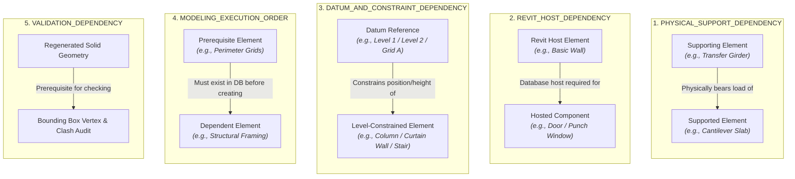

# AIGRAV — ARCHITECTURAL REFERENCE-TO-BIM POLICY
**Document ID:** AIGRAV-POL-MF0-02  
**Status:** MF0_READY_FOR_INDEPENDENT_REVIEW  
**Date:** 2026-11-12  
**Target Platform:** Autodesk Revit 2026 / .NET 10 / C# Revit Bridge / FastMCP Python  
**Staging Path:** `C:\AIGRAV\_governance_review\modeling_fidelity\ARCHITECTURAL_REFERENCE_TO_BIM_POLICY.md`  
**Classification:** MANDATORY ARCHITECTURAL MODELING GOVERNANCE  

---

## 1. Core Principle & Purpose

> [!CRITICAL] THE CARDINAL PRINCIPLE OF INPUT COMPLETENESS & USER CLARIFICATION
> **AIGRAV MUST UNDERSTAND THE DESIGN BEFORE MODELING. IF REQUIRED DESIGN INFORMATION IS INCOMPLETE, AIGRAV MUST ASK THE USER FIRST.**  
> AI-generated assumptions must **never silently replace missing user or project design information**. A single 2D perspective rendering cannot determine hidden dimensions, rear elevations, structural systems, foundation designs, or concealed construction details.

---

## 2. Separation of the Five Operational Status Dimensions

To eliminate confusion between visual presence and technical completeness, AIGRAV enforces five strictly independent status dimensions across all architectural components and attributes:

```mermaid
flowchart TD
    subgraph D1 ["1. Observation Status"]
        O1["OBSERVED"]
        O2["PARTIALLY_OBSERVED"]
        O3["NOT_OBSERVED_OCCLUDED"]
    end

    subgraph D2 ["2. Evidence Confidence (Canonical)"]
        C1["PROJECT_INPUT_VERIFIED"]
        C2["OBSERVED_FROM_REFERENCE"]
        C3["INFERRED_FROM_REFERENCE"]
        C4["ASSUMED_PENDING_USER_APPROVAL"]
        C5["DESIGN_INPUT_REQUIRED"]
        C6["CONFLICTING_DESIGN_INPUT"]
    end

    subgraph D3 ["3. Information Completeness"]
        I1["COMPLETE"]
        I2["INCOMPLETE_NON_CRITICAL"]
        I3["INCOMPLETE_CRITICAL"]
    end

    subgraph D4 ["4. Modeling Eligibility"]
        E1["MODEL_SCOPE_ELIGIBLE_PENDING_APPROVAL"]
        E2["BLOCKED"]
    end

    subgraph D5 ["5. Blueprint Approval State"]
        S1["REFERENCE_ANALYSIS"] --> S2["MATURITY_AND_SCOPE_CHECK"]
        S2 --> S3["REQUIREMENT_COMPLETENESS_CHECK"]
        S3 --> S4["CLARIFICATION_REQUIRED"]
        S4 --> S5["USER_RESPONSE"]
        S5 --> S6["BLUEPRINT_REVISION"]
        S6 --> S7["COMPLETENESS_REVALIDATION"]
        S7 --> S8["BLUEPRINT_READY_FOR_REVIEW"]
        S8 --> S9["BLUEPRINT_APPROVED"]
        S9 --> S10["MODELING_AUTHORIZED"]
    end
```

### 2.1 Canonical Status Rules & Dimensional Confidence Protocol
1. **No Shorthand Terms:** Shorthand terms (such as `OBSERVED`, `OCCLUDED`, `INFERRED`, or `UNSTATED`) must **never** be used as replacements for the six canonical Evidence Confidence enums.
2. **Quarantine of Approved Assumptions:** When a user explicitly approves an assumption (`ASSUMED_PENDING_USER_APPROVAL`), the item **must not be relabeled as `PROJECT_INPUT_VERIFIED`**. It is recorded as `ASSUMED_PENDING_USER_APPROVAL (USER_APPROVED)` with an immutable timestamped audit note, maintaining strict separation between verified project facts and approved inferences.
3. **Conceptual Model Dimensional Confidence:** Approximate dimensions estimated from a perspective view (e.g. building footprint, total height, cantilever projection) must be classified as `INFERRED_FROM_REFERENCE`. They retain inherent uncertainty ($\pm 15\%$), require explicit user confirmation before being used in schematic massing, and **can NEVER be promoted to `PROJECT_INPUT_VERIFIED` or silently converted into structural sizes or construction coordinates**.

---

## 3. Model Maturity Scope & Package-Level Customization

### 3.1 Package-Level Maturity Independence
Different project packages, disciplines, or subsystems within a single model may require different maturity levels. Architecture, Structure, and MEP are **not forced to share a single uniform maturity level**:
- *Example:* The Architectural Envelope may target `BIM_COORDINATION_MODEL` while the Superstructure remains at `CONCEPTUAL_REFERENCE_MODEL` pending civil engineer calculation, and Site Hardscape is deferred.

### 3.2 External LOD References Clarification
Industry specifications such as AIA G202-2013 or BIMForum LOD (LOD 100, 200, 300, 350, 400) are recognized as **informative external references**. Their applicability depends on contract requirements; they are **not universal 1:1 equivalents** of AIGRAV's internal maturity categories.

### 3.3 Maturity Level Specification Matrix

| Maturity Dimension | `CONCEPTUAL_REFERENCE_MODEL` | `BIM_COORDINATION_MODEL` | `CONSTRUCTION_DOCUMENTATION_MODEL` |
|---|---|---|---|
| **Primary Purpose** | Massing studies, zoning volume verification, solar orientation. | Multi-discipline coordination, spatial clash detection, room area takeoff. | Fabrication detailing, permit documentation, contractual BoQ. |
| **Minimum Required Input** | Overall building silhouette, approximate boundary footprint ($W \times L$), total height. | Verified level datums, continuous load paths, native family types, compound wall/roof layers, door/window schedules. | PE-certified structural calculations, manufacturer product families, rebar/anchor layouts, waterproofing flashings, soil report. |
| **Permitted Modeling Detail** | Mass envelopes, generic single-layer walls/slabs/roofs ($\pm 15\%$ tolerance), simplified opening voids. | Native Revit categories, compound multi-layer assemblies, design-driven column offsets, hosted fenestration, native multi-plane roofs. | Fully detailed manufacturer families, structural connections, MEP penetration sleeves, expansion joints. |
| **Required Semantic Data** | Category, Level, Name, Estimated Volume/Area. | Native Category, Compound Layers, Type Mark, Headroom Parameters, OmniClass, Thermal/Visual Assets. | Manufacturer Name, Model Number, Structural Rebar Schedule, Material Specification Codes, Fabrication Data. |
| **Required Validation** | Silhouette aspect ratio ($10\%$), bounding box spatial containment. | 5-Gate Acceptance Matrix (Gates A–E $\ge 85\%$), zero unintended roof protrusions, zero slab collisions. | PE structural sign-off, full IFC export compliance, construction joint clash clearance. |
| **Prohibited Assumptions** | High-precision millimeter dimensions, unverified internal layouts. | Faking windows/doors with basic walls, generic flat slabs for sloped roofs, unmanaged column heights. | Generating fabrication models from 2D visual references without engineering drawings. |
| **Expected Deliverables** | 3D Perspective Massing View, Volumetric Takeoff Report. | 7-View Orthogonal & Perspective Validation Set, Room Schedule, Quantity Takeoff. | Full Sheet Documentation Set, Structural Schedules, Construction Detail Sections. |
| **Conditions that Block Modeling** | Footprint boundaries completely missing or contradictory. | Unresolved roof pitch/drainage, missing parent levels, unverified cantilever transfer systems. | Lack of certified engineering drawings and manufacturer product data. |

> [!WARNING] BAN ON PREMATURE DOCUMENTATION MATURITY
> A single 2D perspective rendering **can never support `CONSTRUCTION_DOCUMENTATION_MODEL`**. If requested, AIGRAV must halt and inform the user that detailed engineering drawings are required.

---

## 4. Strict Semantic Dependency Model

AIGRAV strictly isolates five distinct dependency types. Conflating physical support with Revit database hosting or datum constraints is prohibited:

### Dependency Rules & System Conditionality:
1. **No Artificial Hosting on Slabs:** Ordinary walls, curtain walls, and stairs in Revit reference levels via `BaseLevel` and `TopLevel` (`DATUM_AND_CONSTRAINT_DEPENDENCY`). They must **not** be classified as `REVIT_HOST_DEPENDENCY` on floor slabs unless an explicit host-based family (such as a floor-hosted railing or slab edge sweep) is instantiated.
2. **True Revit Hosting vs. Curtain Wall Panel Replacement:** `REVIT_HOST_DEPENDENCY` is reserved strictly for elements where the Revit API requires a host entity at instantiation (e.g., `doc.Create.NewFamilyInstance(..., hostWall, ...)` for doors and windows in Basic Walls). For Curtain Walls, doors are placed by substituting a `CurtainCell.Panel` within the curtain grid, which is a specialized panel replacement operation rather than standard wall hosting.
3. **Conditional Ground Slab Support:** Ground floor slabs are conditionally supported: slabs-on-grade are physically borne by the subgrade soil (no column support), whereas suspended ground slabs bear on grade beams/columns.
4. **Indirect Roof Support Load Paths:** A main roof does not bear directly on the floor slab below it; it bears on upper columns, structural walls, or roof framing. The relationship from floor slab to roof is indirect physical support combined with sequential modeling execution order.
5. **No Asserted Unverified Structural Paths:** Structural relationships between columns, transfer girders, slabs, canopies, and roofs must be classified as verified, inferred, or unresolved. AIGRAV must never assert an unverified engineering load path as an established fact.

---

## 5. Non-Leading Clarification Questions Mandate

When critical information is missing (Mode B), clarification questions must follow strict non-leading standards across all subsystems (`Q0` through `Q8`):
1. **Approved Information First:** Always inquire whether approved project drawings, architectural layouts, or structural calculations already exist.
2. **Documented Consequences:** Explicitly state the technical and coordination consequences if approved documentation is unavailable.
3. **Provisional Alternatives Clearly Labeled:** If conceptual alternatives are provided, they must be explicitly labeled as **provisional choices requiring user authorization**, not presented as predetermined facts established by the image.
4. **No Invented Member Sizing:** Barred from suggesting specific structural cross-sections (e.g., $350 \times 700\text{ mm}$ transfer beams or $400 \times 400\text{ mm}$ columns) from visual renderings.

---

## 6. Authorization Semantics & Approval State Machine

Visual observation completeness (`OBSERVATION_COMPLETE`) **never authorizes modeling**:
- An element is `MODEL_SCOPE_ELIGIBLE_PENDING_APPROVAL` only when all its physical prerequisites, hosting relationships, dimensions, and materials are resolved.
- **The status `MODELING_AUTHORIZED` applies strictly to the Blueprint as a whole upon explicit human sign-off.** No individual element may bypass this gate.

---

## 7. Ten Mandatory Architectural Governance Directives

1. **Directive 1 (Blueprint Decomposition):** No direct primitive modeling without an approved Blueprint.
2. **Directive 2 (Input Completeness & Non-Leading Questions):** Ask for approved drawings first; provisional options labeled clearly. Complete questions Q0–Q8 mandatory. Zero silent assumptions.
3. **Directive 3 (Attribute-Level Disaggregation):** Separate visual presence from technical specification across all components.
4. **Directive 4 (Prohibition on Unsupported Sizing):** Never recommend structural dimensions or profiles from a perspective rendering.
5. **Directive 5 (Multi-Package Maturity Selection):** Support independent maturity by package/discipline without default bias.
6. **Directive 6 (Authorization Semantics):** Use `OBSERVATION_COMPLETE`, `MODEL_SCOPE_ELIGIBLE_PENDING_APPROVAL`, and `BLOCKED`. `MODELING_AUTHORIZED` granted only upon full Blueprint sign-off.
7. **Directive 7 (Five Dependency Types & Conditionality):** Distinctly classify Physical Support, Revit Hosting, Datum Constraints, Execution Order, and Validation. Explicitly evaluate conditional edges.
8. **Directive 8 (Design-Driven Column Constraints):** $\text{TopOffset} = \text{TargetTopElevation} - \text{TopLevelElevation}$ based on explicit structural interfaces. Zero unintended penetrations.
9. **Directive 9 (Category Invariance & Controlled Exceptions):** Native categories mandatory. `DirectShape` permitted only with documented justification, parameters, and user approval.
10. **Directive 10 (Engineering Disclaimer):** Geometric sanity checks verify clearances and continuous paths; they do not replace licensed Professional Engineer (PE) structural calculations.

---
*End of Refined Deliverable 2 — Architectural Reference-to-BIM Policy is Staged for Independent Review (`MF0_READY_FOR_INDEPENDENT_REVIEW`).*
