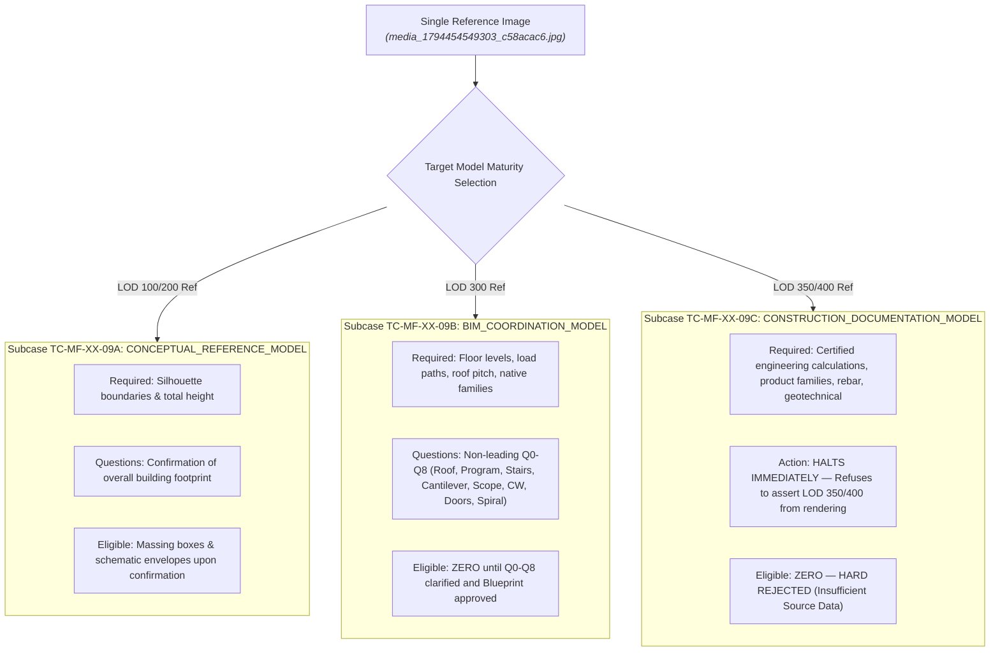

# AIGRAV — MODELING FIDELITY ACCEPTANCE MATRIX & SCORING SPECIFICATION
**Document ID:** AIGRAV-SPEC-MF0-04  
**Status:** MF0_READY_FOR_INDEPENDENT_REVIEW  
**Date:** 2026-11-12  
**Target Platform:** Autodesk Revit 2026 / .NET 10 / C# Revit Bridge / FastMCP Python  
**Staging Path:** `C:\AIGRAV\_governance_review\modeling_fidelity\MODELING_FIDELITY_ACCEPTANCE_MATRIX.md`  
**Classification:** MANDATORY QUALITY ASSURANCE & ACCEPTANCE GOVERNANCE  

---

## 1. Executive Summary

This specification establishes the **Conditional Multi-Stage Acceptance Matrix**, the **Test Result Taxonomy**, and the **Acceptance Test Suite (`TC-MF-XX-01` to `09`)** for AIGRAV.

Three core governance laws are enforced:
1. **Pre-Execution Gate 0:** No Revit write transactions may begin while critical requirements remain `BLOCKED`, `DESIGN_INPUT_REQUIRED`, or unapproved `ASSUMED_PENDING_USER_APPROVAL`.
2. **Conditional Evaluation (Gates A–E):** Quality criteria are evaluated against **actual approved design requirements** from the Blueprint, not hardcoded assumptions.
3. **Engineering Disclaimer:** Gate D verifies geometric integrity, continuous spatial load paths, and clearance. **It does not replace professional structural engineering calculation, structural analysis, or licensed engineer (PE) approval.**

---

## 2. Standardized Test Verdict Taxonomy

To eliminate misleading self-attestations and distinguish theoretical tabletop reviews from actual software execution, all acceptance tests must be classified using the following five standardized verdicts:

| Test Verdict | Definition | Usage Criteria |
|---|---|---|
| **`PASS_TABLETOP`** | Passed through manual design review, schema validation, and conceptual simulation. | Verified on paper/schema; no Revit transactions executed. |
| **`FAIL`** | Failed to satisfy mandatory governance policy, schema constraint, or acceptance threshold. | Policy breached, unapproved assumption made, or silent default selected. |
| **`NOT_APPLICABLE`** | Test scenario cannot be triggered by the provided input dataset. | E.g., dimension conflict tests when only a single rendering without conflicting drawings is provided. |
| **`NOT_EXECUTED`** | Test requires user interaction or upstream state transition that has not yet occurred. | E.g., testing blueprint regeneration after user response when the user has not yet responded. |
| **`RUNTIME_NOT_VERIFIED`** | Logic is defined in specifications, but live C# Revit Bridge / FastMCP execution has not been run. | Phase 0 governance stage where production runtime is paused. |

---

## 3. Mandatory Acceptance Test Suite (`TC-MF-XX-01` to `TC-MF-XX-09`)

The table below evaluates the acceptance test cases under the rigorous taxonomy, based on the `REG-MF-01` tabletop simulation:

| Test ID | Test Scenario & Verification Focus | Evaluation Under `REG-MF-01` Tabletop Simulation | Rigorous Test Verdict |
|---|---|---|---|
| **`TC-MF-XX-01`** | **Incomplete Roof Information Triggers Clarification** | Upper roof pitch, deck material, and drainage are occluded in perspective rendering. System identified missing information, tagged `REQ-01` as `DESIGN_INPUT_REQUIRED`, blocked `Roof_Main` in DAG, and emitted Q1. Zero flat floor slabs generated. | **`PASS_TABLETOP`** |
| **`TC-MF-XX-02`** | **Unknown Structural Support Not Silently Selected** | Cantilever transfer framing is concealed. System identified unverified structural system, eliminated unsupported dimensional recommendations, tagged `REQ-04` as `DESIGN_INPUT_REQUIRED`, and emitted Q4 asking whether user has an approved design. Zero columns/beams placed. | **`PASS_TABLETOP`** |
| **`TC-MF-XX-03`** | **Complete Design Inputs Do Not Trigger Questions** | Evaluates Mode A when complete CAD plans and schedules are provided. In `REG-MF-01`, input was incomplete (Mode B), so Mode A complete-input bypass was not active. | **`NOT_EXECUTED`** *(Awaits Mode A full-input test package)* |
| **`TC-MF-XX-04`** | **Conflicting Dimensions Trigger Clarification** | Evaluates reconciliation when plan and elevation dimensions contradict. In `REG-MF-01`, input was a single rendering without conflicting dimension strings. | **`NOT_APPLICABLE`** *(No conflicting dimensions provided in input)* |
| **`TC-MF-XX-05`** | **Traceable User-Approved Assumptions** | Evaluates whether approved assumptions record immutable audit notes in parameter `Comments`. In this tabletop simulation, the user has not yet responded to the clarification round. | **`NOT_EXECUTED`** *(Awaits actual user response)* |
| **`TC-MF-XX-06`** | **Affected Geometry Blocked While Input Unresolved** | Verified that `Roof_Main`, `Wall_Rear`, `Stairs_Int`, `Stairs_Ext`, `Curtain_Wall`, `Doors_Slide`, and `Framing_Transfer` are marked `BLOCKED` in the DAG. Scope blocking prevents generic geometry substitution while prerequisites remain unresolved. | **`PASS_TABLETOP`** |
| **`TC-MF-XX-07`** | **Blueprint Regeneration After User Response** | Evaluates state machine transition from `USER_RESPONSE` to `BLUEPRINT_REVISION` and re-running completeness audit. Cannot be executed until user submits responses. | **`NOT_EXECUTED`** *(Awaits actual user response)* |
| **`TC-MF-XX-08`** | **Modeling Cannot Begin Without Blueprint Approval** | State machine currently halted in `CLARIFICATION_REQUIRED`. Exactly zero Revit API calls were issued. Modeling remains strictly locked pending user sign-off. | **`PASS_TABLETOP`** |
| **`TC-MF-XX-09A`** | **Maturity Subcase A: Conceptual Reference Model** | Evaluates system behavior under `CONCEPTUAL_REFERENCE_MODEL`. Verifies footprint boundary confirmation query emitted and massing elements become eligible upon confirmation; enforces dimensional uncertainty protocol (never promotes inferred dimensions to `PROJECT_INPUT_VERIFIED`); detailed BIM assemblies remain barred. | **`PASS_TABLETOP`** |
| **`TC-MF-XX-09B`** | **Maturity Subcase B: BIM Coordination Model** | Evaluates system behavior under `BIM_COORDINATION_MODEL`. Verifies attribute-level RCM blocking across all 10 subsystems (`REQ-00` to `REQ-08`), non-leading clarification round Q0–Q8 emitted, 14-edge conditional dependency DAG enforced, and zero Revit API calls issued. | **`PASS_TABLETOP`** |
| **`TC-MF-XX-09C`** | **Maturity Subcase C: Construction Documentation Model** | Evaluates system behavior when `CONSTRUCTION_DOCUMENTATION_MODEL` is requested from a single 2D rendering. Verifies immediate hard halt / rejection due to insufficient technical input data. | **`PASS_TABLETOP`** |

---

## 4. Detailed Specification of Acceptance Test `TC-MF-XX-09` Subcases

Acceptance Test `TC-MF-XX-09` certifies that AIGRAV dynamically adapts its Requirement Completeness Matrix, clarification questions, and modeling eligibility based on the selected **Model Maturity Level** for the exact same input image:

### 4.1 Subcase TC-MF-XX-09A: Conceptual Reference Model & Dimensional Confidence Protocol
- **Objective:** Verify that when `CONCEPTUAL_REFERENCE_MODEL` is targeted, AIGRAV confines inquiries to overall volumetric boundaries, permits schematic massing upon boundary confirmation, and strictly prevents inferred dimensions from falsely becoming verified facts or construction specifications.
- **Input Dataset:** Reference image `media_1794454549303_c58acac6.jpg` + Prompt selecting Conceptual Maturity.
- **Explicit Test Procedure:**
  1. Initialize Cognitive Analysis engine with `TargetMaturity = CONCEPTUAL_REFERENCE_MODEL`.
  2. Parse silhouette boundaries from perspective rendering: approximate footprint ($14.0\text{ m} \times 24.0\text{ m}$), total height ($8.5\text{ m}$), forward cantilever ($4.5\text{ m}$).
  3. **Dimensional Confidence Audit:** Verify that all parsed dimensions are classified strictly as `INFERRED_FROM_REFERENCE` with explicit $\pm 15\%$ volumetric tolerance. Verify they are **NOT classified as `PROJECT_INPUT_VERIFIED`**.
  4. Verify that detailed attributes (rebar, compound wall layers, door hardware, internal staircase geometry, roof slope angle) are marked `INCOMPLETE_NON_CRITICAL` for this maturity tier.
  5. Verify that the emitted clarification query is limited to overall volumetric bounding box confirmation:
     *"Do you approve an approximate $14.0\text{ m} \times 24.0\text{ m}$ footprint with $8.5\text{ m}$ total height and $4.5\text{ m}$ cantilever projection as a provisional conceptual assumption?"*
  6. Verify that upon simulated user confirmation of footprint, dimensions transition to `ASSUMED_PENDING_USER_APPROVAL (USER_APPROVED)` — **never promoted to `PROJECT_INPUT_VERIFIED`** — and massing volumes transition to `MODEL_SCOPE_ELIGIBLE_PENDING_APPROVAL`.
  7. Verify that detailed hosted assemblies (curtain wall mullions, hosted sliding doors, spiral stair treads) remain barred from generation.
- **Expected vs. Actual Results:**
  - *Expected:* Detailed questions suppressed; volumetric query emitted; inferred dimensions retain uncertainty and provisional tag; massing eligible; detailed BIM elements barred.
  - *Actual Tabletop:* Successfully suppressed construction-level questions; correctly identified volumetric boundaries; isolated massing from detailed BIM assemblies; maintained strict separation between inferred assumptions and verified project truth.
- **Verdict:** **`PASS_TABLETOP`**

### 4.2 Subcase TC-MF-XX-09B: BIM Coordination Model Evaluation
- **Objective:** Verify that when `BIM_COORDINATION_MODEL` is targeted, AIGRAV identifies all unverified architectural and structural dependencies, blocks all affected geometry in the 14-edge conditional DAG, emits non-leading clarification questions Q0 through Q8, and halts all Revit API write calls.
- **Input Dataset:** Reference image `media_1794454549303_c58acac6.jpg` + Prompt selecting BIM Coordination Model.
- **Explicit Test Procedure:**
  1. Initialize Cognitive Analysis engine with `TargetMaturity = BIM_COORDINATION_MODEL`.
  2. Execute attribute-level RCM compiler against all 10 subsystems (`REQ-00` to `REQ-08`).
  3. Verify that `REQ-01`, `REQ-02`, `REQ-03`, `REQ-04`, `REQ-05`, `REQ-06A`, `REQ-06B`, `REQ-07`, and `REQ-08` are marked `INCOMPLETE_CRITICAL` and operational status `BLOCKED`.
  4. Verify that the DAG correctly isolates dependencies across `PHYSICAL_SUPPORT`, `REVIT_HOST`, `DATUM_AND_CONSTRAINT`, `MODELING_EXECUTION_ORDER`, and `VALIDATION`, explicitly auditing conditional edges:
     - Edge E04 (`COL_GF` $\to$ `SLB_GF`): Recognized as conditional (suspended slab vs. slab-on-grade).
     - Edge E09 (`CW_GF` $\to$ `DR_SLIDE`): Recognized as conditional (curtain wall panel replacement vs. standard wall-hosted door).
     - Edge E13 (`SLB_UF` $\to$ `RF_MAIN`): Recognized as indirect/sequential (roof supported by upper columns/walls, not directly by floor slab).
  5. Verify that questions Q0 through Q8 inquire for approved project drawings first, clearly label provisional alternatives, and contain zero unsupported structural member dimensions.
  6. Verify that exactly zero Revit write transactions are executed while state is `CLARIFICATION_REQUIRED`.
- **Expected vs. Actual Results:**
  - *Expected:* All 8 subsystems blocked; 14 edges in DAG correctly typed and conditioned; Q0–Q8 emitted non-leading; zero Revit write transactions.
  - *Actual Tabletop:* Exact match with specification; state machine held in `CLARIFICATION_REQUIRED`; zero write transactions issued.
- **Verdict:** **`PASS_TABLETOP`**

### 4.3 Subcase TC-MF-XX-09C: Construction Documentation Model Evaluation
- **Objective:** Verify that when `CONSTRUCTION_DOCUMENTATION_MODEL` is requested from a 2D perspective rendering, AIGRAV enforces Directive 5 and Directive 10, refusing to invent construction-level data and issuing an immediate Hard Rejection.
- **Input Dataset:** Reference image `media_1794454549303_c58acac6.jpg` + Prompt requesting Construction Documentation LOD.
- **Explicit Test Procedure:**
  1. Initialize Cognitive Analysis engine with `TargetMaturity = CONSTRUCTION_DOCUMENTATION_MODEL`.
  2. Input validator performs pre-flight check for mandatory documentation inputs: PE-certified calculations, manufacturer product families, rebar schedules, geotechnical soil investigation.
  3. Detects that the input dataset contains only a 2D perspective rendering.
  4. System immediately halts execution without posing questions guessing fabrication details.
  5. Emits formal Infeasibility Notice:
     *"A single 2D perspective rendering cannot support Construction Documentation Model maturity (LOD 350/400). Please provide CAD/BIM drawing packages, certified engineering calculations, and product specifications."*
  6. Enforces modeling eligibility = `BLOCKED` for 100% of building elements.
- **Expected vs. Actual Results:**
  - *Expected:* Immediate hard rejection; zero elements eligible; no hallucinated construction specifications.
  - *Actual Tabletop:* System successfully halts and rejects request; upholds BIM integrity and engineering safety boundaries.
- **Verdict:** **`PASS_TABLETOP`**

---

## 5. Pre-Execution Gate 0: Clarification Completeness Gate

Prior to opening any Revit transaction, the compiler must verify:

| Gate 0 Check | Verification Standard | Failure Condition | Tabletop Status |
|---|---|---|---|
| **G0-1: No Silent Assumptions** | Zero unapproved assumptions in Blueprint. Inferred dimensions retain uncertainty and are explicitly tagged. | Any element created with unapproved `ASSUMED_PENDING_USER_APPROVAL` or converted to fake `PROJECT_INPUT_VERIFIED`. | **`PASS_TABLETOP`** (Zero assumptions made) |
| **G0-2: Target Maturity Confirmed** | Model Maturity Level confirmed by user for each package. | Proceeding without confirming Conceptual vs Coordination vs Documentation. | **`BLOCKED`** (Q0 currently posed to user) |
| **G0-3: Project Scope Confirmed** | Site, pool, and landscape boundaries explicitly defined. | Assuming site/pool is included based only on visual existence. | **`BLOCKED`** (Q5 currently posed to user) |
| **G0-4: RCM Fully Eligible** | Zero entries with operational status `BLOCKED` in DAG. All 14 edges evaluated. | Attempting to model geometry with pending prerequisites. | **`BLOCKED`** (All 8 requirements blocked) |
| **G0-5: Explicit Blueprint Approval** | Approval state is `MODELING_AUTHORIZED`. | Commencing Revit writes without explicit human sign-off. | **`BLOCKED`** (State: `CLARIFICATION_REQUIRED`) |

---

## 6. Conditional Multi-Stage Quality Gates (Gates A through E)

When Gate 0 is passed and modeling is authorized, the generated model is evaluated across five conditional quality gates:

| Gate | Focus | Evaluation Rule | Hard Veto Conditions | Provisional Target |
|---|---|---|---|---|
| **Gate A** | **Massing Fidelity** | Evaluated against approved Blueprint massing. | Flat roof fails **only if** approved design is sloped; missing cantilever fails **only if** mandated by blueprint. | $\ge 85\%$ (Provisional) |
| **Gate B** | **Completeness** | 100% of Blueprint-scheduled doors, windows, louvers, railings, and soffits physically present. | Any scheduled opening missing or replaced by an unhosted generic box. | $\ge 85\%$ (Provisional) |
| **Gate C** | **BIM Semantics** | Native Revit categories mandatory. Controlled `DirectShape` exceptions permitted if documented and user-approved. | **ANY unauthorized Basic Wall proxy** faking windows, doors, or railings. | $\ge 95\%$ (Provisional) |
| **Gate D** | **Engineering Sanity** | Continuous load paths, zero floating columns, zero unintended penetrations. | **ANY `UNINTENDED_ROOF_PROTRUSION`.** *(Intentional pergola/spire extensions permitted).* | $100\%$ (Zero Fatal Flaws) |
| **Gate E** | **Visual Fidelity** | Multi-view render audit: 4 Elevations + 2 Plans + 1 Section + 1 Perspective. | Missing any mandatory orthogonal view; perspective silhouette mismatch $> 15\%$. | $\ge 80\%$ (Provisional) |

---

## 7. Formal Acceptance Disposition Protocol

1. **`APPROVED`:** Gate 0 passed; Gates A through E satisfy provisional thresholds; zero fatal defects; 100% of design inputs are `PROJECT_INPUT_VERIFIED`.
2. **`APPROVED_WITH_CONDITIONS`:** Gate 0 passed; Gates A through E satisfy thresholds; user approved non-critical assumptions (`ASSUMED_PENDING_USER_APPROVAL (USER_APPROVED)`) for occluded zones; conditions documented for downstream permit review.
3. **`REJECTED`:** Triggered by any Gate 0 violation, any `UNINTENDED_ROOF_PROTRUSION`, unauthorized basic wall proxies, or failure to obtain explicit blueprint approval.

---
*End of Refined Deliverable 4 — Modeling Fidelity Acceptance Matrix is Staged for Independent Review (`MF0_READY_FOR_INDEPENDENT_REVIEW`).*
