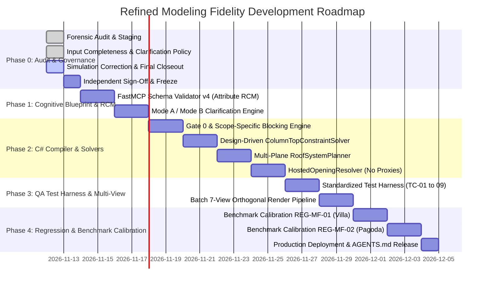

# AIGRAV — MODELING FIDELITY IMPLEMENTATION PLAN
**Document ID:** AIGRAV-PLAN-MF0-05  
**Status:** MF0_READY_FOR_INDEPENDENT_REVIEW  
**Date:** 2026-11-12  
**Target Platform:** Autodesk Revit 2026 / .NET 10 / C# Revit Bridge / FastMCP Python  
**Staging Path:** `C:\AIGRAV\_governance_review\modeling_fidelity\MODELING_FIDELITY_IMPLEMENTATION_PLAN.md`  
**Classification:** MANDATORY ARCHITECTURAL SYSTEM DEVELOPMENT ROADMAP  

---

## 1. Executive Summary & Architecture Roadmap

This document establishes the technical roadmap to implement the two-stage reference-to-BIM architecture across FastMCP Python and C# Revit Bridge, enforcing the **Strict Input Completeness & User Clarification Policy** (`AIGRAV-POL-MF0-02`).

The system is built upon three coordinated tiers:
1. **Tier 1: Cognitive Analysis & Clarification Engine (Python FastMCP):**  
   Evaluates project inputs under Mode A (Complete) or Mode B (Incomplete), evaluates attribute-level source confidence, supports **independent package-level maturity selection** (Architecture, Structure, MEP), manages the **Requirement Completeness Matrix (RCM)** across five distinct status dimensions, enforces the Conceptual Dimensional Confidence Protocol, executes the Approval State Machine, and generates the validated Blueprint JSON (`AIGRAV-SPEC-MF0-03`).
2. **Tier 2: BIM Semantic Compiler & Dependency Solvers (C# Revit Bridge):**  
   Executes deterministic Revit write transactions only when state is `MODELING_AUTHORIZED`. Enforces scope-specific blocking across the five discrete dependency types (`PHYSICAL_SUPPORT`, `REVIT_HOST`, `DATUM_AND_CONSTRAINT`, `MODELING_EXECUTION_ORDER`, `VALIDATION`), evaluates conditional activating prerequisites, and executes design-driven solvers (`ColumnTopConstraintSolver`, `RoofSystemPlanner`, and `HostedOpeningResolver`).
3. **Tier 3: Independent Multi-Gate QA/QC Validator (Python/C#):**  
   Enforces Gate 0 (Clarification Completeness) and Gates A through E, batch-exports 7 views, executes the mandatory acceptance test cases (`TC-MF-XX-01` to `TC-MF-XX-09` including `TC-MF-XX-09A/B/C`), and emits the formal disposition using the standardized verdict taxonomy.

---

## 2. Updated Core Solvers & Architectural Engine Specifications

### 2.1 The Clarification & Approval State Machine Engine (Tier 1)
*Objective:* Manage the transition from raw reference inputs through completeness checking, user clarification, and explicit blueprint approval, supporting package-level maturity independence and dimensional uncertainty tracking.

```python
# Algorithmic Specification: blueprint_clarification_engine.py
from enum import Enum
from typing import List, Dict, Tuple, Optional

class ApprovalState(str, Enum):
    REFERENCE_ANALYSIS = "REFERENCE_ANALYSIS"
    MATURITY_AND_SCOPE_CHECK = "MATURITY_AND_SCOPE_CHECK"
    REQUIREMENT_COMPLETENESS_CHECK = "REQUIREMENT_COMPLETENESS_CHECK"
    CLARIFICATION_REQUIRED = "CLARIFICATION_REQUIRED"
    USER_RESPONSE = "USER_RESPONSE"
    BLUEPRINT_REVISION = "BLUEPRINT_REVISION"
    COMPLETENESS_REVALIDATION = "COMPLETENESS_REVALIDATION"
    BLUEPRINT_READY_FOR_REVIEW = "BLUEPRINT_READY_FOR_REVIEW"
    BLUEPRINT_APPROVED = "BLUEPRINT_APPROVED"
    MODELING_AUTHORIZED = "MODELING_AUTHORIZED"

class ModelMaturity(str, Enum):
    CONCEPTUAL_REFERENCE_MODEL = "CONCEPTUAL_REFERENCE_MODEL"             # Informative ref: LOD 100/200
    BIM_COORDINATION_MODEL = "BIM_COORDINATION_MODEL"                     # Informative ref: LOD 300
    CONSTRUCTION_DOCUMENTATION_MODEL = "CONSTRUCTION_DOCUMENTATION_MODEL" # Informative ref: LOD 350/400

class PackageMaturityProfile:
    def __init__(self, 
                 architecture: ModelMaturity,
                 structure: ModelMaturity,
                 mep: Optional[ModelMaturity] = None,
                 site: Optional[ModelMaturity] = None):
        self.architecture = architecture
        self.structure = structure
        self.mep = mep
        self.site = site

class RequirementCompletenessChecker:
    @staticmethod
    def evaluate_rcm(rcm_entries: List[Dict], maturity_profile: PackageMaturityProfile) -> Tuple[ApprovalState, List[Dict]]:
        blocked_requirements = []
        user_questions = []

        for req in rcm_entries:
            confidence = req.get("confidence_status")
            pkg = req.get("discipline_package", "architecture")
            target_maturity = getattr(maturity_profile, pkg, ModelMaturity.BIM_COORDINATION_MODEL)

            # Enforce hard rejection if documentation model is requested from 2D rendering
            if target_maturity == ModelMaturity.CONSTRUCTION_DOCUMENTATION_MODEL and req.get("is_2d_rendering_only", False):
                req["operational_status"] = "BLOCKED"
                req["blocking_reason"] = "Single 2D rendering cannot support Construction Documentation LOD."
                blocked_requirements.append(req)
                continue

            # Enforce attribute-level completeness check
            if confidence in ["DESIGN_INPUT_REQUIRED", "CONFLICTING_DESIGN_INPUT"]:
                req["operational_status"] = "BLOCKED"
                blocked_requirements.append(req)
                if req.get("user_question"):
                    user_questions.append(req["user_question"])
            elif confidence == "ASSUMED_PENDING_USER_APPROVAL" and not req.get("user_approved", False):
                req["operational_status"] = "BLOCKED"
                blocked_requirements.append(req)
                if req.get("user_question"):
                    user_questions.append(req["user_question"])
            elif req.get("has_unresolved_prerequisites", False):
                req["operational_status"] = "BLOCKED"
                blocked_requirements.append(req)
            elif req.get("all_prerequisites_resolved", False):
                req["operational_status"] = "MODEL_SCOPE_ELIGIBLE_PENDING_APPROVAL"
            else:
                req["operational_status"] = "OBSERVATION_COMPLETE"

        if user_questions:
            return ApprovalState.CLARIFICATION_REQUIRED, user_questions
        elif blocked_requirements:
            return ApprovalState.CLARIFICATION_REQUIRED, []
        else:
            return ApprovalState.BLUEPRINT_READY_FOR_REVIEW, []
```

---

### 2.2 The Design-Driven Column Termination Solver (`ColumnTopConstraintSolver`)
*Objective:* Calculate exact column top offsets based on explicit structural interfaces, eliminating unintended roof protrusions while preserving intentional structural columns without hardcoding member dimensions.

```csharp
// Algorithmic Specification: ColumnTopConstraintSolver.cs
public enum ColumnTerminationClassification
{
    INTENTIONAL_STRUCTURAL_CONNECTION,
    UNINTENDED_ROOF_PROTRUSION,
    UNRESOLVED_COLUMN_TERMINATION
}

public class ColumnTerminationResult
{
    public ElementId ColumnId { get; set; }
    public double CalculatedTopOffsetFeet { get; set; }
    public double TargetTopElevationFeet { get; set; }
    public ColumnTerminationClassification Classification { get; set; }
    public string DiagnosticNotes { get; set; }
}

public class ColumnTopConstraintSolver
{
    public static ColumnTerminationResult SolveColumnTermination(
        Document doc,
        FamilyInstance column,
        Level baseLevel,
        Level topLevel,
        double structuralInterfaceElevationMm,
        bool isIntentionalExtension = false)
    {
        double topLevelElevFeet = topLevel.Elevation;
        double targetTopElevFeet = UnitUtils.ConvertToInternalUnits(structuralInterfaceElevationMm, UnitTypeId.Millimeters);

        // Design-Driven Formula: TopOffset = TargetTopElevation - TopLevelElevation
        double calculatedTopOffsetFeet = targetTopElevFeet - topLevelElevFeet;

        column.get_Parameter(BuiltInParameter.FAMILY_BASE_LEVEL_PARAM)?.Set(baseLevel.Id);
        column.get_Parameter(BuiltInParameter.FAMILY_BASE_LEVEL_OFFSET_PARAM)?.Set(0.0);
        column.get_Parameter(BuiltInParameter.FAMILY_TOP_LEVEL_PARAM)?.Set(topLevel.Id);
        column.get_Parameter(BuiltInParameter.FAMILY_TOP_LEVEL_OFFSET_PARAM)?.Set(calculatedTopOffsetFeet);

        doc.Regenerate();

        BoundingBoxXYZ colBBox = column.get_BoundingBox(null);
        double actualTopZ = colBBox.Max.Z;
        double toleranceFeet = UnitUtils.ConvertToInternalUnits(25.0, UnitTypeId.Millimeters);

        ColumnTerminationClassification classification;
        string notes;

        if (isIntentionalExtension)
        {
            classification = ColumnTerminationClassification.INTENTIONAL_STRUCTURAL_CONNECTION;
            notes = "Intentional structural extension verified.";
        }
        else if (actualTopZ > targetTopElevFeet + toleranceFeet)
        {
            classification = ColumnTerminationClassification.UNINTENDED_ROOF_PROTRUSION;
            notes = $"FATAL: Column breaches target structural interface by {(actualTopZ - targetTopElevFeet) * 304.8:F1}mm.";
        }
        else
        {
            classification = ColumnTerminationClassification.INTENTIONAL_STRUCTURAL_CONNECTION;
            notes = "Column terminates cleanly at or below designated structural interface.";
        }

        return new ColumnTerminationResult
        {
            ColumnId = column.Id,
            CalculatedTopOffsetFeet = calculatedTopOffsetFeet,
            TargetTopElevationFeet = targetTopElevFeet,
            Classification = classification,
            DiagnosticNotes = notes
        };
    }
}
```

---

### 2.3 Scope-Specific Blocking Across Five Dependency Types (`RevitBimCompiler`)
*Objective:* Enforce execution locks on blocked elements across Physical Support, Revit Hosting, Datum Constraints, Execution Sequence, and Validation dependencies, evaluating activating conditions for conditional relationships.

```csharp
// Algorithmic Specification: RevitBimCompiler.cs
public enum DependencyType
{
    PHYSICAL_SUPPORT_DEPENDENCY,
    REVIT_HOST_DEPENDENCY,
    DATUM_AND_CONSTRAINT_DEPENDENCY,
    MODELING_EXECUTION_ORDER,
    VALIDATION_DEPENDENCY
}

public class ElementDependency
{
    public string SourceId { get; set; }
    public DependencyType Type { get; set; }
    public bool IsConditional { get; set; }
    public string ActivatingCondition { get; set; }
}

public class RevitBimCompiler
{
    public static void ExecuteMilestoneBuild(
        Document doc, 
        ArchitecturalBlueprint blueprint, 
        string milestoneId)
    {
        // 1. Verify Global Modeling Authorization
        if (blueprint.ApprovalState != ApprovalState.MODELING_AUTHORIZED)
        {
            throw new UnauthorizedModelingException(
                $"Gate 0 Hard Reject: Cannot begin Revit transactions. Blueprint approval state is '{blueprint.ApprovalState}', must be 'MODELING_AUTHORIZED'.");
        }

        // 2. Iterate elements and enforce scope blocking across all 5 dependency types
        foreach (var elementSpec in blueprint.GetElementsForMilestone(milestoneId))
        {
            if (blueprint.BlockedElements.Contains(elementSpec.Id))
            {
                throw new BlockedElementScopeException(
                    $"Gate 0 Scope Violation: Element '{elementSpec.Id}' is currently BLOCKED pending unresolved dependencies. Generic geometry substitution is prohibited.");
            }

            // Verify dependency graph integrity including conditional triggers
            foreach (var dep in elementSpec.Dependencies)
            {
                if (dep.IsConditional && !blueprint.IsConditionActive(dep.ActivatingCondition))
                {
                    continue; // Skip inactive conditional branch
                }

                if (!blueprint.IsDependencySatisfied(dep))
                {
                    throw new UnresolvedDependencyException(
                        $"Dependency Violation: Element '{elementSpec.Id}' depends on '{dep.SourceId}' via {dep.Type}. Source is not yet resolved.");
                }
            }

            // Proceed with native element construction
            BuildNativeElement(doc, elementSpec);
        }
    }
}
```

---

### 2.4 The Multi-Plane Native Roof Planner (`RoofSystemPlanner`)
*Objective:* Construct compound sloped roof assemblies with fascia and soffit, eliminating crude single flat slabs.

```csharp
// Algorithmic Specification: RoofSystemPlanner.cs
public class RoofSystemPlanner
{
    public static RoofSystemResult BuildRoofSystem(
        Document doc,
        Level roofLevel,
        CurveLoop footprintBoundary,
        double slopeDegrees,
        double overhangMm,
        RoofType mainRoofType,
        FamilySymbol fasciaSymbol = null,
        FamilySymbol soffitSymbol = null)
    {
        // 1. Create native FootPrintRoof with slope
        ModelCurveArray curveArray = new ModelCurveArray();
        FootPrintRoof roof = doc.Create.NewFootPrintRoof(footprintBoundary, roofLevel, mainRoofType, out ModelCurveArray footPrintToModelCurveMapping);

        // Set slope on designated perimeter eave curves
        foreach (ModelCurve mc in footPrintToModelCurveMapping)
        {
            roof.set_DefinesSlope(mc, slopeDegrees > 0);
            if (slopeDegrees > 0)
            {
                roof.set_SlopeAngle(mc, slopeDegrees * Math.PI / 180.0);
            }
        }

        doc.Regenerate();

        // 2. Add Fascia and Soffit components if specified in Blueprint
        return new RoofSystemResult { RoofId = roof.Id, IsMultiPlane = true };
    }
}
```

---

### 2.5 The Hosted Opening Resolver (`HostedOpeningResolver`)
*Objective:* Enforce native hosting for doors, windows, and curtain walls. Support both Basic Wall hosted families and Curtain Wall panel replacement. Strictly prohibit basic wall proxies.

```csharp
// Algorithmic Specification: HostedOpeningResolver.cs
public class HostedOpeningResolver
{
    // Mode A: Standard Basic Wall Hosted Insertion
    public static FamilyInstance InsertHostedDoor(
        Document doc,
        FamilySymbol doorSymbol,
        Wall hostWall,
        XYZ insertionPoint)
    {
        if (hostWall == null || !hostWall.IsValidObject)
            throw new InvalidHostException("Cannot place door without valid native Wall host.");

        if (hostWall.WallType.Kind == WallKind.Curtain)
            throw new InvalidHostException("Curtain Wall cannot host standard door instances; use ReplaceCurtainPanelWithDoor instead.");

        if (!doorSymbol.IsActive)
            doorSymbol.Activate();

        return doc.Create.NewFamilyInstance(insertionPoint, doorSymbol, hostWall, StructuralType.NonStructural);
    }

    // Mode B: Curtain Wall Panel Door Replacement
    public static Panel ReplaceCurtainPanelWithDoor(
        Document doc,
        Wall curtainWall,
        UV gridCellCoordinates,
        FamilySymbol curtainDoorSymbol)
    {
        CurtainGrid grid = curtainWall.CurtainGrid;
        if (grid == null)
            throw new InvalidOperationException("Curtain wall does not possess a valid CurtainGrid.");

        // Locate designated panel in grid and swap type
        Panel targetPanel = grid.GetPanel(gridCellCoordinates);
        targetPanel.ChangeTypeId(curtainDoorSymbol.Id);
        return targetPanel;
    }
}
```

---

## 3. Phased Implementation Roadmap



---

## 4. Test Harness Integration: Acceptance Tests `TC-MF-XX-01` to `09`

The QA validation suite incorporates the mandatory test cases evaluated under the standardized verdict taxonomy:

| Test ID | Test Focus | Method of Verification | Expected Verdict in Phase 0 Simulation |
|---|---|---|---|
| **TC-MF-XX-01** | Incomplete Roof Info | Mock single-view image with occluded roof $\to$ verify system halts and emits consolidated roof question. | **`PASS_TABLETOP`** |
| **TC-MF-XX-02** | Structural System Guessing | Mock unstated column grid $\to$ verify columns are blocked without unsupported sizing recommendations. | **`PASS_TABLETOP`** |
| **TC-MF-XX-03** | Complete Design Inputs | Provide complete CAD drawings and specs $\to$ verify Mode A executes without asking redundant questions. | **`NOT_EXECUTED`** |
| **TC-MF-XX-04** | Conflicting Dimensions | Inject conflicting plan vs elevation dimensions $\to$ verify `CONFLICTING_DESIGN_INPUT` halts affected bay. | **`NOT_APPLICABLE`** |
| **TC-MF-XX-05** | Traceable Assumptions | Approve rear facade via user response $\to$ verify approved assumption logged in parameter `Comments`. | **`NOT_EXECUTED`** |
| **TC-MF-XX-06** | Scope Blocking in DAG | Authorize Structure while Roof is blocked $\to$ verify compiler builds columns but throws exception if roof is called. | **`PASS_TABLETOP`** |
| **TC-MF-XX-07** | Blueprint Revalidation | Submit user answers $\to$ verify state machine transitions through `BLUEPRINT_REVISION` and updates JSON. | **`NOT_EXECUTED`** |
| **TC-MF-XX-08** | Explicit Blueprint Approval | Put Blueprint in `BLUEPRINT_READY_FOR_REVIEW` $\to$ verify zero Revit transactions occur until explicit approval. | **`PASS_TABLETOP`** |
| **TC-MF-XX-09A** | Maturity Subcase A: Conceptual & Dimensional Confidence | Evaluate single image targeting `CONCEPTUAL_REFERENCE_MODEL` $\to$ verify footprint confirmation emitted, massing eligible upon confirmation; enforces strict uncertainty protocol (inferred dimensions never promoted to `PROJECT_INPUT_VERIFIED`). | **`PASS_TABLETOP`** |
| **TC-MF-XX-09B** | Maturity Subcase B: Coordination | Evaluate single image targeting `BIM_COORDINATION_MODEL` $\to$ verify 10 subsystems blocked, non-leading Q0–Q8 emitted, 14-edge conditional DAG evaluated, zero Revit transactions. | **`PASS_TABLETOP`** |
| **TC-MF-XX-09C** | Maturity Subcase C: Documentation | Evaluate single image requesting `CONSTRUCTION_DOCUMENTATION_MODEL` $\to$ verify immediate hard halt / refusal due to insufficient input data. | **`PASS_TABLETOP`** |

---

## 5. Execution Governance & Approval Boundary

In accordance with strict system boundaries:
- **No production code is modified or compiled in this phase.**
- This implementation plan remains staged in `C:\AIGRAV\_governance_review\modeling_fidelity\`.
- Implementation of Phase 1 may only commence upon formal independent sign-off of Phase 0.

---
*End of Refined Deliverable 5 — Modeling Fidelity Implementation Plan is Staged for Independent Review (`MF0_READY_FOR_INDEPENDENT_REVIEW`).*
