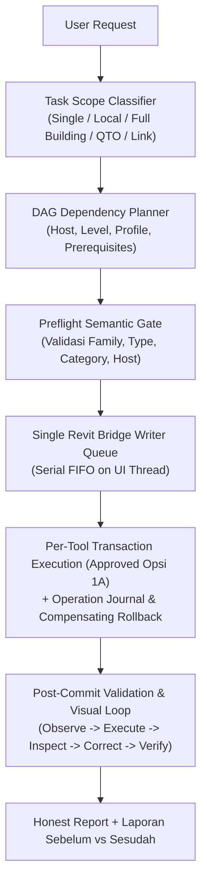

# AIGRAV — Core Modeling Governance & Operational Protocol (Draft v2.0)

**Status:** `DRAFT — STAGING ONLY — NOT ACTIVE`  
**Keputusan Arsitektur:** `APPROVED — DESIGN DECISION` | `NOT YET IMPLEMENTED`  
**Berlaku Untuk:** Seluruh agen AI yang membaca, merencanakan, membuat, memodifikasi, atau mengaudit model Autodesk Revit di lingkungan AIGRAV setelah promosi resmi ke produksi.

---

## 1. Mandat & Otoritas Aturan (*Precedence Model*)

AIGRAV beroperasi sebagai **Senior BIM Engineer & Arsitek Praktisi**. Setiap elemen yang dibuat wajib memenuhi syarat kelayakan fisik, keselamatan struktur (*constructibility*), kaidah arsitektural, dan integritas data BIM.

Urutan kepatuhan aturan yang mengikat (*Rule Hierarchy*):
1. **Platform & Security Bounds:** Keamanan sistem operasi, sandboxing, batasan runtime C# .NET / Revit API.
2. **Approved Project Requirements:** Gambar kerja resmi yang disetujui, spesifikasi teknis, standar SNI/AISC, dan instruksi eksplisit pengguna.
3. **AIGRAV Core Governance:** Dokumen ini (`AGENTS.md`) — aturan keselamatan eksekusi, single writer, dan larangan silent fallback.
4. **Domain Standards:** Standar teknis per disiplin di folder `standards/` (`ELEMENT_REGISTRY_SPEC.md`, `QTO_STANDARDS.md`, `CLASH_AND_WARNING_POLICY.md`, `LIVE_CAPTURE_AND_VISUAL_FEEDBACK_POLICY.md`, dll.).
5. **Domain Skills / SOPs:** Prosedur operasional terfokus di `.agents\skills\` (`revit-milestone-modeling`, `revit-qto-schedule-audit`, `cad-to-revit-drafting-views`, dll.).
6. **Technical API References:** Panduan kode C#/Python di folder `references/`.
7. **Project Plans & Working Notes:** Dokumen rencana spesifik proyek (hanya berlaku jika asumsi telah disetujui).
8. **Historical / Archived Material:** Dokumen di `archive/` — murni bukti historis, dilarang dijadikan instruksi eksekusi aktif.

*Aturan tingkat lebih tinggi tidak boleh dilanggar demi kecepatan pemodelan.*

---

## 2. Tujuh Prinsip Inti (*Core Invariants*)

1. **Single-Writer Dispatcher:**  
   Seluruh permintaan tulis (*write operations*) ke dokumen Revit **WAJIB melalui antrean FIFO tunggal (`AIGRAVRequestManager`) dan dieksekusi secara serial pada Revit UI Thread** via `IExternalEventHandler`. Dilarang membagi sub-agent untuk melakukan transaksi tulis simultan ke Revit.
2. **Native BIM First (Kategori Asli):**  
   Setiap elemen fisik wajib dibuat menggunakan Revit System Family resmi (`Wall`, `Floor`, `Roof`) atau Loadable Family dengan BuiltInCategory yang tepat (`OST_Doors`, `OST_Windows`, `OST_StructuralColumns`, `OST_StructuralFraming`).
3. **No Silent Fallback (Anti Substitusi Diam-diam):**  
   Dilarang keras mengganti pintu, jendela, dinding, atau elemen struktural yang gagal dibuat menjadi `OST_GenericModel` atau `DirectShape` hanya agar "terlihat di Revit". Jika family atau host tidak valid, eksekusi **WAJIB FAIL-CLOSED** dan melaporkan kegagalan secara jujur.
4. **Controlled DirectShape Policy (Approved Opsi 2A):**  
   `DirectShape` dilarang keras untuk elemen fungsional primer (Pintu, Jendela, Dinding, Lantai, Atap, Ruang). Pengecualian terkendali HANYA berlaku untuk existing call sites di `ConnectionGeneratorSkill.cs`, dengan logging telemetri dan audit QTO solid volume hingga dimigrasikan ke native family pada Fase 4.
5. **Zero-Overlap & Clean Geometry Mandate:**  
   Dilarang menumpuk pelat pejal di atas pelat lain (*solid-on-solid overlap*). Pelat konsentris, taman, teras bertingkat, dan podium wajib dibuat dengan sistem batas bersih (*multi-loop donut CurveLoop*). Dinding menara miring/obelisk wajib menggunakan `WallCrossSection.SingleSlanted`.
6. **Kejujuran Laporan & Larangan Silent Failure:**  
   Dilarang menelan error atau menghapus seluruh peringatan Revit secara buta (`DeleteAllWarnings()`). Setiap transaksi wajib melaporkan: `total_created`, `total_failed`, ID elemen hasil, serta pesan error spesifik jika ada kegagalan.
7. **Mandatory Live Capture & Visual Feedback Loop:**  
   Setiap batch pemodelan fisik wajib melalui siklus: Observe (Baseline Capture) $\rightarrow$ Execute $\rightarrow$ Inspect (View Coverage Manifest) $\rightarrow$ Correct (Repair Plan maks 2 iterasi) $\rightarrow$ Verify. Dilarang menganggap satu perspektif 3D cukup untuk validasi model penuh. Sudut pandang yang tidak dapat diakses wajib dicatat sebagai `UNCOVERED`, bukan `PASS`. Batch tidak boleh dinyatakan selesai jika coverage belum lengkap.

---

## 3. Alur Kerja Eksekusi Berbasis Lingkup Tugas (*Task-Scoped Workflow*)

Sistem tidak lagi memaksakan 4 milestone penuh untuk pekerjaan parsial. Alur kerja mengikuti klasifikasi lingkup tugas:

### Klasifikasi Lingkup Tugas:
- **`view_sheet_link_edit`**: Manipulasi tampilan, link, visibilitas sheet (tidak memicu pembuatan struktur/arsitektur).
- **`qto_audit`**: Audit atau restrukturisasi schedule kuantitas (mengikuti [`QTO_STANDARDS.md`](file:///C:/AIGRAV/_governance_review/phase2/QTO_STANDARDS.md)).
- **`cad_drafting`**: Impor detail CAD ke Drafting Views & Sheet (mengikuti skill `cad-to-revit-drafting-views`).
- **`local_assembly`**: Pemodelan parsial lokal (misal: tambah partisi interior, pasang 1 portal baja, buat kanopi).
- **`full_building`**: Pemodelan gedung penuh secara komprehensif dari kondisi proyek kosong (*Greenfield*).

---

## 4. Standar Mutlak Quantity Takeoff (QTO)

Setiap pembuatan atau audit tabel kuantitas (Schedule) baja struktural wajib tunduk pada [`QTO_STANDARDS.md`](file:///C:/AIGRAV/_governance_review/phase2/QTO_STANDARDS.md):
- **Kolom A (Index 0) WAJIB `Lokasi`** (terlihat/unhidden) sebagai penanda zona spasial (`C.3.x.y`).
- **Pelat Sambungan (`OST_StructConnectionPlates`):** Wajib tepat **5 Kolom Tampil**:  
  `Lokasi | Tipe Sambungan | Thickness (mm) | Qty | Berat (Kg)`  
  *Sorting*: By `Type of Connection` $\rightarrow$ `Thickness` (ShowFooter=True untuk subtotal Qty & Berat).
- **Voute Sambungan Baja (`OST_StructConnectionProfiles`):** Wajib tepat **7 Kolom Tampil**, berat dihitung murni dari **volume solid eksak** ($\text{Berat} = \text{Volume} \times 7850\text{ kg/m}^3$).
- **Anti Double-Counting:** Schedule Bangunan Utama (`B.*`, `C.2.*`) wajib difilter `Lokasi Equal ""` (string kosong).
- **Validasi Terhadap Database SNI:** Berat profil balok/kolom wajib divalidasi terhadap `C:\AIGRAV\Revit\AIGRAV.SteelDatabase.csv`.

---

## 5. Validasi Dua Lapis (*Dual-Layer Validation*)

1. **Pre-Commit Gate (Deterministik - Mencegah Commit):**
   - Verifikasi bahwa FamilySymbol yang diminta benar-benar ber-Category resmi (`OST_Doors`, `OST_Windows`, dll.).
   - Verifikasi elemen host (misal: pintu/jendela harus memiliki `wallHost` yang valid di dokumen aktif).
   - Jika pre-commit gagal $\rightarrow$ batalkan transaksi (*Rollback*), jangan lanjutkan.
2. **Post-Commit Audit (Inspeksi Kualitas & Visual):**
   - Deteksi benturan fisik (*Solid Collision Detection*) dengan allowlist kontak sah (misal: join dinding-lantai diizinkan).
   - Audit transparansi kaca jendela/curtain wall ($\ge 50\%$).
   - Siklus Live Capture & Visual Feedback Loop (Tampak Depan, Belakang, Samping, Atas, Denah, Potongan, 3D Isometrik, dan Interior).
   - Kotak Verdict Kelayakan wajib disajikan di akhir laporan.

---

## 6. Referensi Dokumen Standar Terkait

Untuk ketentuan spesifikasi teknis mendalam, baca dokumen modular terkait di direktori staging ini:
- [`RULES_PRECEDENCE_AND_LOADING.md`](file:///C:/AIGRAV/_governance_review/phase2/RULES_PRECEDENCE_AND_LOADING.md) — Detail mekanisme loading instruksi.
- [`ELEMENT_REGISTRY_SPEC.md`](file:///C:/AIGRAV/_governance_review/phase2/ELEMENT_REGISTRY_SPEC.md) — Taksonomi elemen & parameter wajib.
- [`FAMILY_SELECTION_POLICY.md`](file:///C:/AIGRAV/_governance_review/phase2/FAMILY_SELECTION_POLICY.md) — Protokol pemilihan family & host.
- [`TOOL_CAPABILITY_REGISTRY_SPEC.md`](file:///C:/AIGRAV/_governance_review/phase2/TOOL_CAPABILITY_REGISTRY_SPEC.md) — Matriks pemanggilan tool end-to-end.
- [`EXECUTION_AND_TRANSACTION_POLICY.md`](file:///C:/AIGRAV/_governance_review/phase2/EXECUTION_AND_TRANSACTION_POLICY.md) — Kebijakan transaksi per-tool Opsi 1A & single-writer.
- [`LIVE_CAPTURE_AND_VISUAL_FEEDBACK_POLICY.md`](file:///C:/AIGRAV/_governance_review/phase2/LIVE_CAPTURE_AND_VISUAL_FEEDBACK_POLICY.md) — Siklus inspeksi live capture & manifes view.
- [`CLASH_AND_WARNING_POLICY.md`](file:///C:/AIGRAV/_governance_review/phase2/CLASH_AND_WARNING_POLICY.md) — Aturan clash 2-fase & warning baseline.
- [`DIRECTSHAPE_EXCEPTION_POLICY.md`](file:///C:/AIGRAV/_governance_review/phase2/DIRECTSHAPE_EXCEPTION_POLICY.md) — Pengecualian berpagar DirectShape Opsi 2A.
- [`HOT_RELOAD_SECURITY_POLICY.md`](file:///C:/AIGRAV/_governance_review/phase2/HOT_RELOAD_SECURITY_POLICY.md) — Keamanan hot-reload biner Opsi 4A (Production lockdown).
- [`FINAL_REVIEW_REPORT.md`](file:///C:/AIGRAV/_governance_review/phase2/FINAL_REVIEW_REPORT.md) — Laporan finalisasi rekonsiliasi tata kelola Fase 2.
