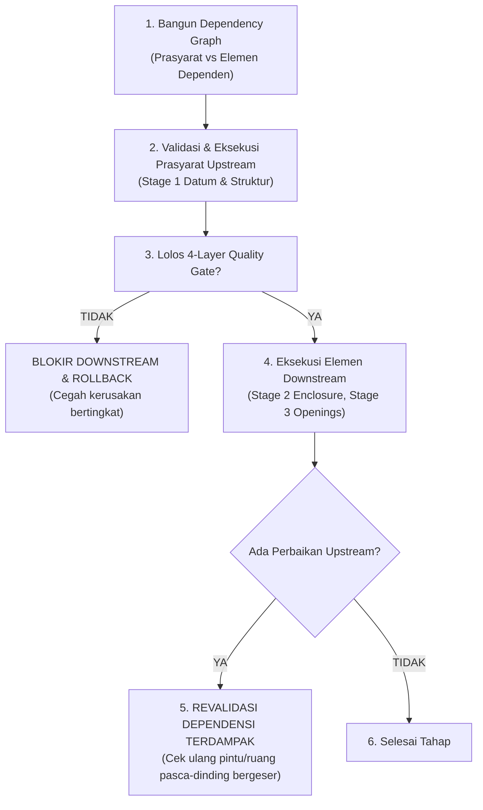

# AIGRAV BIM Semantic & Architectural Quality Validation Standard (Revised Specification)

**Status:** `DRAFT — STAGING ONLY — NOT ACTIVE`  
**Keputusan Arsitektur:** `APPROVED — DESIGN DECISION` | `NOT YET IMPLEMENTED`  
**Tujuan Dokumen:** Menetapkan standar validasi kualitas pemodelan BIM 4-lapisan (*Mandatory 4-Layer Quality Gates*) untuk setiap tahap pemodelan (*per-stage quality gates*), mengintegrasikan siklus validasi visual tertutup (*Observe → Execute → Inspect → Correct → Verify*), menegakkan integritas dependensi antar-elemen (*dependency-aware validation*), dan menyatakan secara tegas bahwa respon API sukses atau Element ID saja bukan bukti penyelesaian yang sah.

---

## 1. Prinsip Fundamental: Elemen ID Sukses $\neq$ Kelayakan Arsitektur

> [!CRITICAL] PERNYATAAN PENOLAKAN KLAIM PALSU (API SUCCESS $\neq$ ACCEPTANCE)
> Sebuah respon sukses dari Revit API, pengembalian kode HTTP 200, atau terciptanya sebuah `ElementId` integer baru **BUKAN BUKTI PENYELESAIAN PEMODELAN ARSITEKTUR**.  
> Sistem **DILARANG MENYATAKAN SELESAI** jika elemen hanya berwujud geometri di ruang kosong namun cacat secara semantik, salah meletakkan host, melanggar irama fasad, menabrak jalur sirkulasi, atau menyisakan artefak visual.

Pemodelan dinyatakan selesai dan sah **HANYA JIKA** telah lulus secara deterministik melalui **Empat Lapisan Gerbang Kualitas Mandiri (4 Independent Validation Layers)** di setiap tahapannya.

---

## 2. Empat Lapisan Gerbang Kualitas Per-Tahap (*Mandatory Per-Stage 4-Layer Quality Gates*)

Setiap tahap pemodelan (*Stage 0 s/d Stage 7*) wajib melewati 4 lapisan validasi independen:

```
[LAPISAN A: BIM Semantic Validation]
   └── Kategori resmi Revit (BuiltInCategory invariance)
   └── Kelas family & tipe parametrik sah (System / Loadable / Adaptive)
   └── Validasi host aktual (Instance.Host.Id == TargetHost.Id)
   └── Kelengkapan parameter wajib & zero unapproved generic fallbacks
          │
          ▼
[LAPISAN B: Geometric Validation]
   └── Konsistensi dimensi (mm & feet internal)
   └── Keterikatan garis sumbu (Alignment to Levels & Grids)
   └── Konektivitas & tumpuan struktural menerus
   └── Geometri bersih: kurva tertutup, non-self-intersecting, zero solid overlaps (Donut Slabs)
          │
          ▼
[LAPISAN C: Architectural Validation]
   └── Keselarasan terhadap maksud desain (Design Intent Fidelity)
   └── Proporsi estetika & rasio dimensional (H/W ratios)
   └── Konsistensi irama fasad (Façade Rhythm & Bay Spacing deviasi <= ±5 mm)
   └── Kelayakan konstruksi (Constructibility) & tinggi bebas (Headroom >= 2.20 m)
   └── Kejelasan transisi vertikal (Podium - Tower - Crown articulation)
          │
          ▼
[LAPISAN D: Live Visual Validation]
   └── Observe: Penangkapan baseline sebelum batch dibuka
   └── Inspect: Pemeriksaan tangkapan layar multi-view sesuai View Coverage Manifest
   └── Identifikasi cacat visual: Z-fighting, pergeseran bidang, tembus pandang kaca
   └── Correct: Penyusunan Repair Plan terstruktur & eksekusi perbaikan (maks 2 iterasi)
   └── Verify: Re-capture seluruh view terdampak, zero UNCOVERED mandatory views
```

---

### Lapisan A: BIM Semantic Validation (Integritas Objek & Parameter)
- **Category Invariance:** Elemen wajib ber-kategori resmi sesuai fungsinya (`OST_Walls`, `OST_StructuralColumns`, `OST_StructuralFraming`, `OST_Floors`, `OST_Roofs`, `OST_Doors`, `OST_Windows`, `OST_Rooms`, `OST_DuctCurves`, `OST_PipeCurves`).
- **Host Integrity:** Untuk elemen ber-host (pintu, jendela, opening), sistem memverifikasi `instance.Host != null` dan mengarah pada ID host dinding yang valid di dokumen yang sama.
- **Parameter Completeness:** Parameter instans/tipe wajib (lebar, tinggi, ambang, material, elevasi) terisi dengan tipe data yang benar.
- **Anti-Fallback Enforcement:** Jika family yang diminta tidak ditemukan, sistem menolak transaksi (*Fail-Closed*); dilarang keras mengalihkan ke `OST_GenericModel` atau `DirectShape`.

---

### Lapisan B: Geometric Validation (Presisi Spasial & Hubungan Kontak)
- **Dimensi & Toleransi Spasial:** Koordinat dan elevasi terikat pada datum level/grid dengan toleransi ketat ($< 1.0\text{ mm}$).
- **Konektivitas Struktur:** Kolom memiliki tumpuan menerus vertikal ke bawah (*no floating columns*); balok bertumpu pada kolom atau girder (*continuous load path*).
- **Pembedaan Sambungan BIM Sah vs Interseksi Tak Disengaja:**  
  * *Sambungan BIM Sah Disetujui:* Pertemuan monolitik kolom-balok beton cor di tempat via `JoinGeometryUtils`, tumpuan pelat-dinding dengan prioritas core, perlekatan dinding ke atap (`Wall.Attach`), dan baseplate/angkur tertanam. Volume join tervalidasi tidak menghasilkan double-counting.
  * *Interseksi Tak Disengaja Dilarang:* Pelat lantai sebidang yang saling tumpang tindih (*coplanar overlapping floors*) dilarang keras karena memicu Z-fighting dan benturan QTO (wajib menggunakan multi-loop `CurveLoop` donut slabs); dinding ganda sejajar (*duplicate collinear walls*) dan penetrasi pipa/duct tanpa sleeve resmi ditolak.
- **Sirkuit Batas Tertutup Ruang:** Pembuatan ruang (`OST_Rooms`) wajib memvalidasi `room.GetBoundarySegments()` non-empty dan tertutup. Ruang terbuka/bocor wajib memicu rollback transaksi lokal (`ERR_ROOM_NOT_ENCLOSED`).

---

### Lapisan C: Architectural Validation (Kaidah Arsitektur, Proporsi & Estetika)
Validator bertindak sebagai **Lead BIM Engineer & Arsitek Senior**:
- **Proporsi & Skala Manusia:** Bukaan pintu, koridor, dan ruang hunian memenuhi proporsi ergonomis arsitektur.
- **Irama Fasad Berbasis Toleransi Terkonfigurasi (*Design-Driven Façade Rhythm*):**  
  Menghapus asumsi batas kaku universal. Evaluasi jarak antar-mullion atau as bukaan jendela diuji terhadap konfigurasi toleransi sistem fasad (`FacadeRhythmToleranceConfig`):
  * Unitized Curtain Wall: $\pm 2.0\text{--}3.0\text{ mm}$
  * Stick-Built Curtain Wall: $\pm 5.0\text{ mm}$
  * Precast Cladding: $\pm 6.0\text{--}10.0\text{ mm}$
  * Pasangan Bata / Hebel (*Punched Openings*): $\pm 10.0\text{--}15.0\text{ mm}$
  * Proyek Spesifik: Mengikuti nilai toleransi dokumen teknis (EIR/BEP) yang menimpa default screening.
- **Validasi Tinggi Bebas Berbasis Tipologi & Fungsi Ruang (*ClearanceRequirementMatrix*):**  
  Tinggi bebas di bawah dasar balok/plafon diuji terhadap matriks fungsi:
  * Hunian (Type 36): Ruang utama $\ge 2.40\text{--}2.60\text{ m}$ (lokal balok $\ge 2.20\text{ m}$); Kamar Mandi $\ge 2.10\text{--}2.20\text{ m}$.
  * Kantor Komersial: Ruang kerja terbuka $\ge 2.70\text{--}3.00\text{ m}$; Lobi dasar $\ge 3.60\text{--}6.00\text{ m}$; Koridor $\ge 2.40\text{ m}$.
  * Industri / Gudang: Area operasional $\ge 4.50\text{--}8.00\text{ m}$; Loading dock $\ge 4.20\text{--}4.50\text{ m}$.
  * Tangga & Sirkulasi: Tinggi bebas vertikal tangga dari nosing $\ge 2.00\text{--}2.20\text{ m}$ (IBC 1011.3).
  * Basement / Parkir: Jalur kendaraan $\ge 2.10\text{--}2.40\text{ m}$.
- **Drainase Selubung Atap:** Kemiringan atap sesuai material ($\tan(\theta \times \pi / 180)$); teritisan overhang memadai; bebas kemiringan terbalik (*negative slope*).
- **Artikulasi Transisi Vertikal Kondisional:**  
  Persyaratan transisi tripartit (*Podium - Tower - Crown*) **HANYA BERLAKU UNTUK GEDUNG TINGGI (HIGH-RISE TOWER $\ge 8$ LANTAI)**. Untuk Hunian Type 36, evaluasi difokuskan pada elevasi lantai plinth terhadap muka tanah luar ($+0.20\text{--}+0.30\text{ m}$) dan teritisan atap; untuk bangunan industri, pada batas dinding plinth bata ke metal cladding.

---

### Lapisan D: Live Visual Validation (Cakupan Tampilan Relevan & Siklus Uji Gambar)
Menerapkan siklus 5 tahap:  
$$\text{Observe} \longrightarrow \text{Execute} \longrightarrow \text{Inspect} \longrightarrow \text{Correct} \longrightarrow \text{Verify}$$
1. **Observe:** Ambil gambar baseline (*Pre-Batch Baseline Capture*) sebelum transaksi dimulai.
2. **Execute:** Jalankan transaksi pemodelan dan catat ID ke jurnal operasi.
3. **Inspect (Applicable View Coverage):**  
   Setiap sudut pandang yang tercantum dalam *View Coverage Manifest* dievaluasi statusnya dengan tiga keadaan eksplisit:
   - `PASS`: Sudut pandang relevan (*applicable*), gambar sukses diekspor, elemen target berada di dalam frustum pandang, kriteria kualitas visual terpenuhi (transparansi kaca $\ge 50\%$, ketiadaan Z-fighting).
   - `FAIL`: Sudut pandang relevan, namun citra gagal diekspor, buram/kosong, atau terdeteksi cacat visual arsitektur.
   - `NOT_APPLICABLE`: Sudut pandang berada di luar lingkup tugas atau tidak relevan dengan tipologi bangunan (misal: crown elevation untuk Hunian Type 36, atau interior view untuk pekerjaan pondasi). Wajib menyertakan justifikasi tertulis.
   > [!IMPORTANT] INVARIAN CAKUPAN TAMPILAN
   > **SELURUH SUDUT PANDANG RELEVAN (APPLICABLE VIEWS) WAJIB DIPERIKSA DAN WAJIB BERSTATUS `PASS`**. Jika ada sudut pandang relevan yang `FAIL` atau `UNCOVERED`, status tugas diblokir (*BLOCKED_INCOMPLETE_VISUAL_COVERAGE*).
4. **Correct:** Jika ditemukan cacat visual atau geometris:
   - Susun **Repair Plan** terstruktur (elemen target, parameter koreksi, pergeseran koordinat).
   - Eksekusi perbaikan (maksimal 2 iterasi otomatis).
   - Ambil ulang (*Re-capture*) seluruh view yang terdampak perbaikan.
5. **Verify:** Konfirmasi bahwa seluruh applicable view berstatus `PASS` (zero `FAIL` / zero `UNCOVERED`).

---

## 3. Eksekusi Berbasis Dependensi (*Dependency-Aware Execution*)

Untuk menjamin keutuhan model dan menghindari kesalahan berantai (*cascading defects*):



1. **Penyusunan Dependency Graph Pra-Eksekusi:**  
   Sebelum pemodelan dimulai, orkestrator memetakan pohon ketergantungan (misal: Level $\rightarrow$ Grid $\rightarrow$ Pondasi $\rightarrow$ Kolom $\rightarrow$ Balok $\rightarrow$ Dinding $\rightarrow$ Bukaan $\rightarrow$ Ruang).
2. **Eksekusi Prasyarat Mendahului Elemen Dependen:**  
   Elemen induk/host (dinding) WAJIB selesai dimodelkan dan divalidasi sebelum elemen anak (pintu/jendela) ditempatkan.
3. **Pemblokiran Downstream Jika Upstream Gagal:**  
   Jika elemen hulu (*upstream*) gagal atau cacat pada salah satu dari 4 Quality Gate, eksekusi elemen hilir (*downstream*) **DIBLOKIR TOTAL**.
4. **Preservasi Tahap yang Telah Divalidasi:**  
   Tahap yang telah lulus validasi disimpan dalam kondisi terkunci dan tidak boleh dirombak oleh tahap berikutnya tanpa izin kompensasi resmi.
5. **Revalidasi Dependensi Terdampak Pasca-Perbaikan:**  
   Jika sebuah elemen hulu diperbaiki (misal: tebal atau posisi dinding bergeser), seluruh elemen dependen yang menempel padanya (pintu, jendela, dimensi, batas ruang) **WAJIB DIREVALIDASI ULANG** untuk memastikan tidak ada objek melayang atau bocor.
