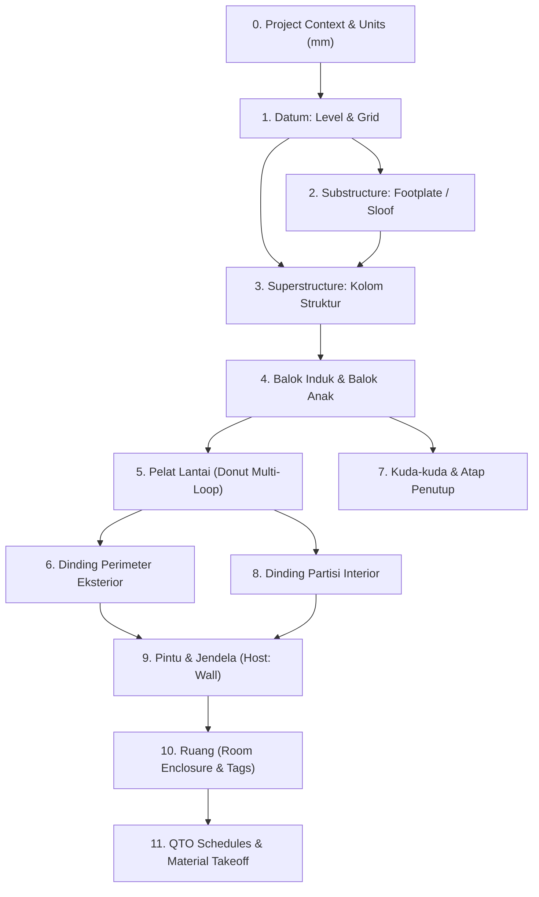

# AIGRAV Task Scope Classification & Dependency DAG Planning

**Status:** `DRAFT — STAGING ONLY — NOT ACTIVE`  
**Keputusan Arsitektur:** `APPROVED — DESIGN DECISION` | `NOT YET IMPLEMENTED`  
**Tujuan Dokumen:** Menggantikan pemaksaan 4 makro-milestone kaku dengan sistem klasifikasi lingkup tugas (*Task Scope Classifier*), graf dependensi dinamis (*Dependency DAG*), serta penetapan cakupan tangkapan layar wajib (*View Coverage Manifest*) yang proporsional dengan jenis pekerjaan.

---

## 1. Masalah pada Alur 4 Milestone Kaku

Pada arsitektur lama (`AGENTS.md` v1.0), pemodelan selalu dipaksa mengikuti urutan sekuensial linear:
$$\text{Milestone 1 (Struktur)} \longrightarrow \text{Milestone 2 (Selubung)} \longrightarrow \text{Milestone 3 (Partisi/Bukaan)} \longrightarrow \text{Milestone 4 (QTO)}$$

**Kelemahan Nyata di Lapangan:**
- Ketika pengguna hanya meminta: *"Ubah visibilitas Revit Links di sheet PORTAL"* atau *"Tambahkan 2 pintu interior di lantai mezzanine"*, sistem lama terbebani oleh instruksi wajib membuat pondasi, memeriksa tumpuan kolom, menghitung bentang balok, atau menghasilkan schedule baja.
- Tugas-tugas non-struktural atau perbaikan dokumentasi menjadi lambat, rumit, dan rentan salah fokus (*prompt overhead*).

---

## 2. Klasifikasi Lingkup Tugas & Cakupan View Wajib (*Task Scope & View Coverage*)

Sebelum merencanakan eksekusi, agen AI **WAJIB** mengklasifikasikan tugas ke dalam salah satu dari 6 kategori lingkup dan mematuhi batas cakupan visual yang diwajibkan:

| Kode Lingkup Tugas | Definisi & Contoh Skenario | Dokumen Standar Acuan | Cakupan View Wajib (*Mandatory View Coverage*) |
| :--- | :--- | :--- | :--- |
| **`view_sheet_link_edit`** | Modifikasi grafis view, visibilitas link model, crop box, penataan viewport pada sheet. | `BimAuditSkill.cs` | **1 View Target:** Tangkapan layar dari view atau sheet yang sedang dimanipulasi (Before & After). |
| **`qto_audit`** | Pembuatan, penataan ulang kolom, atau audit validasi tabel kuantitas schedule. | `QTO_STANDARDS.md` | **0 Geometri 3D:** Cukup data audit in-memory; jika schedule ditempatkan pada sheet, tangkap 1 view sheet. |
| **`cad_drafting`** | Ekstraksi detail CAD ModelSpace dan penataan pada Drafting View/Sheet Revit. | `cad-to-revit-drafting-views` | **2 View:** Drafting View hasil impor monokrom + Sheet akhir tempat viewport diletakkan. |
| **`single_element`** | Pembuatan/modifikasi 1 elemen tunggal (misal: buat 1 dinding, ubah tipe balok). | `FAMILY_SELECTION_POLICY.md` | **2 View:** 1 Denah/Tampak lokal elemen + 1 Perspektif 3D close-up terisolasi. |
| **`local_assembly`** | Pemodelan parsial lokal (misal: tambah partisi interior, pasang 1 portal baja, buat kanopi). | `ELEMENT_REGISTRY_SPEC.md` | **4 View:** Denah area lokal, Potongan lokal melintang, Tampak lokal, dan 3D isometrik terfokus. |
| **`full_building`** | Pemodelan gedung penuh secara komprehensif dari kondisi proyek kosong (*Greenfield*). | `revit-milestone-modeling` | **9 View Lengkap (Manifest Penuh):** Front, Rear, Left, Right, Roof/Top, Ground Plan, Section, 3D Isometric, Key Interior. |

> [!IMPORTANT] Larangan Asumsi Perspektif Tunggal pada Full-Building
> Untuk lingkup `full_building`, agen **DILARANG MENGANGGAP 1 PERSPEKTIF 3D CUKUP**. Seluruh 9 view dalam manifest wajib berhasil ditangkap dan diperiksa. View yang tidak dapat diakses wajib dicatat sebagai `UNCOVERED`, bukan `PASS`.

---

## 3. Perencanaan Graf Dependensi Dinamis (*Dependency DAG*)

Untuk tugas pemodelan konstruksi (`local_assembly` atau `full_building`), eksekusi elemen harus mematuhi graf prasyarat fisik (*physical dependency DAG*):

### Aturan Kunci Hubungan Dependensi:
1. **Host-First Rule:** Pintu (`OST_Doors`) dan Jendela (`OST_Windows`) **TIDAK BISA** dimasukkan ke dalam antrean eksekusi sebelum elemen Dinding Host (`OST_Walls`) selesai dibuat dan di-commit ke dalam dokumen.
2. **Support-First Rule:** Balok (`OST_StructuralFraming`) membutuhkan kolom tumpuan atau elevasi Level yang valid; pelat lantai (`OST_Floors`) membutuhkan elevasi Level dan perletakan balok/dinding perimeter.
3. **Enclosure-First Rule:** Ruang (`OST_Rooms`) hanya dapat ditempatkan jika batas perimeter dinding/pelat (*Room Bounding elements*) telah membentuk ruang tertutup sempurna.

---

## 4. Pencegahan Polusi Konteks (*Context Isolation*)

Dengan klasifikasi tugas di atas, agen yang mengeksekusi perintah manipulasi grafis (seperti `aigrav_execute_hide_portal_links`) dilarang memuat modul kalkulasi struktur baja, aturan bentang balok, atau skrip pembuatan pondasi. Isolasi konteks ini memastikan waktu respon cepat dan konsistensi instruksi tinggi.
