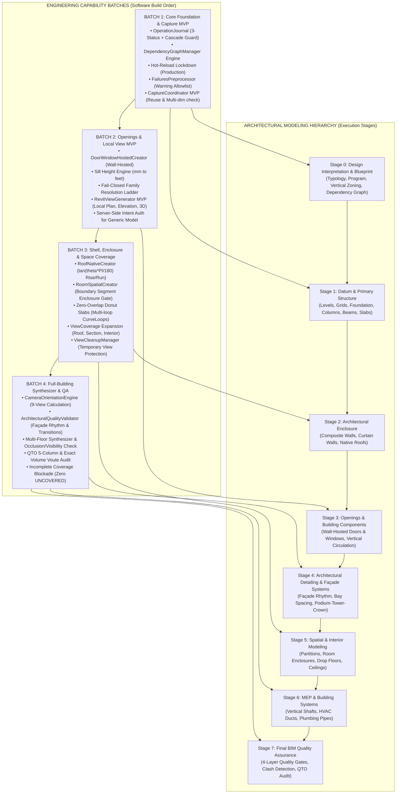

# AIGRAV Phase 3 Implementation Plan (Architectural Quality & Functional Fidelity Revised Blueprint)

**Status:** `GOVERNANCE_FROZEN — DOCUMENTATION_AUDIT_COMPLETE — POC_NOT_EXECUTED` (STRICT HOLD: NOT AUTHORIZATION TO CODE)  
**Tanggal Penyusunan:** 12 November 2026  
**Otoritas Perancang:** Lead BIM Engineer & Antigravity Autonomous Orchestrator  
**Lokasi Dokumen:** `C:\AIGRAV\_governance_review\phase2\PHASE3_IMPLEMENTATION_PLAN_REVISED.md`  
**Dokumen Pendamping & Referensi:**
- [`MODELING_HIERARCHY.md`](file:///C:/AIGRAV/_governance_review/phase2/MODELING_HIERARCHY.md) (Hierarki 8 Tahap & Standar Kualitas)
- [`FAMILY_SELECTION_POLICY.md`](file:///C:/AIGRAV/_governance_review/phase2/FAMILY_SELECTION_POLICY.md) (Pemilihan Family Fungsional)
- [`ELEMENT_REGISTRY_SPEC.md`](file:///C:/AIGRAV/_governance_review/phase2/ELEMENT_REGISTRY_SPEC.md) (Registri Elemen Baku)
- [`BIM_SEMANTIC_VALIDATION.md`](file:///C:/AIGRAV/_governance_review/phase2/BIM_SEMANTIC_VALIDATION.md) (4-Layer Quality Gates)
- [`LIVE_CAPTURE_AND_VISUAL_FEEDBACK_POLICY.md`](file:///C:/AIGRAV/_governance_review/phase2/LIVE_CAPTURE_AND_VISUAL_FEEDBACK_POLICY.md)
- [`ACCEPTANCE_TEST_MATRIX.md`](file:///C:/AIGRAV/_governance_review/phase2/ACCEPTANCE_TEST_MATRIX.md) (TC-01 s/d TC-45)
- [`PHASE3_PLAN_CONFLICT_AND_RISK_LOG.md`](file:///C:/AIGRAV/_governance_review/phase2/PHASE3_PLAN_CONFLICT_AND_RISK_LOG.md)
- [`EXECUTION_AND_TRANSACTION_POLICY.md`](file:///C:/AIGRAV/_governance_review/phase2/EXECUTION_AND_TRANSACTION_POLICY.md)
- [Review Addendum & Architectural Quality Mandate Artifacts](file:///C:/Users/sapuser/.gemini/antigravity/brain/d6d604bd-c0d6-42bb-92dd-0ab6b71e37d0/.user_uploaded/media_1794436843015_5f676aae.md)

---

## 1. Landasan Arsitektur & Core Invariants

Cetak biru implementasi Fase 3 ini menyempurnakan seluruh perencanaan teknis dengan memadukan **Koreksi Pemblokiran Fase 2 (Review Addendum)** dan **Mandat Kualitas Pemodelan Arsitektural & Fidelitas Fungsional (*Architectural Modeling Quality & Functional Fidelity Addendum*)**.

AIGRAV berevolusi dari sekadar pembuat geometri (*geometry-generation assistant*) menjadi **sistem pemodelan BIM disiplin (*disciplined BIM modeling system*)** yang mampu menghasilkan model Autodesk Revit yang koheren secara arsitektural, berdaya visual tinggi, dan tepat secara semantik.

### Sembilan Invarian Inti (Core Invariants):

1. **Geometric Completion $\neq$ Architectural Completion:**  
   Keberhasilan eksekusi API atau penerbitan `ElementId` oleh Revit DB kernel **BUKAN BUKTI** bahwa elemen selesai atau layak diterima. Model wajib memenuhi proporsi estetika, irama fasad (*façade rhythm*), logika struktural (*load path*), keselamatan ergonomis (*headroom clearances*), dan konstruktibilitas fisik.
2. **Hierarki Pemodelan 8 Tahap Berbasis Dependensi (Stage 0 s/d Stage 7):**  
   Pemodelan wajib mengikuti sekuens: *Stage 0 (Interpretation & Blueprint) $\rightarrow$ Stage 1 (Datum & Structure) $\rightarrow$ Stage 2 (Enclosure) $\rightarrow$ Stage 3 (Openings) $\rightarrow$ Stage 4 (Façade Detailing) $\rightarrow$ Stage 5 (Spatial & Interior) $\rightarrow$ Stage 6 (MEP Systems) $\rightarrow$ Stage 7 (Final QA)*.
3. **Seleksi Tahap Dinamis (Dynamic Stage Selection):**  
   Tahap pemodelan diaktifkan sesuai kebutuhan aktual tugas; sistem dilarang memaksakan tahap yang tidak relevan pada tugas parsial.
4. **Pemilihan Family Fungsional (Functional Family Selection):**  
   Setiap objek bangunan wajib menggunakan kategori Revit native resmi yang mencerminkan fungsi fisiknya: Dinding $\rightarrow$ `OST_Walls`, Kolom Portal $\rightarrow$ `OST_StructuralColumns`, Balok $\rightarrow$ `OST_StructuralFraming`, Pelat $\rightarrow$ `OST_Floors`, Atap $\rightarrow$ `OST_Roofs`, Pintu $\rightarrow$ `OST_Doors`, Jendela $\rightarrow$ `OST_Windows`, Ruang $\rightarrow$ `OST_Rooms`, Saluran Udara $\rightarrow$ `OST_DuctCurves`, Perpipaan $\rightarrow$ `OST_PipeCurves`. Generic Model dan DirectShape dilarang keras menjadi automatic fallback!
5. **Gerbang Kualitas 4-Lapisan Mandiri Per-Tahap (4-Layer Quality Gates):**  
   Setiap tahap wajib lolos:
   - **Lapisan A (Semantik):** Kategori, host, family class, tipe parameter sah, zero unapproved fallback.
   - **Lapisan B (Geometri):** Dimensi, level/grid alignment, konektivitas menerus, pembedaan sambungan BIM sah (*monolithic concrete joins, wall-floor priority*) vs interseksi tak disengaja (*coplanar overlapping slabs, collinear walls*).
   - **Lapisan C (Arsitektur):** Keselarasan desain, proporsi ($H/W$), irama fasad berbasis toleransi terkonfigurasi (`FacadeRhythmToleranceConfig`), tinggi bebas berbasis matriks tipologi & fungsi ruang (`ClearanceRequirementMatrix`), dan artikulasi transisi vertikal kondisional (podium-tower-crown untuk gedung tinggi dengan parameter pengujian terkonfigurasi `ProjectConfig.HighRiseThresholdFloors = 8`, terpisah dari klasifikasi yuridis hukum Indonesia pada PP No. 16 Tahun 2021, Pasal 9 ayat (6), jo. Lampiran bagian 5 — Ketinggian Bangunan Gedung yang menetapkan ambang batas jumlah lantai eksak $> 8$ lantai).
   - **Lapisan D (Visual Live Capture):** Baseline capture, manifest cakupan tampilan relevan (*Applicable View Coverage*: `PASS`, `FAIL`, `NOT_APPLICABLE`), deteksi cacat visual, repair plan (maks 2 iterasi), re-capture, zero UNCOVERED views.
6. **Single-Writer Dispatcher & Revit UI Thread:**  
   Seluruh transaksi tulis Revit API wajib dijalankan serial melalui antrean FIFO `AIGRAVRequestManager.cs` pada UI thread utama Revit melalui `RevitExternalEventHandler.cs`.
7. **Operation Journal 4-Kelas Mutasi & Compensating Rollback (Opsi 1A):**  
   Klasifikasi tegas 4 status mutasi:
   - `CREATED`: Dihapus dengan urutan topologis terbalik setelah simulasi dry-run dalam `SubTransaction` membuktikan **seluruh kaskade kembalian** `doc.Delete()` steril dari 4 kelas elemen terproteksi: (1) elemen dependen yang dipin pengguna (`element.Pinned == true`), (2) elemen pre-existing (`deletedSet.Overlaps(preExistingSet) == false`), (3) elemen modifikasi pengguna, dan (4) elemen dengan kepemilikan tidak dikenal (*unknown ownership*). Jika terdeteksi satu saja elemen terproteksi atau unknown, sistem membatalkan sub-transaksi via `subTrans.RollBack()`, menolak penghapusan riil, dan menerbitkan eskalasi aman `ERR_COMPENSATION_CASCADE_DETECTED`.
   - `MODIFIED`: Perekaman before-state property snapshot mendalam untuk parameter standar dan translasi linear $-\vec{\Delta}$ (didukung untuk parameter standar; sketch/compound layers tidak didukung).
   - `DELETED`: Rekonstruksi (*re-creation*) elemen dengan ElementId baru dan pemetaan identitas logis stabil (`AIGRAV_LOGICAL_ID` GUID via Extensible Storage). Tanpa klaim restorasi universal dari snapshot parameter/XYZ semata.
   - `NON_COMPENSABLE`: Menghentikan rollback otomatis dan beralih ke prosedur pemulihan manual terkendali. Dilarang keras melakukan reload file atau overwrite otomatis (`RELOAD_BASELINE_FROM_DISK`) pada model Revit Cloud Worksharing (BIM 360 / ACC) atau workshared central model. Rollback wajib dilaporkan secara jujur sebagai *Compensating Rollback* (bukan atomic rollback).
8. **Keamanan Hot-Reload Produksi (Opsi 4A):**  
   Hot-reload dinonaktifkan di mode produksi (`ERR_HOT_RELOAD_DISABLED_IN_PROD`); pembaruan DLL produksi wajib melalui restart proses Revit.
9. **Perlindungan Mutlak View Pengguna:**  
   View sementara sistem diberi metadata penanda `AIGRAV_VIEW_OWNER == "AIGRAV_AGENT"`. `ViewCleanupManager` dilarang keras menghapus, memotong, atau mengubah view buatan pengguna (*User-Authored Views*).

---

## 2. Pemetaan Kode Sumber Nyata (Real Codebase Audit & Mapping)

Berdasarkan audit fisik terhadap repositori C# di `C:\AIGRAV\Revit\AIGRAV.RevitBridge\` dan FastMCP di `C:\AIGRAV\MCP\TestServer\server.py`:

### 2.1. Modul yang DIPERTAHANKAN (PRESERVE)
| Berkas Sumber / Komponen | Peran & Tanggung Jawab | Alasan Teknis Dipertahankan |
| :--- | :--- | :--- |
| **`AIGRAVRequestManager.cs`** | Antrean thread-safe FIFO `ConcurrentQueue<AIGRAVRequest>` | Menjamin kepatuhan invarian Single-Writer Dispatcher ke Revit UI Thread. |
| **`RevitExternalEventHandler.cs`** | Handler serial Revit `IExternalEventHandler` | Memastikan seluruh pemanggilan Revit API berjalan 100% pada Main UI Thread. |
| **`AIGRAVHttpServer.cs`** | Listener HTTP Bridge lokal (port 8765) | Saluran komunikasi IPC berlatensi rendah antara FastMCP dan Revit Bridge. |
| **`BimAuditSkill.cs:26240, 29471`** | Schedule Pelat Sambungan Baja (`OST_StructConnectionPlates`) | Sudah benar mengimplementasikan tepat **5 kolom baku** (`Lokasi, Tipe Sambungan, Thickness, Qty, Berat`). |
| **`VouteProfileQTOSkill.cs:115`** | Schedule Voute Baja (`OST_StructConnectionProfiles`) | Mengambil profil voute dan mengkalibrasi berat dari **volume solid eksak** ($\text{Volume} \times 7850\text{ kg/m}^3$) dengan 7 kolom baku. |
| **`AIGRAV.SteelDatabase.csv`** | Database Profil Baja SNI & Gunung Garuda | Sumber kebenaran tunggal kalibrasi berat balok/kolom baja struktural. |
| **`ConnectionGeneratorSkill.cs:91, 109, 140`** | DirectShape Pelat Simpul Khusus Baja | Dipertahankan sementara di bawah *Controlled-Exception Opsi 2A* agar alur detailing sambungan baja eksisting tetap berjalan. |
| **`BimAuditSkill.SpatialCreators.cs`** | Pembuatan Level, Grid, Dinding Bata, Kolom, Balok, Pelat | Inti pembuatan elemen struktural/arsitektur native yang sudah bekerja dengan baik. |

---

### 2.2. Modul yang PERLU DIPERBAIKI / DI-REFACTOR (FIX / REFACTOR)
| Berkas Sumber & Lokasi | Masalah Teknis Nyata | Rencana Refactoring pada Fase 3 |
| :--- | :--- | :--- |
| **`BimAuditSkill.cs:14493`** | `failuresAccessor.DeleteAllWarnings()` menghapus seluruh warning baru secara buta (*blind suppression*). | **Ganti dengan Dua Lapisan Terpisah**: Pasang `IFailuresPreprocessor` dengan allowlist jinak di dalam transaksi; hitung delta penambahan warning dokumen (`Document.GetWarnings()` baseline diff) pasca-commit. |
| **`AIGRAVSkillLoader.cs:40`** | Memuat DLL dari disk secara dinamis tanpa verifikasi mode produksi atau tanda tangan biner. | **Terapkan Opsi 4A**: Nonaktifkan pemanggilan hot-reload di mode produksi (`ERR_HOT_RELOAD_DISABLED_IN_PROD`). Di mode dev, pasang dialog prompt persetujuan interaktif dan verifikasi checksum SHA-256. |
| **`BimAuditSkill.VisualAndPython.cs:18`** | `CaptureRevitViewportJson` hanya mengekspor 1 view aktif; `aigrav_inspect_model_visually` hanya mengumpulkan 3-4 view dokumen yang sudah ada secara pasif. | **Refactor ke Arsitektur 5 Komponen**: Pisahkan koordinasi, pembuatan view, orientasi kamera 3D, ekspor file, dan cleanup. Implementasikan penandaan status jujur (`PASS`, `FAIL`, `UNCOVERED`). |
| **`AIGRAVToolExecutor.cs:2153`** | Pemanggilan `place_family_instance` unhosted (`XYZ location`) gagal saat dipanggil untuk pintu/jendela ber-host dinding. | **Pisahkan Alur Hosted vs Unhosted**: Arahkan pembuatan pintu dan jendela ke endpoint khusus wall-hosted (`NewFamilyInstance` hosted overload); tolak keras fallback ke Generic Model. |
| **`HouseType36Builder.cs:180, 215`** | Memanggil `CreateDirectShapeBox` untuk demonstrasi kotak massa. | **Hapus Total Pemanggilan DirectShapeBox**: Refactor skrip demonstrasi tipe 36 agar murni menggunakan System Family `Wall` dan `Floor`. |
| **`AIGRAVToolExecutor.cs:522`** | `create_generic_model` dapat dipanggil secara bebas tanpa otorisasi intent. | **Pasang Server-Side Intent Authorization**: Tolak pembuatan Generic Model untuk kategori arsitektur inti; batasi hanya untuk use case yang terotorisasi eksplisit di server. |

---

### 2.3. Modul yang PERLU DIBUAT BARU (CREATE NEW)
| Nama Modul Baru | Bahasa & Proyek Target | Tanggung Jawab & Spesifikasi Teknis |
| :--- | :---: | :--- |
| **`DependencyGraphManager.cs`** | C# (`AIGRAV.RevitBridge`) | Mengelola pemetaan ketergantungan antar-tahap (Stage 0–7), memblokir eksekusi hilir (*downstream*) saat hulu (*upstream*) gagal, dan memicu revalidasi otomatis elemen dependen pasca-perbaikan. |
| **`OperationJournalManager.cs`** | C# (`AIGRAV.RevitBridge`) | Mengelola pencatatan operasi pemodelan dengan klasifikasi 4 status mutasi: `CREATED` (simulasi dry-run SubTransaction dengan inspeksi seluruh kaskade terhadap elemen pinned, pre-existing, user-modified, dan unknown ownership; pembatalan sub-transaksi dan penolakan aman jika kaskade tidak steril), `MODIFIED` (before-state snapshot + inverse handler linear), `DELETED` (re-creation attempt dengan pemetaan stable logical ID `AIGRAV_LOGICAL_ID` GUID, tanpa klaim restorasi universal), dan `NON_COMPENSABLE` (berhenti dan eskalasi manual aman, tanpa reload otomatis pada model workshared/cloud). Menyediakan `CompensatingRollback(taskId)`. |
| **`ArchitecturalQualityValidator.cs`** | C# (`AIGRAV.RevitBridge`) | Engine evaluasi Lapisan C: mengevaluasi konsistensi irama fasad ($\le \pm 5\text{ mm}$ deviasi), rasio proporsi bukaan ($H/W$), batas tinggi bebas (*clear headroom*), dan artikulasi transisi podium-menara-mahkota. |
| **`DoorWindowHostedCreator.cs`** | C# (`AIGRAV.Skills.BimAudit`) | Implementasi endpoint native `aigrav_create_door` dan `aigrav_create_window` via `doc.Create.NewFamilyInstance(location, symbol, hostWall, level, NonStructural)`. Validasi host, parameter sill, orientasi swing, dan cut void. |
| **`RoofNativeCreator.cs`** | C# (`AIGRAV.Skills.BimAudit`) | Implementasi endpoint native `aigrav_create_roof` via `doc.Create.NewFootPrintRoof`. Validasi kurva poligon tertutup planar, konversi rasio slope $\tan(\theta \times \pi / 180)$, dan overhang parametrik. |
| **`RoomSpatialCreator.cs`** | C# (`AIGRAV.Skills.BimAudit`) | Implementasi endpoint native `aigrav_create_room` via `doc.Create.NewRoom`. Validasi batas ruang via `GetBoundarySegments()`; rollback transaksi jika sirkuit batas terbuka/kosong (`ERR_ROOM_NOT_ENCLOSED`). |
| **`ViewCoverageCoordinator.cs`** | C# (`AIGRAV.RevitBridge`) | Koordinator pemilihan view yang wajib diambil berdasarkan tipe tugas dan *View Coverage Manifest* yang diselaraskan dengan tahap pemodelan aktif. Mengelola status `PASS`, `FAIL`, `UNCOVERED`, `NOT_APPLICABLE`. |
| **`RevitViewGenerator.cs`** | C# (`AIGRAV.RevitBridge`) | Pembuat view Revit native secara terprogram: `ViewPlan.Create`, `ElevationMarker.CreateElevationMarker` (static factory) + `marker.CreateElevation` (instance method), `ViewSection.CreateSection`, dan `View3D.CreateIsometric`. |
| **`CameraOrientationEngine.cs`** | C# (`AIGRAV.RevitBridge`) | Mesin kalkulasi vektor 3D (eye, target, up vector, bounding sphere, section box, crop box) untuk orientasi kamera isometrik dan perspektif interior/eksterior. |
| **`ViewCaptureExporter.cs`** | C# (`AIGRAV.RevitBridge`) | Eksekutor `doc.ExportImage()` dan validator kualitas citra multi-dimensi (PNG signature, dimensi $\ge 1280 \times 720$, blank/black frame detector, target visibility check). |
| **`ViewCleanupManager.cs`** | C# (`AIGRAV.RevitBridge`) | Pembersih view sementara berpenanda `AIGRAV_VIEW_OWNER == "AIGRAV_AGENT"`. Menjamin view buatan pengguna tidak tersentuh. |
| **`MepRoutingCreator.cs`** | C# (`AIGRAV.Skills.MEP`) | Pembuatan kurva dan routing saluran udara (`Duct.Create` / `OST_DuctCurves`) serta perpipaan plumbing (`Pipe.Create` / `OST_PipeCurves`) native pada namespace Autodesk.Revit.DB.Mechanical & Plumbing. |
| **`MEPDisciplineValidator.cs`** | C# (`AIGRAV.Skills.MEP`) | Validasi integritas semantik, konektivitas sistem MEP, ruang bebas plenum plafon, dan deteksi penetrasi benturan keras terhadap struktur (*clash detection*). |
| **`BimQTOAuditEngine.cs`** | C# (`AIGRAV.RevitBridge`) | Engine audit jadwal kuantitas lintas disiplin (Arsitektur, Struktur, MEP): penegakan format baku 5 kolom pelat baja, 7 kolom voute volume solid eksak ($\text{Volume} \times 7850\text{ kg/m}^3$), dan filter anti double-counting (`Lokasi`). |
| **FastMCP Tools Baru di `server.py`** | Python (`C:\AIGRAV\MCP\TestServer\`) | Mendaftarkan fungsi MCP untuk `aigrav_create_door`, `aigrav_create_window`, `aigrav_create_roof`, `aigrav_create_room`, dan integrasi telemetri 4-layer validation. |

---

## 3. Diagram Dependensi Terintegrasi (Hierarki 8 Tahap vs 4 Batch Eksekusi)

Diagram berikut memetakan hubungan ketergantungan logis antara **Hierarki Pemodelan Arsitektural (Stage 0 s/d Stage 7)** dengan **Batch Implementasi Rekayasa Perangkat Lunak (Batch 1 s/d Batch 4)**:



---

## 4. Rencana Implementasi Bertahap (Batch 1 s/d Batch 4)

---

### 🚀 BATCH 1: Core Foundation, Transaction Engine, Security & Capture MVP

#### A. Sasaran Teknis & Lingkup Pekerjaan:
1. **Pembangunan `OperationJournalManager.cs` & Compensating Rollback (Divalidasi via `POC-JOURNAL-01` & `POC-PERF-01`):**
   - Menyediakan struktur data thread-safe berbasis sesi untuk melacak seluruh mutasi elemen.
   - Mengelompokkan mutasi ke dalam **4 kelas mutasi**:
     * `CREATED`: Dihapus secara topologis terbalik setelah simulasi dry-run dalam `SubTransaction` terisolasi menginspeksi **seluruh kaskade kembalian** `doc.Delete()` dan membuktikannya bebas dari 4 kelas elemen terproteksi: (1) elemen dependen yang dipin pengguna (`element.Pinned == true`), (2) elemen pre-existing (`deletedSet.Overlaps(preExistingSet) == false`), (3) elemen modifikasi pengguna, dan (4) elemen dengan kepemilikan tidak dikenal (*unknown ownership*). Jika kaskade menyentuh salah satu elemen terproteksi/unknown, sub-transaksi di-rollback via `subTrans.RollBack()` dan compensating deletion riil ditolak aman.
     * `MODIFIED`: Perekaman before-state property snapshot mendalam untuk parameter standar (Double, Integer, String, ElementId) dan translasi spasial linear $-\vec{\Delta}$. Operasi perubahan sketch/boundary kompleks atau compound layers diklasifikasikan sebagai `NON_COMPENSABLE`.
     * `DELETED`: Serialisasi snapshot mendalam elemen eksisting; rekonstruksi (*re-creation*) elemen dengan ElementId baru dan pemetaan identitas logis stabil (`AIGRAV_LOGICAL_ID` GUID via Extensible Storage). Tanpa klaim restorasi universal dari parameter/XYZ semata (modifikasi sketch/compound/void yang hilang memerlukan intervensi manual).
     * `NON_COMPENSABLE`: Deteksi operasi destruktif/ireversibel atau kaskade tak terduga; sistem menghentikan rollback otomatis dan beralih ke protokol pemulihan manual terkendali. Dilarang keras menimpa atau me-reload model secara otomatis (`RELOAD_BASELINE_FROM_DISK`) pada Revit Cloud Worksharing (BIM 360 / ACC) atau model worksharing terpusat.
   - **Cascade Deletion Guard:** Memeriksa kembalian `ICollection<ElementId>` dari `doc.Delete()` dalam simulasi dry-run SubTransaction. Membatalkan proses rollback dan menerbitkan eskalasi darurat `ERR_COMPENSATION_CASCADE_DETECTED` jika terdeteksi ID elemen eksisting pra-batch, elemen pinned, elemen user-modified, atau elemen unknown ownership ikut terhapus.
   - **Protokol Benchmark Kinerja Empiris (`POC-PERF-01`):**
     * Klasifikasi 30 pengulangan pertama sebagai pengukuran rintisan (*pilot measurements*).
     * Pengujian formal $p_{95}$ wajib menggunakan sampel $N \ge 100$ iterasi dengan pemulihan keadaan baseline ekivalen (*baseline restoration*) per repetisi.
     * Nilai $T_{\text{base}} = 120\text{ ms}$ dan $k = 4.5\text{ ms/elemen}$ diperlakukan murni sebagai hipotesis awal. Ambang batas $T_{\text{acceptance}} = p_{95} \times 1.5$ memperlakukan pengali $1.5$ sebagai **faktor pengaman kebijakan yang dipilih secara sadar (*explicitly selected policy safety factor*)**, bukan murni turunan empiris.
   - Menegaskan pelaporan secara jujur sebagai *Compensating Rollback* (bukan atomic rollback).
2. **Pembangunan `DependencyGraphManager.cs` (Pondasi Stage 0):**
   - Memetakan pohon ketergantungan antar-tahap dan antar-elemen.
   - Menerapkan mekanisme pemblokiran eksekusi hilir (*downstream block*) jika elemen hulu (*upstream*) gagal divalidasi pada salah satu Quality Gate.
   - Menyediakan fungsi pelacakan dependensi terdampak (*impacted dependency tracking*) untuk memicu revalidasi otomatis saat elemen induk mengalami pergeseran/perbaikan.
3. **Penguncian Keamanan Hot-Reload (`AIGRAVSkillLoader.cs`):**
   - Menerapkan Opsi 4A: Pemuatan dinamis DLL dinonaktifkan di mode produksi (`ERR_HOT_RELOAD_DISABLED_IN_PROD`); pembaruan DLL produksi wajib melalui restart proses Revit.
   - Pada mode development, sertakan prompt persetujuan interaktif dan verifikasi checksum SHA-256.
4. **Pemisahan Penanganan Warning (`IFailuresPreprocessor` vs Baseline Diff):**
   - Hapus pemanggilan destruktif `failuresAccessor.DeleteAllWarnings()` pada `BimAuditSkill.cs:14493`.
   - Pasang `FailuresPreprocessorHandler` di dalam transaksi: hanya menyerap warning jinak terdaftar pada *Reviewed Allowlist*; kegagalan error membatalkan transaksi.
   - Bangun audit pasca-commit: Mengambil snapshot `doc.GetWarnings()` sebelum batch ($W_{\text{before}}$) dan setelah commit ($W_{\text{after}}$) untuk melaporkan delta warning baru ($\Delta W$).
5. **Live Capture Infrastructure MVP (`CaptureCoordinator.cs` & `ViewCaptureExporter.cs`):**
   - Bangun kontrak data `ViewCoverageManifest` dan `CaptureCoordinator`.
   - Menemukan dan menggunakan kembali view dokumen eksisting yang valid dalam model uji.
   - Ekspor baseline capture sebelum batch dan post-commit capture sesudah transaksi selesai.
   - Evaluasi kualitas citra multi-dimensi (header PNG valid, dimensi $\ge 1280 \times 720$, blank/black frame detector, target visibility check).
   - Mengelola status view: `PASS`, `FAIL`, `UNCOVERED`, `NOT_APPLICABLE`.

#### B. Acceptance Tests Batch 1:
- [x] **TC-08 (Warning Allowlist):** Warning kritis bertumpuk membatalkan transaksi; warning jinak diserap dan dicatat.
- [x] **TC-10 (Compensating Rollback Opsi 1A):** Kegagalan di tengah batch memicu kompensasi jujur (bukan atomic rollback).
- [x] **TC-15 (Production Hot-Reload Lockdown):** Pemanggilan reload di mode produksi ditolak; wajib restart Revit.
- [x] **TC-16 (Live Capture Baseline):** Tangkapan layar baseline tersimpan sebelum batch dieksekusi.
- [x] **TC-25 (Visual Clarity Gate Rejection):** Citra blank/rusak ditolak oleh validator kualitas.
- [x] **TC-31 (DELETED Journal Non-Compensable):** Operasi delete elemen eksisting berstatus non-compensable default.
- [x] **TC-32 (Cascade Deletion Guard):** Pendeteksian efek cascade saat penghapusan elemen mencegah kerusakan elemen eksisting.
- [x] **TC-34 (Multi-Dimensional Image Validity):** Citra sparse valid berukuran kecil diterima; citra besar tapi kosong ditolak.
- [x] **TC-38 (Dependency Graph Pre-Requisite Enforcement):** Kegagalan validasi elemen hulu memblokir eksekusi pemodelan hilir.

---

### 🚀 BATCH 2: Wall-Hosted Architectural Openings & Local View MVP (Stage 3 Focus)

#### A. Sasaran Teknis & Lingkup Pekerjaan:
1. **Pembangunan `DoorWindowHostedCreator.cs` di C# Bridge:**
   - Mengimplementasikan overload Revit API resmi untuk penempatan hosted family:
     ```csharp
     FamilyInstance instance = doc.Create.NewFamilyInstance(
         insertionPointXYZ, 
         familySymbol, 
         hostWall, 
         hostLevel, 
         StructuralType.NonStructural);
     ```
   - **Validasi Pra-Syarat Ketat (Preflight Assertions):**
     * Memastikan `familySymbol` berada di dokumen aktif dan memiliki kategori resmi (`OST_Doors` atau `OST_Windows`).
     * Memastikan placement/hosting type family kompatibel dengan dinding host.
     * Memastikan `hostWall` valid, tidak terhapus, bertipe `Wall`, dan berada pada dokumen yang sama.
     * Simbol diaktifkan via `symbol.Activate()` di dalam transaksi sebelum instance dibuat.
     * Titik penyisipan dihitung relatif terhadap garis lokasi dinding host dan origin family.
   - **Engine Penyetelan Parameter Sill Height Jendela:**
     * Konversi satuan wajib: $\text{sillHeightFeet} = \text{sillHeightMm} / 304.8$.
     * Algoritma lookup parameter bertingkat (cek BuiltInParameter bawaan, lalu nama parameter instan; validasi writable dan double storage type).
     * Jika parameter tidak tersedia/read-only, tangani secara aman tanpa crash dan laporkan warning terstruktur.
   - **Verifikasi Pasca-Regenerasi:**
     * Panggil `doc.Regenerate()`.
     * Verifikasi `instance.Host.Id == hostWall.Id`.
     * Verifikasi orientasi hand/facing, dimensi bukaan, dan pembentukan void bukaan dinding (*wall opening cut*).
2. **Local View Generation MVP (`RevitViewGenerator.cs` — Divalidasi via `POC-VIEW-01` & `POC-VIEW-02`):**
   - Menyiapkan pembuatan/penggunaan view lokal terfokus:
     * **Local Plan View:** View denah yang mencakup dinding host dan bukaan terkait (`ViewPlan.Create`).
     * **Local Section View:** View potongan tegak lurus dinding host via `ViewSection.CreateSection` dengan BBox transform ortonormal koordinat kaki (feet) terverifikasi. *Catatan: `ViewSection.CreateDetail` hanya untuk detail view, dilarang sebagai generator potongan.*
     * **Local Elevation View:** View tampak tegak lurus fasad via sekuens static factory `ElevationMarker.CreateElevationMarker` dan instance method `marker.CreateElevation` dengan kompensasi orientasi normal dinding.
     * **Focused 3D View:** View isometrik 3D terfokus (`View3D.CreateIsometric` + `View3D.SetOrientation`) dengan section box terbatas di sekitar koordinat bukaan.
   - Jika salah satu view lokal gagal dibuat/divalidasi, catat status `UNCOVERED` dan **MEMBLOKIR BATCH**.
3. **Pembersihan Fallback Ilegal & Server-Side Intent Authorization:**
   - Hapus pemanggilan `CreateDirectShapeBox` pada `HouseType36Builder.cs` (baris 180, 215). Ganti seluruh struktur demonstrasi dengan System Family `Wall` dan `Floor`.
   - **Fail-Closed Opening Policy:** Jika family symbol pintu/jendela tidak ditemukan, lemparkan error terstruktur `ERR_FAMILY_SYMBOL_NOT_FOUND`. Dilarang keras dialihkan ke Generic Model atau DirectShape!
   - **Server-Side Intent Authorization untuk Generic Model:** Otorisasi diverifikasi di sisi server berdasarkan intent tugas dan allowlist kategori, bukan mengandalkan parameter teks klien.
4. **Pendaftaran FastMCP Tool di `server.py`:**
   - Mendaftarkan endpoint `@mcp.tool()`: `aigrav_create_door` dan `aigrav_create_window` dengan skema parameter lengkap dan respons JSON terstruktur.

#### B. Acceptance Tests Batch 2:
- [x] **TC-01 (Wall Native Creation):** Pembuatan dinding menggunakan `WallType` resmi menghasilkan kategori `OST_Walls`.
- [x] **TC-02 (Door Wall-Hosted):** Pintu terbuat dengan kategori `OST_Doors`, ber-host dinding, memotong void dinding, dan muncul di schedule.
- [x] **TC-03 (Window Wall-Hosted):** Jendela terbuat dengan kategori `OST_Windows`, ber-host dinding, dan sill height akurat $\pm 1\text{ mm}$.
- [x] **TC-04 (Fail-Closed Behavior):** Permintaan opening fiktif gagal tanpa membuat Generic Model atau DirectShape.
- [x] **TC-05 (Authorized Generic Model):** Generic Model hanya lolos jika terotorisasi secara eksplisit di server.
- [x] **TC-22 & TC-23 (Visual Defect & Re-Capture):** Cacat elevasi/posisi menghasilkan repair plan terstruktur dan re-capture otomatis.
- [x] **TC-28 (Local View Generation or Uncovered Blockade):** View lokal denah, tampak, dan 3D wajib tersedia; jika gagal, batch diblokir sebagai `UNCOVERED`.
- [x] **TC-33 (Window Sill Variance Safety):** Jendela custom tanpa parameter sill standar ditangani aman tanpa crash.
- [x] **TC-37 (Generic Model Provenance Server-Side Auth):** Parameter provenance klien tanpa otorisasi server ditolak mentah-mentah.
- [x] **TC-42 (Downstream Dependency Revalidation):** Pergeseran dinding memicu revalidasi keterikatan pintu/jendela dan batas ruang.

---

### 🚀 BATCH 3: Building Shell, Spatial Enclosure & Roof/Room Coverage (Stage 2 & 5 Focus)

#### A. Sasaran Teknis & Lingkup Pekerjaan:
1. **Pembangunan `RoofNativeCreator.cs` di C# Bridge (Prioritas 2 / Stage 2):**
   - Mengimplementasikan pembuatan atap footprint native via Revit API:
     ```csharp
     ModelCurveArray footPrintToModelCurveMapping = new ModelCurveArray();
     FootPrintRoof roof = doc.Create.NewFootPrintRoof(
         boundaryCurveArray, 
         roofLevel, 
         roofType, 
         out footPrintToModelCurveMapping);
     ```
   - **Matematika Rasio Kemiringan (Slope Ratio Engine):**
     * Revit API `FootPrintRoof.SlopeAngle` menerima nilai **rasio rise/run**, bukan derajat!
     * Konversi matematis wajib: $\text{slopeRatio} = \tan(\theta \times \pi / 180.0)$.
     * Menetapkan kemiringan per-edge melalui kurva model pemetaan (`ModelCurveArray`).
   - **Validasi Geometri Footprint:**
     * Kurva poligon tertutup, berkesinambungan, sebidang (*coplanar*), dan tidak memotong dirinya sendiri.
     * Overhang teritisan (default 800 mm) dan rentang kemiringan dikonfigurasi sebagai parameter proyek fleksibel.
     * Mencegah kemiringan terbalik (*negative back-fall*) yang berisiko genangan air.
2. **Pembangunan `RoomSpatialCreator.cs` di C# Bridge (Prioritas 3 / Stage 5):**
   - Mengimplementasikan penempatan ruang arsitektural native via Revit API:
     ```csharp
     Room room = doc.Create.NewRoom(targetLevel, new UV(xFeet, yFeet));
     ```
   - **Enclosure Gate & Rollback Alur Wajib:**
     * Preflight Level, Phase, dan parameter *Room Bounding* pada elemen pembatas.
     * Panggil `doc.Regenerate()` untuk memicu kalkulasi spasial internal Revit.
     * Query batas ruang via `room.GetBoundarySegments(new SpatialElementBoundaryOptions())`.
     * Validasi: Boundary segments non-null, jumlah sirkuit kurva tertutup $\ge 1$, dan luas `room.Area > 0.001\text{ ft}^2`.
     * **Rollback Lokal:** Jika ruang bocor atau tidak tertutup (*Not Enclosed*), batalkan transaksi lokal (`transaction.RollBack()`) dan kembalikan error terstruktur `ERR_ROOM_NOT_ENCLOSED`. Dilarang melaporkan sukses hanya karena objek `Room` non-null!
3. **Penegakan Mandat Pelat Bebas Tumpang Tindih (*Zero-Overlap Donut Slabs*):**
   - Pembuatan pelat bertingkat konsentris wajib menggunakan `CurveLoop` multi-loop: Loop 0 = Outer Boundary, Loop 1..N = Inner Void Openings.
   - Mengeliminasi Z-fighting, duplikasi volume beton pada QTO, dan benturan spasial antar-pelat.
4. **Peluasan Kapabilitas Capture (`RevitViewGenerator` & `ViewCleanupManager`):**
   - Pembuatan view untuk cakupan atap dan ruang: Top/Roof Plan, Building Cross Section, Exterior 3D Perspective, Interior Enclosure Key View.
   - **Implementasi `ViewCleanupManager.cs`:** Melacak seluruh view/marker sementara berpenanda `AIGRAV_VIEW_OWNER == "AIGRAV_AGENT"` dan membersihkannya secara aman. Dilarang keras menyentuh atau menghapus view buatan pengguna (*User-Authored Views*).
5. **Pendaftaran FastMCP Tool di `server.py`:**
   - Mendaftarkan endpoint `@mcp.tool()`: `aigrav_create_roof` dan `aigrav_create_room`.

#### B. Acceptance Tests Batch 3:
- [x] **TC-06 (Native Roof Footprint):** Atap terbuat dengan kategori `OST_Roofs`, slope akurat, tanpa fallback DirectShape.
- [x] **TC-07 (Room Boundary Enclosure Gate):** Ruang bocor dibatalkan transaksinya; ruang tertutup berhasil dibuat dengan area valid.
- [x] **TC-09 (Matriks Kontak Sah vs Benturan):** Join dinding-pelat valid; penetrasi furnitur ke kolom terdeteksi benturan.
- [x] **TC-26 (Interior View Seal Check):** Citra interior memvalidasi ruang tertutup bersih tanpa tembus latar langit.
- [x] **TC-29 (Roof Slope Rise/Run Conversion):** Konversi sudut derajat ke rasio rise/run diverifikasi secara matematis pada geometri atap.
- [x] **TC-30 (Room Boundary Enclosure Failure Rollback):** `NewRoom` di area bocor memicu rollback lokal dan error `ERR_ROOM_NOT_ENCLOSED`.
- [x] **TC-36 (Temporary View Lifecycle Cleanup Safety):** View sementara dibersihkan tanpa merusak view buatan pengguna.

---

### 🚀 BATCH 4: Advanced Architectural Synthesis, Façade, MEP & Cross-Discipline QTO (Dekomposisi 4 Sub-Modul Terisolasi)

Untuk mencegah penumpukan lingkup yang berlebihan (*monolithic scope risk*) serta menjamin setiap kapabilitas memiliki pengujian penerimaan mandiri dan isolasi kegagalan (*failure isolation*), Batch 4 didekomposisi secara tegas menjadi **4 Sub-Modul Rekayasa Terisolasi** ditambah **Persyaratan Penerimaan QTO Lintas Disiplin**:

#### 1. Sub-Modul 4A: View Synthesis & Visual Verification
- **Komponen Kode:** `CameraOrientationEngine.cs`, `MultiFloorViewSynthesizer.cs`, `ViewCoverageCoordinator.cs`, `ViewCaptureExporter.cs`.
- **Lingkup Teknis:**
  * Menghitung orientasi kamera 3D (eye, target, up vector, section box) untuk menghasilkan 9 sudut pandang standar manifest (Front, Rear, Left, Right, Top/Roof, Floor Plan, Section, 3D Iso, Interior Key).
  * Mengorkestrasi pembuatan denah per-lantai dan potongan tambahan untuk bangunan bertingkat banyak (*multi-floor*).
  * Validasi Keterlihatan Elemen Target (*Target Element Visibility Check*): frustum & occlusion check.
  * Penegakan Manifes Tampilan Relevan: status `PASS`, `FAIL`, dan `NOT_APPLICABLE` (setiap applicable view wajib diinspeksi dan wajib PASS; zero UNCOVERED).
  * Penyusunan galeri visual komparasi Sebelum vs Sesudah dan pembatasan 2 iterasi perbaikan otomatis.
- **Isolasi Kegagalan (Failure Isolation):**  
  Kegagalan matematis kamera 3D atau rendering gambar terisolasi murni pada domain telemetri visual; kegagalan ini tidak merusak database model Revit, tidak memodifikasi parameter elemen, dan tidak memblokir ekstraksi kuantitas QTO.
- **Independent Acceptance Tests:**  
  `TC-11`, `TC-12`, `TC-17`, `TC-18`, `TC-19`, `TC-20`, `TC-21`, `TC-24`, `TC-27`, `TC-35`.

#### 2. Sub-Modul 4B: Architectural Quality & Typology
- **Komponen Kode:** `ArchitecturalQualityValidator.cs`.
- **Lingkup Teknis:**
  * **Toleransi Irama Fasad Terkonfigurasi (*Design-Driven Façade Rhythm*):** Evaluasi jarak as bukaan berdasarkan skema toleransi sistem fasad (`FacadeRhythmToleranceConfig`), menolak asumsi kaku universal.
  * **Matriks Validasi Tinggi Bebas (*ClearanceRequirementMatrix*):** Evaluasi tinggi bebas di bawah balok/plafon berbasis fungsi ruang dan tipologi (hunian $\ge 2.40\text{--}2.60\text{ m}$ per Permen PU 29/2006 `UNVERIFIED_STANDARD_REFERENCE`, kantor $\ge 2.70\text{--}3.00\text{ m}$, industri $\ge 4.50\text{--}8.00\text{ m}$, tangga $\ge 2.032\text{ m}$ per IBC 1011.3 sebagai rujukan komparatif).
  * **Artikulasi Transisi Vertikal Kondisional:** Aturan tripartit (*Podium-Tower-Crown*) hanya ditegakkan pada tipologi Menara Tinggi (*High-Rise Tower > 8 lantai* per PP No. 16 Tahun 2021, Pasal 9 ayat (6), jo. Lampiran bagian 5 — Ketinggian Bangunan Gedung / batas uji arsitektural terkonfigurasi `ProjectConfig.HighRiseThresholdFloors = 8`; IBC 2024 Section 202 [definisi] vs Section 403.1 [applicability]); pada Hunian Type 36, dialihkan ke evaluasi teritisan dan plinth tanah; pada industri, ke batas dinding bata-cladding.
  * **Seleksi Tahap Dinamis:** Memvalidasi bahwa tugas parsial hanya mengeksekusi tahap yang relevan tanpa pemaksaan tahap lainnya.
- **Isolasi Kegagalan (Failure Isolation):**  
  Temuan cacat arsitektur diterbitkan sebagai repair plan terstruktur atau peringatan telaah manusia; kegagalan estetika tidak menyebabkan crash transaksi biner atau penghapusan elemen yang tidak bersalah.
- **Independent Acceptance Tests:**  
  `TC-39`, `TC-40`, `TC-43`, `TC-44`, `TC-45`.

#### 3. Sub-Modul 4C: Façade System
- **Komponen Kode:** `FacadeSystemCreator.cs`, `CurtainWallNativeModule.cs`.
- **Lingkup Teknis:**
  * Pemodelan sistem curtain wall native (`OST_CurtainWallPanels`, `OST_CurtainWallMullions`) dengan pembagian grid modular presisi.
  * Penempatan panel spandrel penutup balok struktural dan sirip penahan panas (*sun-shading louvers*).
  * Artikulasi mahkota puncak menara (*Crown Spire Detailing*) menggunakan kombinasi profil struktur native dan atap geometris penutup mesin lift/gondola BMU.
  * Penegakan toleransi pemasangan berbasis spesifikasi desain proyek (`ProjectConfig.FacadeTolerance`).
- **Isolasi Kegagalan (Failure Isolation):**  
  Kesalahan geometri atau profil mullion fasad terisolasi pada sistem dinding selubung; tidak merusak struktur kolom/balok utama portal.
- **Independent Acceptance Tests:**  
  `TC-39`, `TC-40`.

#### 4. Sub-Modul 4D: MEP System & Routing Creator
- **Komponen Kode:** `MepRoutingCreator.cs`, `MEPDisciplineValidator.cs`.
- **Lingkup Teknis:**
  * **Pembangunan Saluran & Pipa Native (`MepRoutingCreator.cs`):** Pembuatan saluran udara menggunakan kategori resmi `OST_DuctCurves` (`DuctType`) dan perpipaan plumbing menggunakan `OST_PipeCurves` (`PipeType`) via API resmi Autodesk.Revit.DB.Mechanical & Plumbing tanpa Generic Model sweep.
  * **Validasi Integritas Semantik & Clash (`MEPDisciplineValidator.cs`):** Memvalidasi bahwa instalasi MEP berada di dalam plenum plafon atau shaft vertikal, kontinuitas koneksi sistem, dan ketiadaan penetrasi benturan keras terhadap balok struktur (*hard clash detection*).
- **Isolasi Kegagalan (Failure Isolation):**  
  Kesalahan semantik pada rute MEP terisolasi pada disiplin MEP; kegagalan MEP tidak membatalkan atau merusak geometri arsitektur dan struktur yang telah divalidasi.
- **Independent Acceptance Tests:**  
  `TC-41`.

#### 5. Persyaratan Penerimaan QTO Lintas Disiplin (*Cross-Discipline QTO Acceptance*):
- **Komponen Kode:** `BimQTOAuditEngine.cs`, `VouteProfileQTOSkill.cs`, `BimAuditSkill.cs`.
- **Lingkup Teknis Lintas Disiplin:**
  * **Disiplin Struktur Baja:** Memvalidasi schedule pelat sambungan (`OST_StructConnectionPlates`) tampil tepat 5 kolom terlihat baku (`Lokasi | Tipe Sambungan | Thickness | Qty | Berat`), Kolom A = `Lokasi`.
  * **Disiplin Sambungan Voute:** Memvalidasi schedule voute baja (`OST_StructConnectionProfiles`) 7 kolom baku dengan berat dikalibrasi dari volume solid eksak ($\text{Volume} \times 7850\text{ kg/m}^3$).
  * **Disiplin Arsitektur & Selubung:** Ekstraksi kuantitas luas dinding bata/plesteran, luas lantai penutup keramik, luas kaca curtain wall & spandrel panel.
  * **Disiplin MEP:** Ekstraksi panjang rute saluran udara (m) dan perpipaan plumbing (m) per ukuran/diameter.
  * **Filter Anti Double-Counting:** Penegakan `Lokasi Equal ""` untuk schedule utama dan `Lokasi Equal "<Zona>"` untuk schedule sub-zona.
- **Independent Acceptance Tests:**  
  `TC-13`, `TC-14`.

#### B. Ringkasan Kasus Uji Penerimaan Batch 4 (Independent & Traceable):
- [x] **Sub-Modul 4A (View Synthesis & Visual Verification):** `TC-11`, `TC-12`, `TC-17`, `TC-18`, `TC-19`, `TC-20`, `TC-21`, `TC-24`, `TC-27`, `TC-35`.
- [x] **Sub-Modul 4B (Architectural Quality & Typology):** `TC-43`, `TC-44`, `TC-45`.
- [x] **Sub-Modul 4C (Façade System):** `TC-39`, `TC-40`.
- [x] **Sub-Modul 4D (MEP System):** `TC-41`.
- [x] **Cross-Discipline QTO Acceptance:** `TC-13`, `TC-14`.

---

## 5. Laporan Asumsi Revit API 2026 (Verified vs Requiring Proof-of-Concept)

Berdasarkan audit terhadap SDK Revit API 2026 dan proyek `AIGRAV.RevitBridge.csproj`:

### 5.1. Asumsi API yang Telah TERVERIFIKASI
| Signature / API Method | Lokasi SDK Autodesk | Catatan Verifikasi & Penggunaan |
| :--- | :--- | :--- |
| `doc.Create.NewFamilyInstance(XYZ, FamilySymbol, Element, Level, StructuralType)` | `Revit-API-MainReference/168d4c67-73dd...` | **VERIFIED:** Overload resmi penempatan elemen ber-host dinding. Membutuhkan symbol aktif dan level valid. |
| `doc.Create.NewFootPrintRoof(CurveArray, Level, RoofType, out ModelCurveArray)` | `Revit-API-MainReference/110741bf-b041...` | **VERIFIED:** Metode resmi pembuatan atap footprint dengan pemetaan kurva model. |
| `FootPrintRoof.set_SlopeAngle(ModelCurve, double)` | `Revit-API-MainReference/4d58f862-472b...` | **VERIFIED:** Menerima **rasio rise/run**. Wajib dikonversi via $\tan(\theta \times \pi / 180)$. |
| `doc.Create.NewRoom(Level, UV)` | `Revit-API-MainReference/28262c8c-d18a...` | **VERIFIED:** Membuat elemen Room. Batas spasialnya wajib diinspeksi pasca-regenerate. |
| `Room.GetBoundarySegments(SpatialElementBoundaryOptions)` | `Revit-API-MainReference/75c9d2c7-a402...` | **VERIFIED:** Mengembalikan daftar segmen batas. Bernilai kosong jika ruang berstatus *Not Enclosed*. |
| `Duct.Create(Document, ElementId, ElementId, ElementId, XYZ, XYZ)` | `Revit-API-MainReference/f482025e-3e11...` | **VERIFIED:** Metode resmi pembuatan saluran udara HVAC native. |
| `Pipe.Create(Document, ElementId, ElementId, ElementId, XYZ, XYZ)` | `Revit-API-MainReference/9a7d32c1-84e1...` | **VERIFIED:** Metode resmi pembuatan perpipaan plumbing native. |
| `View3D.CreateIsometric(Document, ElementId)` | `Revit-API-MainReference/a913253d-2a92...` | **VERIFIED:** Membuat view isometrik 3D default (`ViewFamily.ThreeDimensional`). |
| `View3D.SetOrientation(ViewOrientation3D)` | `Revit-API-MainReference/5a67c4e1-789a...` | **VERIFIED:** Menyetel orientasi arah kamera 3D (eye, up, forward vector) secara presisi. |
| `ElevationMarker.CreateElevationMarker` (static) & `marker.CreateElevation` (instance) | `Revit-API-MainReference/2f707487-817c...` | **VERIFIED:** Sekuens resmi dua tahap: static factory membuat marker, lalu instance method pada marker membuat view tampak mata angin resmi (`ViewFamily.Elevation`). |
| `ViewSection.CreateSection(Document, ElementId, BoundingBoxXYZ)` | `Revit-API-MainReference/d6228f68-3643...` | **VERIFIED:** Membuat potongan melintang dengan BoundingBoxXYZ bertransform ortonormal (`ViewFamily.Section`). |
| `ViewSection.CreateDetail(Document, ElementId, BoundingBoxXYZ)` | `Revit-API-MainReference/e83b1209-1142...` | **VERIFIED:** Membuat view detail khusus (`ViewFamily.Detail`). *DILARANG KERAS digunakan sebagai generator potongan atau tampak!* |
| `doc.ExportImage(ImageExportOptions)` | `Revit-API-MainReference/b98a3e71-39fa...` | **VERIFIED:** Mengekspor view ke citra PNG resolusi tinggi. |

---

### 5.2. Registri Permanen Pengujian Pembuktian Konsep (*Permanent POC Register*)
1. **`POC-VIEW-01` (Transform BoundingBoxXYZ `CreateSection` Non-Ortonormal):** Uji fungsi kalkulasi matriks basis ortonormal pada dinding dengan rotasi sudut sembarang ($15^\circ, 30^\circ, 45^\circ, 75^\circ$) sebelum Batch 2.
2. **`POC-VIEW-02` (Orientasi ElevationMarker & Project North vs True North):** Uji sekuens static factory `ElevationMarker.CreateElevationMarker` dan instance method `marker.CreateElevation`, deteksi normal vector, serta pemetaan dinamis index mata angin (0, 1, 2, 3) terhadap Project North vs True North ($37^\circ$) sebelum Batch 2.
3. **`POC-JOURNAL-01` (Operation Journal & Compensating Rollback 4-Kelas Mutasi):** Uji independen 4 kelas mutasi (`CREATED`, `MODIFIED`, `DELETED`, `NON_COMPENSABLE`) dengan simulasi dry-run SubTransaction, validasi irisan set (`deletedSet.Overlaps(preExistingSet) == false`), proteksi elemen pinned (`element.Pinned == true`), supported-operation matrix, pemetaan stable logical ID (`AIGRAV_LOGICAL_ID` GUID), dan protokol penghentian aman tanpa reload otomatis pada model workshared/cloud sebelum Batch 1.
4. **`POC-ROOF-01` (Pembuatan Native FootPrintRoof via Rise/Run Ratio):** Uji validasi poligon kurva batas tertutup sebidang, overhang teritisan, dan rasio slope $\tan(\theta \times \pi / 180)$ sebelum Batch 3.
5. **`POC-PERF-01` (Benchmark Latensi Deletion Guard & Rollback Multi-Skala):** Pengukuran empiris dengan klasifikasi 30 pengulangan rintisan (*pilot measurements*) dan $N \ge 100$ untuk estimasi formal $p_{95}$ dengan pemulihan baseline per repetisi pada model 1k, 10k, dan 50k elemen. Formula ambang batas $T_{\text{acceptance}} = p_{95} \times 1.5$ memperlakukan pengali $1.5$ sebagai faktor pengaman kebijakan eksplisit sebelum Batch 1. *Nilai $T_{\text{base}} = 120\text{ ms}$ dan $k = 4.5\text{ ms}$ diperlakukan murni sebagai hipotesis yang belum terbukti.*

---

## 6. Protokol Keselamatan Staging & Uji Regresi (Safety Guardrails)

1. **Penggunaan Fixture Model Terisolasi (Disposable Test Fixture):**  
   Seluruh pengujian otomatis dijalankan pada berkas model uji salinan (`C:\AIGRAV\TestFixtures\DisposableTestModel.rvt`). Dilarang menyentuh model produksi pengguna.
2. **Isolasi Folder Kompilasi Staging:**  
   Kode sumber baru dikompilasi ke folder biner staging terpisah (`C:\AIGRAV\Revit\AIGRAV.RevitBridge\bin\Staging\`). Biner DLL dilarang dipindahkan ke folder add-in Revit aktif sebelum seluruh 45 kasus uji lulus $100\%$.
3. **Preservasi Biner Cadangan Stabil:**  
   Salinan cadangan biner produksi disimpan di `C:\AIGRAV\Backup\RevitBridge_KnownGood_20261112\`.
4. **Gerbang Kualitas Antar-Batch:**  
   Batch $N+1$ dilarang dimulai sebelum seluruh kriteria pada Batch $N$ diverifikasi lulus dan disetujui.

---

## 7. Matriks Ketertelusuran Pengujian Menyeluruh (Traceability Matrix: TC-01 s/d TC-45)

| Test Case ID | Nama Kasus Uji | Batch | Modeling Stage | Modul C# / Python Pelaksana | Target Kriteria Keberhasilan Deterministik |
| :--- | :--- | :---: | :---: | :--- | :--- |
| **TC-01** | Wall Native Creation | Batch 2 | Stage 2 | `BimAuditSkill.SpatialCreators.cs` | Category `OST_Walls`, System Family valid, zero DirectShape. |
| **TC-02** | Door Wall-Hosted | Batch 2 | Stage 3 | `DoorWindowHostedCreator.cs` | Category `OST_Doors`, `Host.Id == wall.Id`, cut void terbentuk. |
| **TC-03** | Window Wall-Hosted | Batch 2 | Stage 3 | `DoorWindowHostedCreator.cs` | Category `OST_Windows`, `Host.Id == wall.Id`, sill height $\pm 1\text{ mm}$. |
| **TC-04** | Fail-Closed Opening Policy | Batch 2 | Stage 3 | `DoorWindowHostedCreator.cs` | Error `ERR_FAMILY_SYMBOL_NOT_FOUND`, zero Generic Model. |
| **TC-05** | Authorized Generic Model Gate | Batch 2 | Khusus | `AIGRAVToolExecutor.cs` | Generic model hanya dibuat jika terotorisasi di server. |
| **TC-06** | Native Roof Footprint | Batch 3 | Stage 2 | `RoofNativeCreator.cs` | Category `OST_Roofs`, slope akurat, zero DirectShape prisma. |
| **TC-07** | Room Boundary Enclosure Gate | Batch 3 | Stage 5 | `RoomSpatialCreator.cs` | Room tertutup sukses dengan area valid; open area ditolak. |
| **TC-08** | Warning Allowlist Suppress | Batch 1 | Seluruh | `FailuresPreprocessorHandler.cs` | Warning jinak diserap; warning bertumpuk membatalkan transaksi. |
| **TC-09** | Matriks Kontak Sah vs Benturan | Batch 3 | Stage 7 | `ClashDetectionEngine.cs` | Join dinding-pelat sah; penetrasi furnitur-kolom = clash keras. |
| **TC-10** | Compensating Rollback Opsi 1A | Batch 1 | Seluruh | `OperationJournalManager.cs` | CREATED terhapus, MODIFIED pulih, laporan menyebut compensating. |
| **TC-11** | Task Scope Classifier Multi-View | Batch 4 | Stage 7 | `TaskScopeClassifier.cs` | Full building mewajibkan 9 view manifest. |
| **TC-12** | Task Scope Classifier Bypass | Batch 4 | Ringan | `TaskScopeClassifier.cs` | Tugas ringan link/sheet selesai tanpa memicu 9 view. |
| **TC-13** | 5 Kolom Baku Pelat QTO | Batch 3 & 4 | Stage 7 | `BimQTOAuditEngine.cs` | Tepat 5 kolom terlihat, Kolom A adalah `Lokasi`, total aktif (Cross-Discipline QTO). |
| **TC-14** | Kalibrasi Volume Eksak Voute | Batch 3 & 4 | Stage 7 | `BimQTOAuditEngine.cs` | Berat dihitung dari $\text{Volume} \times 7850\text{ kg/m}^3$, anti-double count (Cross-Discipline QTO). |
| **TC-15** | Production Hot-Reload Lockdown | Batch 1 | Seluruh | `AIGRAVSkillLoader.cs` | Reload di mode produksi ditolak; wajib restart Revit. |
| **TC-16** | Live Capture Baseline Pre-Batch | Batch 1 | Seluruh | `CaptureCoordinator.cs` | Baseline tersimpan sebelum batch dieksekusi. |
| **TC-17** | Live Capture Post-Batch Commit | Batch 4A | Seluruh | `CaptureCoordinator.cs` | Post-commit capture tersimpan setelah transaksi selesai. |
| **TC-18** | View Coverage Manifest Enforce | Batch 4A | Stage 7 | `ViewCoverageCoordinator.cs` | Seluruh 9 view terdaftar diekspor dan diverifikasi. |
| **TC-19** | Uncovered View Protocol | Batch 4A | Stage 7 | `ViewCoverageCoordinator.cs` | View tak dapat diambil dicatat `UNCOVERED`, bukan PASS palsu. |
| **TC-20** | Multi-View Coverage Export | Batch 4A | Stage 7 | `ViewCaptureExporter.cs` | 9 berkas PNG tersimpan dengan resolusi $\ge 1280 \times 720$. |
| **TC-21** | Reality Disclosure Telemetry | Batch 4A | Stage 7 | `ViewCoverageCoordinator.cs` | Telemetry melaporkan status ketersediaan view secara faktual. |
| **TC-22** | Visual Defect Repair Plan | Batch 2 | Stage 3 | `VisualFeedbackLoop.cs` | Cacat kusen menghasilkan repair plan terstruktur. |
| **TC-23** | Mandatory Re-Capture | Batch 2 | Stage 3 | `CaptureCoordinator.cs` | Re-capture otomatis atas seluruh view terdampak koreksi. |
| **TC-24** | Max 2 Repair Iterations Limit | Batch 4A | Stage 7 | `VisualFeedbackLoop.cs` | Berhenti setelah 2 iterasi gagal dan terbitkan eskalasi. |
| **TC-25** | Visual Clarity Gate Rejection | Batch 1 | Seluruh | `ViewCaptureExporter.cs` | Citra blank/rusak ditolak oleh validator kualitas. |
| **TC-26** | Interior View Seal Check | Batch 3 | Stage 5 | `VisualFeedbackLoop.cs` | Memvalidasi ruang tertutup bersih tanpa tembus latar langit. |
| **TC-27** | Incomplete Coverage Blockade | Batch 4A | Stage 7 | `ViewCoverageCoordinator.cs` | Status selesai diblokir jika ada view wajib berstatus `UNCOVERED`. |
| **TC-28** | Local View Gen / Uncovered Block | Batch 2 | Stage 3 | `RevitViewGenerator.cs` | 3 view lokal wajib dibuat/direuse via POC-VIEW-01/02 (sekuens ElevationMarker static factory + instance); jika tidak, blokir. |
| **TC-29** | Roof Slope Rise/Run Conversion | Batch 3 | Stage 2 | `RoofNativeCreator.cs` | Sudut derajat dikonversi ke $\tan(\theta \times \pi / 180)$ via POC-ROOF-01. |
| **TC-30** | Room Boundary Rollback | Batch 3 | Stage 5 | `RoomSpatialCreator.cs` | `NewRoom` di area bocor memicu rollback dan error terstruktur. |
| **TC-31** | DELETED Journal Non-Compensable | Batch 1 | Seluruh | `OperationJournalManager.cs` | Operasi delete elemen eksisting berstatus non-compensable default; tanpa klaim restorasi universal. |
| **TC-32** | Cascade Deletion Guard | Batch 1 | Seluruh | `OperationJournalManager.cs` | Validasi irisan set (`deletedSet.Overlaps(preExistingSet) == false`) mendeteksi kaskade via dry-run SubTransaction. |
| **TC-33** | Window Sill Variance Safety | Batch 2 | Stage 3 | `DoorWindowHostedCreator.cs` | Family jendela custom tanpa sill standar ditangani aman tanpa crash. |
| **TC-34** | Multi-Dimensional Image Check | Batch 1 | Seluruh | `ViewCaptureExporter.cs` | Sparse valid diterima; blank/kosong ukuran besar ditolak. |
| **TC-35** | Target Element Visibility Check | Batch 4A | Stage 7 | `ViewCaptureExporter.cs` | Memvalidasi keterlihatan elemen target dalam frustum view. |
| **TC-36** | Temporary View Cleanup Safety | Batch 3 | Seluruh | `ViewCleanupManager.cs` | View sementara dibersihkan tanpa merusak view pengguna. |
| **TC-37** | Generic Model Provenance Auth | Batch 2 | Khusus | `AIGRAVToolExecutor.cs` | Provenance Generic Model wajib terotorisasi di sisi server. |
| **TC-38** | Dependency Graph Pre-Requisite | Batch 1 | Stage 0 | `DependencyGraphManager.cs` | Kegagalan upstream memblokir total eksekusi downstream. |
| **TC-39** | Façade Rhythm Consistency | Batch 4C | Stage 4 | `FacadeSystemCreator.cs` | Deviasi jarak antar-as bukaan fasad $\le$ batas toleransi desain proyek. |
| **TC-40** | Podium-Tower-Crown Transition | Batch 4B/4C | Stage 4 | `ArchitecturalQualityValidator.cs` | Artikulasi vertikal terverifikasi (khusus High-Rise $> 8$ lantai PP 16/2021 Pasal 9 ayat (6), jo. Lampiran bagian 5 / threshold terkonfigurasi). |
| **TC-41** | MEP Functional Family Integrity | Batch 4D | Stage 6 | `MepRoutingCreator.cs` & `MEPDisciplineValidator.cs` | Ducting `OST_DuctCurves` & Pipa `OST_PipeCurves` native, plenum check. |
| **TC-42** | Downstream Dep Revalidation | Batch 2 | Stage 3/5 | `DependencyGraphManager.cs` | Pergeseran dinding memicu audit ulang pintu, jendela & ruang. |
| **TC-43** | Functional Typology Clearance | Batch 4B | Seluruh | `ArchitecturalQualityValidator.cs` | Headroom hunian $\ge 2.40\text{ m}$ (Permen PU 29/2006 `UNVERIFIED_STANDARD_REFERENCE`), kantor $\ge 2.70\text{ m}$, industri $\ge 4.50\text{ m}$. |
| **TC-44** | 4-Layer Quality Gate Enforce | Batch 4B | Seluruh | `BimSemanticValidationEngine.cs` | ID sukses API ditolak jika gagal di Lapisan C atau D. |
| **TC-45** | Dynamic Stage Selection | Batch 4B | Seluruh | `DependencyGraphManager.cs` | Tugas parsial hanya mengaktifkan tahap relevan tanpa pemaksaan. |

---

## 8. Pernyataan Penutup Cetak Biru & Putusan Status Akhir

```
┌────────────────────────────────────────────────────────────────────────────────────────┐
│ STATUS RESMI: GOVERNANCE_FROZEN — DOCUMENTATION_AUDIT_COMPLETE — POC_NOT_EXECUTED      │
├────────────────────────────────────────────────────────────────────────────────────────┤
│  [x] DOCUMENTATION_AUDIT_COMPLETED   : 🟢 SELESAI (Seluruh 26 dokumen selaras penuh)   │
│  [x] API_CAPABILITY_REVIEWED         : 🟢 SELESAI (Pemetaan metode Revit API 2026 sah) │
│  [x] CODE_EXISTENCE_VERIFIED         : 🟢 SELESAI (Inventaris fisik C# & FastMCP ada)   │
│  [ ] POC_EXECUTION_PENDING           : 🟡 TERTUNDA (POC-VIEW, JOURNAL, ROOF, PERF)     │
│  [ ] INTEGRATION_TEST_PENDING        : 🟡 TERTUNDA (Uji end-to-end jembatan IPC)       │
│  [ ] ACCEPTANCE_TEST_PENDING         : 🟡 TERTUNDA (Evaluasi 45 Kasus Uji TC-01..TC-45)│
└────────────────────────────────────────────────────────────────────────────────────────┘
```

> [!CRITICAL] PERINGATAN INTEGRITAS: SISTEM BELUM SIAP IMPLEMENTASI PRODUKSI PENUH
> DILARANG MENYEBUT SISTEM AIGRAV SEBAGAI *"IMPLEMENTATION-READY"* KETIKA SELURUH BUKTI EKSEKUSI POC, PENGUJIAN INTEGRASI, DAN UJI PENERIMAAN MASIH BERNILAI NOL (`0`)!  
> Status sistem saat ini adalah **`GOVERNANCE_FROZEN — DOCUMENTATION_AUDIT_COMPLETE — POC_NOT_EXECUTED`**. Langkah selanjutnya yang sah secara teknis HANYALAH **pelaksanaan pembuktian konsep mandiri (Tahap 0: POC Suite)** di lingkungan terisolasi, bukan langsung memulai penulisan kode produksi Batch 1. Sistem tetap berada dalam status **STRICT HOLD** menunggu instruksi otorisasi pengguna.

> **Pemberitahuan Kepatuhan Ketat:**  
> Seluruh pekerjaan ini diselesaikan semata-mata pada direktori staging tata kelola (`C:\AIGRAV\_governance_review\phase2\`). **TIDAK ADA KODE PRODUKSI YANG DIUBAH, TIDAK ADA BINER DLL YANG DIKOMPILASI, DAN TIDAK ADA PROSES REVIT YANG DIJALANKAN.**  
> Seluruh sistem berada dalam status **STRICT HOLD** menanti tinjauan dan persetujuan eksplisit dari Pengguna sebelum pekerjaan Batch 1 diizinkan untuk dimulai.
