# AIGRAV Technical Feasibility & Evidence Audit Report (Evidence-Based Revision)

**Status:** `DRAFT — STAGING ONLY — NOT ACTIVE`  
**Keputusan Arsitektur:** `APPROVED — DESIGN DECISION` | `NOT YET IMPLEMENTED`  
**Tujuan Dokumen:** Melakukan audit bukti kelayakan teknis (*Technical Feasibility Evidence Audit*) terhadap seluruh 45 Kasus Uji Penerimaan (*TC-01 s/d TC-45*) menggunakan taksonomi status 5-tingkat berbasis bukti empiris, memetakan matriks ketertelusuran banyak-ke-banyak (*Many-to-Many Traceability Matrix*), menetapkan protokol POC yang dapat direproduksi, mengkalibrasi target performa deletion guard, dan memastikan pemisahan total antara subsistem kamera 4A dengan geometri fisik model.

---

## 1. Taksonomi Status Kelayakan Berbasis Bukti (*5-Tier Evidence-Based Status Lifecycle*)

Sistem menghapus status tunggal `"FEASIBLE"`. Setiap kapabilitas, metode API, dan kasus uji dievaluasi menggunakan siklus hidup status 5-tingkat berbasis bukti konkret:

```
[1. API_SUPPORTED]
  └── Metode/properti didukung secara resmi oleh Autodesk Revit 2026 API SDK (terdokumentasi).
  └── Belum ada kode C# atau Python AIGRAV yang ditulis untuk memanggil metode tersebut.
  └── BUKTI: Tautan URL SDK resmi, nama tipe C#, dan tanda tangan metode Revit API 2026.
         │
         ▼
[2. CODE_EXISTS]
  └── Kode sumber AIGRAV telah ditulis dan tersimpan di repositori lokal disk.
  └── BUKTI: Path berkas fisik C#/Python, nomor baris kode, dan signature fungsi pemanggil.
         │
         ▼
[3. POC_VERIFIED]
  └── Telah diuji pada skrip POC terisolasi menggunakan fixture RVT disposable dan menghasilkan output terukur.
  └── BUKTI: Log eksekusi console/file, metrik waktu komputasi, dan data geometris terverifikasi.
         │
         ▼
[4. INTEGRATION_VERIFIED]
  └── Modul telah diintegrasikan ke dalam arsitektur RevitBridge (HTTP Listener / ExternalEvent) & FastMCP.
  └── BUKTI: Respons JSON terstruktur end-to-end melalui port 8765 dan skema FastMCP server.py.
         │
         ▼
[5. ACCEPTANCE_PASSED]
  └── Telah lulus pengujian penerimaan otomatis formal sesuai Acceptance Test Matrix.
  └── BUKTI: Laporan uji otomatis, artefak citra live capture, dan audit log zero defect.
```

> [!CRITICAL] LARANGAN KLAIM VERIFIKASI TANPA BUKTI NYATA
> DILARANG KERAS menandai sebuah kapabilitas sebagai `POC_VERIFIED`, `INTEGRATION_VERIFIED`, atau `ACCEPTANCE_PASSED` semata-mata karena metode tersebut terdokumentasi di Autodesk Developer Network! Bukti empiris wajib ditunjukkan pada setiap tingkat status.

---

## 2. Audit Inventaris Kode Sumber & Status Lifecycle Kapabilitas

Berikut adalah hasil audit fisik terhadap basis kode `C:\AIGRAV\Revit\AIGRAV.RevitBridge\` dan FastMCP `C:\AIGRAV\MCP\TestServer\server.py`:

| Komponen / Kapabilitas Teknis | Status Lifecycle | Lokasi Bukti Fisik di Basis Kode / Dokumentasi SDK | Catatan Evaluasi & Kesenjangan Bukti |
| :--- | :---: | :--- | :--- |
| **Serialisasi UI Thread (Single-Writer)** | `CODE_EXISTS` | `AIGRAVRequestManager.cs:15` & `RevitExternalEventHandler.cs:22` | Antrean `ConcurrentQueue<AIGRAVRequest>` terbukti ada; belum diuji beban konkurensi tinggi. |
| **Listener HTTP Bridge (Port 8765)** | `CODE_EXISTS` | `AIGRAVHttpServer.cs:30` | `HttpListener` lokal aktif menerima POST JSON; komunikasi IPC dasar terbukti. |
| **Schedule Pelat Sambungan (5 Kolom)** | `CODE_EXISTS` | `BimAuditSkill.cs:26240, 29471` | Format 5 kolom baku (`fLok, fType, fThk, fQty, fWeight`) terbukti ada di kode C#. |
| **Schedule Voute Volume Eksak (7 Kolom)** | `CODE_EXISTS` | `VouteProfileQTOSkill.cs:115` | Rumus kalkulasi volume eksak ($\times 7850\text{ kg/m}^3$) terbukti ada di C#. |
| **Database Profil Baja SNI** | `CODE_EXISTS` | `C:\AIGRAV\Revit\AIGRAV.SteelDatabase.csv` | File CSV berisi data profil WF, H-Beam, Canal, dan Angle ada secara fisik di disk. |
| **DirectShape Pelat Baja (Opsi 2A)** | `CODE_EXISTS` | `ConnectionGeneratorSkill.cs:91, 109, 140` | Call site DirectShape ada; dipertahankan sementara di bawah Controlled-Exception. |
| **Ekspor 1 Viewport Dasar** | `CODE_EXISTS` | `BimAuditSkill.VisualAndPython.cs:18` | `doc.ExportImage()` mengekspor active view tunggal; belum mendukung multi-view manifest. |
| **Operation Journal 3-Status & Rollback** | `API_SUPPORTED` | `doc.Delete(ElementId)` & parameter inverse | Belum ada kode `OperationJournalManager.cs` di C# (Target Batch 1). |
| **Cascade Deletion Guard** | `API_SUPPORTED` | `doc.Delete()` mengembalikan `ICollection<ElementId>` | Algoritma perbandingan set ID belum diimplementasikan di C# (Target Batch 1). |
| **Warning Allowlist Handler** | `API_SUPPORTED` | `IFailuresPreprocessor.PreprocessFailures()` | Kode saat ini masih memanggil `DeleteAllWarnings()` (Wajib di-refactor di Batch 1). |
| **Pintu Wall-Hosted Native** | `API_SUPPORTED` | `doc.Create.NewFamilyInstance(XYZ, symbol, wall, level, NonStructural)` | Kode saat ini memanggil unhosted overload yang gagal untuk pintu ber-host (Target Batch 2). |
| **Jendela Wall-Hosted & Sill Parameter** | `API_SUPPORTED` | `NewFamilyInstance` + `BuiltInParameter.INSTANCE_SILL_HEIGHT_PARAM` | Belum ada handler penempatan jendela ber-host dinding (Target Batch 2). |
| **Atap Native Footprint Kemiringan** | `API_SUPPORTED` | `doc.Create.NewFootPrintRoof` + `FootPrintRoof.SlopeAngle` (rise/run) | Belum ada modul C# pembuat atap native (Target Batch 3). |
| **Ruang Native & Boundary Check** | `API_SUPPORTED` | `doc.Create.NewRoom` + `room.GetBoundarySegments()` | Belum ada modul C# pembuat ruang dan pemeriksa sirkuit tertutup (Target Batch 3). |
| **Pelat Donat Bebas Tumpang Tindih** | `API_SUPPORTED` | `Floor.Create(doc, IList<CurveLoop>, floorTypeId, levelId)` | `CurveLoop` multi-loop didukung SDK Revit 2026; belum diimplementasikan untuk plaza donat. |
| **Sistem View Native & Manifest** | `API_SUPPORTED` | `ViewPlan.Create`, `ElevationMarker.CreateElevationMarker` + `marker.CreateElevation`, `ViewSection.CreateSection`, `ViewSection.CreateDetail` (hanya detail), `View3D.CreateIsometric`, `View3D.SetOrientation` | Pemetaan metode API telah dikoreksi: CreateElevationMarker adalah static factory dan CreateElevation adalah instance method; CreateDetail() dilarang sebagai generator potongan/tampak; ViewFamilyType dan transform BBox wajib ortonormal (Target Batch 1 s/d 4A). |
| **Toleransi Fasad & Matriks Clearance** | `API_SUPPORTED` | Parameter inspection & geometry distance calculation | Algoritma evaluasi arsitektural berbasis desain proyek dan matriks fungsi ruang (Target Batch 4B). |
| **Sistem Fasad (Curtain Wall, Panels, Mullions)** | `API_SUPPORTED` | `Wall.Create` (CurtainWall), `CurtainGrid`, `CurtainCell`, mullion placement | Modul fasad terintegrasi dengan mahkota menara puncak (Target Batch 4C). |
| **Disiplin MEP Native (Duct & Pipe)** | `API_SUPPORTED` | `Duct.Create` & `Pipe.Create` pada Autodesk.Revit.DB.Mechanical/Plumbing | Pembuatan saluran udara dan perpipaan native serta cek penetrasi plenum (Target Batch 4D). |

---

## 3. Registri Permanen Pengujian Pembuktian Konsep (*Permanent POC Register*)

Untuk mengeliminasi ambiguitas penomoran sekuensial yang sebelumnya tertukar, sistem menetapkan **Registri ID Permanen POC** yang baku dan melacak seluruh ketidakpastian teknis historis:

| Permanent POC ID | Histori Referensi | Fokus Pembuktian Teknis | Fixture Model RVT | Sasaran Verifikasi & Target Modul |
| :--- | :---: | :--- | :--- | :--- |
| **`POC-VIEW-01`** | ex POC-01 | Transform Orthonormal BoundingBoxXYZ pada `ViewSection.CreateSection` | `POC_VIEW_01_SlantedWalls_Fixture.rvt` | Dinding diagonal sembarang ($15^\circ, 30^\circ, 45^\circ, 75^\circ$) tanpa exception BBox (Target Batch 2 & 4A). |
| **`POC-VIEW-02`** | ex POC-02 | Orientasi `ElevationMarker` & Kompensasi Project North vs True North | `POC_VIEW_02_RotatedNorth_Fixture.rvt` | Arah hadap 4 elevasi (Front/Rear/Left/Right) selalu tegak lurus fasad pada rotasi $37^\circ$ (Target Batch 2 & 4A). |
| **`POC-JOURNAL-01`** | ex TC-10/31 | Operation Journal & Compensating Rollback pada 4 Kelas Mutasi | `POC_JOURNAL_01_Mutation_Fixture.rvt` | Uji independen 4 kelas: `CREATED`, `MODIFIED`, `DELETED`, `NON_COMPENSABLE` (Target Batch 1). |
| **`POC-ROOF-01`** | ex TC-06/29 | Pembuatan Atap Native `FootPrintRoof` via Rasio Kemiringan Rise/Run | `POC_ROOF_01_Geometry_Fixture.rvt` | Validasi poligon tertutup sebidang, $\tan(\theta \times \pi / 180)$, dan overhang parametrik (Target Batch 3). |
| **`POC-PERF-01`** | ex POC-03 | Benchmark Latensi Deletion Guard & Rollback pada Berbagai Skala Model | Multi-Scale: 1k, 10k, 50k Elemen | Pengukuran empiris (median, p95, hang detector) untuk menetapkan ambang batas dinamis (Target Batch 1). |

---

### 3.1. POC-VIEW-01: Transform Matriks Orthonormal BoundingBoxXYZ pada `ViewSection.CreateSection`
- **Tujuan Teknis:** Membuktikan bahwa generator BoundingBoxXYZ mampu menghasilkan potongan tegak lurus pada dinding yang bersudut rotasi sembarang ($15^\circ, 30^\circ, 45^\circ, 75^\circ$) tanpa exception `ArgumentException: The bounding box is invalid`.
- **Fixture Model:** `POC_VIEW_01_SlantedWalls_Fixture.rvt` (berisi 4 dinding bata dengan rotasi $15^\circ, 30^\circ, 45^\circ,$ dan $75^\circ$ terhadap sumbu X global).
- **Langkah-Langkah Reproduksi:**
  1. Ambil garis sumbu dinding (`LocationCurve.Curve as Line`).
  2. Hitung vektor arah dinding: $\vec{v} = (\text{end} - \text{start}).\text{Normalize}()$.
  3. Hitung normal horizontal: $\vec{n} = \vec{v} \times \vec{Z}_{\text{up}}$.
  4. Bangun `Transform` ortonormal dalam koordinat internal Revit (feet): `BasisX = v`, `BasisY = Z_up`, `BasisZ = n`, `Origin = midPoint`.
  5. Setel `BoundingBoxXYZ`: `Min = (-length/2 - 500mm, -500mm, -1000mm)`, `Max = (length/2 + 500mm, height + 500mm, 1000mm)`.
  6. Query `ViewFamilyType` khusus `ViewFamily.Section` (bukan Detail View!).
  7. Eksekusi `ViewSection.CreateSection(doc, viewFamilyTypeId, bbox)`.
  8. Regenerate model dan ekspor citra section via `doc.ExportImage()`.
- **Expected Output:** 4 view potongan terbentuk sempurna tegak lurus terhadap masing-masing dinding; citra PNG berhasil diekspor dengan rasio aspek valid.
- **Kriteria Gagal (Failure Criteria):** Terjadi exception Revit API, matriks transform bernilai singular (determinan $\neq 1$), atau pandangan potongan tidak sejajar bidang dinding.
- **Artefak Bukti (Evidence Artifacts):** Berkas biner `POC_VIEW_01_Section_15deg.png`, `POC_VIEW_01_Section_45deg.png`, dan log console `POC_VIEW_01_Transform_Validation.json`.
- **Jadwal Eksekusi:** Pra-Batch 2.

---

### 3.2. POC-VIEW-02: Deteksi Normal Vector View Tampak pada Sekuens ElevationMarker
- **Tujuan Teknis:** Membuktikan arah hadap kamera view elevasi yang dibuat via sekuens dua tahap `ElevationMarker` selalu tegak lurus ke arah bidang fasad gedung terlepas dari perbedaan rotasi *Project North* vs *True North*.
- **Distingsi Sintaks API:** Memvalidasi pemisahan mutlak antara metode pabrik statis (*static factory method*) `ElevationMarker.CreateElevationMarker` dan metode instans (*instance method*) `marker.CreateElevation`. Dilarang memanggil metode statis `ElevationMarker.CreateElevation(...)` karena tidak ada dalam Revit API.
- **Fixture Model:** `POC_VIEW_02_RotatedNorth_Fixture.rvt` (model dengan True North diputar $37^\circ$ terhadap Project North).
- **Langkah-Langkah Reproduksi:**
  1. Tempatkan elemen penanda tampak via static factory: `ElevationMarker marker = ElevationMarker.CreateElevationMarker(doc, viewFamilyTypeId, originXYZ, 100)` dengan `ViewFamily.Elevation`.
  2. Buat 4 view elevasi pada index 0, 1, 2, 3 via instance method: `ViewSection elevation = marker.CreateElevation(doc, planViewId, i)`.
  3. Query `View.ViewDirection` dari masing-masing view yang terbuat.
  4. Cross-check vektor pandang terhadap vektor normal 4 sisi bounding box gedung.
  5. Petakan secara programatis index mana yang merepresentasikan Front, Rear, Left, dan Right.
- **Expected Output:** Pemetaan dinamis index marker ke orientasi fasad yang akurat 100%; bebas dari salah hadap kamera.
- **Kriteria Gagal (Failure Criteria):** Arah kamera terbalik $180^\circ$ menatap ke luar menjauhi gedung, index 0 menghasilkan arah miring diagonal, atau terjadi kesalahan sintaks static invocation.
- **Artefak Bukti (Evidence Artifacts):** Data mapping JSON `POC_VIEW_02_Marker_Orientation_Map.json` dan 4 citra tampak depan/belakang/kiri/kanan.
- **Jadwal Eksekusi:** Pra-Batch 2.

---

### 3.3. POC-JOURNAL-01: Operation Journal & Compensating Rollback pada 4 Kelas Mutasi
- **Tujuan Teknis:** Membuktikan keandalan Operation Journal dan Compensating Rollback secara independen pada **seluruh 4 kelas mutasi**: `CREATED`, `MODIFIED`, `DELETED`, dan `NON_COMPENSABLE`. *Catatan: Cascade Deletion Guard semata BUKAN bukti cukup untuk compensating rollback yang utuh!*
- **Fixture Model:** `POC_JOURNAL_01_Mutation_Fixture.rvt` (dinding bata ber-host pintu/jendela, pelat lantai ber-join, dan parameter tipe/instance).
- **Prosedur Pengujian per Kelas Mutasi:**
  1. **Mutasi Kelas `CREATED`:**
     - *Operasi:* Eksekusi pembuatan 5 elemen baru (dinding, pintu, jendela).
     - *Journal Snapshot:* Catat `ElementId`, kategori, timestamp pembuatan, dan tetapkan GUID identitas logis stabil (`AIGRAV_LOGICAL_ID` via Extensible Storage).
     - *Dry-Run Simulation & Full Cascade Inspection (SubTransaction):* Sebelum eksekusi penghapusan kompensasi riil, wajib dilakukan simulasi dry-run dalam `SubTransaction` terisolasi untuk menginspeksi **seluruh kaskade elemen kembalian** `ICollection<ElementId> cascadeIds = doc.Delete(targetIds)`. Seluruh kaskade diuji secara komprehensif terhadap 4 kelas elemen terproteksi:
       1. *Elemen Tersemat (*Pinned*):* `element.Pinned == true`.
       2. *Elemen Eksisting Pra-Batch (*Pre-Existing*):* `preExistingSet.Contains(id)` (`deletedSet.Overlaps(preExistingSet) == false`).
       3. *Elemen Modifikasi Pengguna (*User-Modified*):* Elemen yang telah diedit pengguna setelah pembuatan awal batch.
       4. *Elemen Kepemilikan Tidak Dikenal (*Unknown Ownership*):* Elemen tanpa penanda identitas logis valid (`AIGRAV_LOGICAL_ID` hilang atau tidak terdaftar pada sesi aktif).
       Sub-transaksi simulasi wajib segera dibatalkan via `subTrans.RollBack()`. Jika terdeteksi satu saja elemen terproteksi atau tidak dikenal dalam kaskade, sistem memicu **penolakan aman (*safe rejection*)**, membatalkan sub-transaksi, memblokir penghapusan kompensasi riil, dan menerbitkan eskalasi darurat `ERR_COMPENSATION_CASCADE_DETECTED`.
     - *Compensating Deletion:* Hanya diizinkan jika dan hanya jika hasil inspeksi seluruh kaskade dry-run terbukti 100% steril (hanya berisi elemen `CREATED` milik tugas terkait tanpa menyentuh elemen terproteksi atau tidak dikenal). Penghapusan dieksekusi dengan urutan topologis terbalik (anak sebelum host).
  2. **Mutasi Kelas `MODIFIED`:**
     - *Operasi:* Modifikasi nilai parameter (misal: `INSTANCE_SILL_HEIGHT_PARAM`, Comments) dan translasi spasial elemen via `ElementTransformUtils.MoveElement`.
     - *Matriks Operasi Didukung (Supported-Operation Matrix):*
       * *DIDUKUNG:* Modifikasi nilai parameter instance dan type standar (`Double`, `Integer`, `String`, `ElementId`), translasi koordinat linear ($\Delta X, \Delta Y, \Delta Z$).
       * *TIDAK DIDUKUNG:* Modifikasi sketch profile dinding/pelat (*Wall Edit Profile* / *Floor Boundary Edit*), perubahan compound layers struktur dinding, atau modifikasi void in-place. Operasi jenis ini diklasifikasikan sebagai `NON_COMPENSABLE`.
     - *Before-State Snapshot:* Rekam snapshot mendalam sebelum transaksi: `ElementId`, `ParameterId`, `StorageType`, `OriginalValue`, dan `OriginalLocationXYZ`.
     - *Compensating Rollback:* Kembalikan parameter ke nilai semula secara iteratif; terapkan translasi vektor invers $-\vec{\Delta}$.
     - *Verifikasi:* Bandingkan nilai akhir elemen terhadap snapshot sebelum mutasi; wajib identik 100%.
  3. **Mutasi Kelas `DELETED`:**
     - *Operasi:* Tool menghapus elemen bangunan eksisting.
     - *Batasan Realitas Revit API (Tanpa Klaim Restorasi Universal):* Elemen yang terhapus **tidak dapat dibangkitkan kembali dengan ElementId aslinya** di luar transaksi aktif tanpa membatalkan seluruh dokumen. Sistem **TIDAK MENGKLAIM** kemampuan restorasi universal semata-mata dari parameter dan XYZ snapshot; modifikasi sketch profil yang hilang, lapisan komposit internal, dan host cutout kompleks tidak dapat dipulihkan secara deterministik hanya dari data snapshot teks/koordinat.
     - *Deep Snapshot:* Rekam data serialisasi geometri dasar, tipe, level, material, dan relasi host/dependen.
     - *Pemetaan Identitas Logis Stabil (Stable Logical ID Mapping):* Ketika elemen diciptakan kembali (*re-created*), elemen baru memperoleh `ElementId` baru dari Revit. Sistem memetakan `OldElementId` $\rightarrow$ `NewElementId` melalui `AIGRAV_LOGICAL_ID` (GUID pada Extensible Storage) agar relasi ketergantungan dan referensi logis tetap sinkron.
     - *Safe Escalation:* Jika re-creation gagal, relasi join rusak, atau sketch hilang, hentikan pemulihan otomatis dan eskalasikan ke status aman `REQUIRE_MANUAL_INTERVENTION`.
  4. **Mutasi Kelas `NON_COMPENSABLE`:**
     - *Operasi:* Eksekusi operasi destruktif ireversibel (misal: purge dokumen, sync central, external file write, pemotongan sketch kompleks, atau mutasi di mana Cascade Guard mendeteksi penghapusan kaskade elemen pre-existing).
     - *Deteksi:* Tandai operasi dengan flag `IsCompensable == false`.
     - *Protokol Pemulihan Terkendali (Controlled Manual Recovery Protocol):* Sistem wajib segera menghentikan rollback otomatis dan mengembalikan status terstruktur `ERR_NON_COMPENSABLE_OPERATION`.
     - *Larangan Overwrite / Reload Model Workshared:* DILARANG KERAS secara otomatis me-reload atau menimpa file dokumen (`RELOAD_BASELINE_FROM_DISK`) pada model Revit Cloud Worksharing (BIM 360 / ACC) atau model worksharing berbasis server/file, karena berpotensi merusak sinkronisasi central model atau menimpa pekerjaan pengguna lain. Pemulihan wajib melalui prosedur terkendali dengan konfirmasi eksplisit dari pengguna.
- **Expected Output:** Laporan audit transaksional yang membuktikan seluruh 4 kelas mutasi tertangani dengan benar, integritas model pulih 100%, dan eskalasi aman berjalan deterministik tanpa merusak elemen pengguna.
- **Kriteria Gagal (Failure Criteria):** Terjadi kebocoran memori, silent failure pada pemulihan parameter, dependensi terhapus tanpa terdeteksi (`Overlaps == true`), elemen pinned terhapus, atau model cloud ditimpa secara otomatis.
- **Artefak Bukti (Evidence Artifacts):** Laporan JSON `POC_JOURNAL_01_Mutation_Report.json` dan log audit database elemen.
- **Jadwal Eksekusi:** Pra-Batch 1.

---

### 3.4. POC-ROOF-01: Pembuatan Atap Native `FootPrintRoof` via Rasio Kemiringan Rise/Run
- **Tujuan Teknis:** Memvalidasi pembuatan atap native `FootPrintRoof` dengan berbagai sudut kemiringan ($5^\circ\text{--}35^\circ$), validasi kurva poligon tertutup sebidang (*coplanar*), dan eliminasi silent fallback DirectShape.
- **Fixture Model:** `POC_ROOF_01_Geometry_Fixture.rvt` (4 dinding keliling $6.0\text{ m} \times 8.0\text{ m}$ dan dinding berbentuk L).
- **Langkah-Langkah Reproduksi:**
  1. Bentuk `CurveArray` keliling dinding dengan offset teritisan overhang (default 800 mm).
  2. Panggil `doc.Create.NewFootPrintRoof(boundaryCurves, roofLevel, roofType, out modelCurvesMapping)`.
  3. Konversikan sudut kemiringan derajat ke rasio rise/run: $\text{slopeRatio} = \tan(\theta \times \pi / 180.0)$.
  4. Terapkan kemiringan per edge melalui `footPrintRoof.set_DefinesSlope(curve, true)` dan `footPrintRoof.set_SlopeAngle(curve, slopeRatio)`.
  5. Regenerate model dan lakukan audit spatial clash terhadap dinding pendukung.
- **Expected Output:** Elemen atap terbentuk dengan kategori resmi `OST_Roofs`, slope akurat, dan join bersih tanpa Z-fighting.
- **Kriteria Gagal (Failure Criteria):** Kurva batas tidak planar, terjadi exception API, atap terbentuk datar padahal didefinisikan miring, atau fallback ke Generic Model/DirectShape.
- **Artefak Bukti (Evidence Artifacts):** Berkas log `POC_ROOF_01_Validation.json` dan citra potongan atap/talang.
- **Jadwal Eksekusi:** Pra-Batch 3.

---

### 3.5. POC-PERF-01: Benchmark Kinerja Latensi Deletion & Rollback Skala Multi-Model
- **Tujuan Teknis:** Mengukur latensi eksekusi inspeksi kembalian `doc.Delete(ElementId)` dan perbandingan irisan himpunan ID (*Cascade Deletion Guard*) pada berbagai skala model dan kompleksitas relasi host/dependen.
- **Penghapusan Asumsi yang Tidak Didukung Bukti (*Removal of Unsupported Assumptions*):**
  > [!CRITICAL] NILAI $T_{\text{base}} = 120\text{ ms}$ DAN $k = 4.5\text{ ms/elemen}$ ADALAH HIPOTESIS AWAL YANG BELUM TERVERIFIKASI
  > Angka-angka tersebut **BUKAN KONSTANTA BAKU**, melainkan hipotesis kerja awal. Ambang batas penerimaan formal (*formal acceptance thresholds*) **WAJIB DITURUNKAN SECARA MURNI DARI BUKTI PENGUKURAN EMPIRIS** setelah POC-PERF-01 dijalankan, bukan diasumsikan secara apriori!
- **Fixture Model Multi-Skala:**
  1. *Model Kecil:* `Fixture_Small_1k.rvt` (1.000 elemen, tipikal Tipe 36).
  2. *Model Menengah:* `Fixture_Medium_10k.rvt` (10.000 elemen, kantor 6 lantai).
  3. *Model Besar:* `Fixture_Large_50k.rvt` (50.000 elemen, menara 25 lantai dengan ribuan sambungan baja dan join pelat).
- **Protokol Benchmarking Empiris:**
  1. **Klasifikasi Pengukuran:**
     - *Pilot Measurements:* $N = 30$ iterasi per skenario untuk verifikasi awal kestabilan runner uji dan deteksi instabilitas memori.
     - *Formal Benchmark Estimation:* $N \ge 100$ iterasi per skenario untuk estimasi persentil ke-95 ($p_{95}$) yang valid secara statistik.
  2. **Pemulihan Keadaan Baseline Ekivalen (*Baseline Restoration*):** Setiap iterasi pengujian wajib memulihkan keadaan baseline model secara ekivalen (melalui subtransaksi rollback terisolasi atau pemuatan ulang fixture bersih) agar akumulasi modifikasi tidak membiaskan latensi iterasi berikutnya.
  3. **Skenario Pengujian:**
     - Skenario A: Penghapusan elemen independen unhosted.
     - Skenario B: Penghapusan dinding host yang mengikat pintu, jendela, dan dimensi.
     - Skenario C: Penghapusan pelat lantai yang ber-join monolitik ke balok dan kolom.
  4. **Pencatatan Metrik Statistik:** Nilai Minimum, Maksimum, Median, dan Persentil ke-95 ($p_{95}$).
  5. **Pemantauan UI Thread & Memori:** Deteksi freezing / hang jika eksekusi $> 5.0\text{ detik}$; rekam alokasi heap RAM via `System.GC.GetTotalMemory()`.
  6. **Penetapan Ambang Batas Kebijakan:** Formula ambang batas penerimaan ditetapkan sebagai $T_{\text{acceptance}} = p_{95} \times 1.5$, di mana pengali $1.5$ diklasifikasikan secara tegas sebagai **faktor pengaman kebijakan yang dipilih secara sadar (*explicitly selected policy safety factor*)**, bukan murni turunan matematis empiris.
- **Expected Output:** Laporan benchmark statistik lengkap berbasis bukti empiris dengan baseline yang terkontrol.
- **Kriteria Gagal (Failure Criteria):** Terjadi UI thread freeze $> 5.0\text{ detik}$, lonjakan memori $> 100\text{ MB}$, atau deviasi variansi $> 50\%$ antar-iterasi identik tanpa pemulihan baseline.
- **Artefak Bukti (Evidence Artifacts):** Berkas CSV `POC_PERF_01_Benchmark_Raw_Data.csv` dan laporan statistik `POC_PERF_01_Summary.json`.
- **Jadwal Eksekusi:** Pra-Batch 1.

---

---

## 4. Pemisahan Total Subsistem Kamera 4A dari Geometri Fisik Model

Untuk menjamin kepatuhan mutlak pada tata kelola integritas BIM:

```mermaid
flowchart LR
    subgraph ENGINE_4A["Sub-Modul 4A: Visual Camera Subsystem"]
        VC["ViewCoverageCoordinator"]
        CO["CameraOrientationEngine"]
        VE["ViewCaptureExporter"]
        CL["ViewCleanupManager"]
    end

    subgraph BIM_DB["Database Geometri Fisik Model Revit"]
        WALLS["OST_Walls"]
        COLS["OST_StructuralColumns"]
        BEAMS["OST_StructuralFraming"]
        SLABS["OST_Floors"]
        ROOFS["OST_Roofs"]
        DOORS["OST_Doors"]
        WINDOWS["OST_Windows"]
    end

    ENGINE_4A -- "READ-ONLY INSPECTION (BoundingBox, Frustum, Category)" --> BIM_DB
    ENGINE_4A -. "DILARANG KERAS MEMODIFIKASI / MENGHAPUS / MENGGANTI" .-x BIM_DB
```



### Invarian Isolasi Subsistem Kamera:
1. **Hak Akses Geometri Murni Read-Only:**  
   Sub-modul 4A hanya membaca parameter spasial (`BoundingBoxXYZ`, elevasi level, titik koordinat elemen target) untuk menentukan posisi mata (*eye*), titik fokus (*target*), dan batas pemotongan (*crop/section box*).
2. **Larangan Modifikasi Geometri Bangunan:**  
   Sub-modul 4A **DILARANG KERAS** memodifikasi, memindahkan, menduplikasi, atau menghapus elemen arsitektur, struktur, maupun MEP bangunan.
3. **Isolasi View Sementara:**  
   Elemen yang dibuat oleh Sub-modul 4A **HANYA BERUPA** view dan marker sementara yang diberi penanda kepemilikan eksplisit `AIGRAV_VIEW_OWNER == "AIGRAV_AGENT"`.
4. **Proteksi View Pengguna:**  
   `ViewCleanupManager` hanya menghapus view berpenanda AIGRAV dan **DILARANG KERAS MENYENTUH VIEW BUATAN PENGGUNA**.

---

## 5. Matriks Ketertelusuran Banyak-ke-Banyak (*Many-to-Many Traceability Matrix*)

Tabel berikut memetakan hubungan banyak-ke-banyak antara Persyaratan Tata Kelola, Kapabilitas Revit API, Modul Implementasi C#/Python, Kasus Uji Penerimaan, dan Bukti Verifikasi Empiris:

| ID Persyaratan Tata Kelola | Kapabilitas Revit API 2026 Terkait | Modul Implementasi C# / FastMCP | Kasus Uji Penerimaan | Bukti Verifikasi Empiris & Status Lifecycle |
| :--- | :--- | :--- | :---: | :--- |
| **REQ-CAT-01** (Dinding Native) | `Wall.Create(doc, Curve, wallTypeId, levelId, ...)` | `BimAuditSkill.SpatialCreators.cs` | `TC-01` | `CODE_EXISTS` (BimAuditSkill.cs: baris pembuatan dinding komposit). |
| **REQ-CAT-02** (Pintu Wall-Hosted) | `doc.Create.NewFamilyInstance(XYZ, symbol, hostWall, level, NonStructural)` | `DoorWindowHostedCreator.cs` | `TC-02` | `API_SUPPORTED` (SDK Revit 2026: NewFamilyInstance hosted overload; Target Batch 2). |
| **REQ-CAT-03** (Jendela Wall-Hosted & Sill) | `NewFamilyInstance` + `BuiltInParameter.INSTANCE_SILL_HEIGHT_PARAM` | `DoorWindowHostedCreator.cs` | `TC-03`, `TC-33` | `API_SUPPORTED` (Konversi mm ke feet internal terverifikasi di SDK; Target Batch 2). |
| **REQ-CAT-04** (Fail-Closed Opening) | `symbol.Category` check + transaction rollback | `DoorWindowHostedCreator.cs` | `TC-04` | `API_SUPPORTED` (Pola fail-closed transaction rollback; Target Batch 2). |
| **REQ-CAT-05** (Server Intent Auth Generic Model) | Validasi Task Intent server-side + Category Allowlist | `AIGRAVToolExecutor.cs` | `TC-05`, `TC-37` | `CODE_EXISTS` (AIGRAVToolExecutor.cs:522; wajib dipasang filter intent di Batch 2). |
| **REQ-CAT-06** (Atap Native Footprint Rise/Run) | `NewFootPrintRoof` + `FootPrintRoof.SlopeAngle` ($\tan(\theta \times \pi / 180)$) | `RoofNativeCreator.cs` | `TC-06`, `TC-29` | `API_SUPPORTED` (`POC-ROOF-01` scheduled; Target Batch 3). |
| **REQ-CAT-07** (Ruang Tertutup & Enclosure Gate) | `NewRoom(Level, UV)` + `room.GetBoundarySegments()` | `RoomSpatialCreator.cs` | `TC-07`, `TC-30` | `API_SUPPORTED` (SDK Autodesk Developer Guide Rooms; Target Batch 3). |
| **REQ-CAT-08** (Sistem Fasad Native) | `Wall.Create` (CurtainWall), `CurtainGrid`, Panels, Mullions | `FacadeSystemCreator.cs` | `TC-39`, `TC-40` | `API_SUPPORTED` (SDK Curtain Wall & Adaptive Components; Target Batch 4C). |
| **REQ-CAT-09** (Pembuatan Saluran & Pipa MEP Native) | `Duct.Create` + `Pipe.Create` pada Revit.DB.Mechanical/Plumbing | `MepRoutingCreator.cs` | `TC-41` | `API_SUPPORTED` (SDK Revit 2026 Mechanical/Plumbing namespace; Target Batch 4D). |
| **REQ-MEP-01** (Integritas Semantik & Validasi MEP) | Evaluasi konektivitas sistem, clearance plenum & clash detection | `MEPDisciplineValidator.cs` | `TC-41` | `API_SUPPORTED` (Validasi semantik dan penetrasi shaft/balok; Target Batch 4D). |
| **REQ-TX-01** (Operation Journal 4-Kelas Mutasi) | Snapshot parameter mendalam + inverse handlers 4 kelas | `OperationJournalManager.cs` | `TC-10`, `TC-31` | `API_SUPPORTED` (`POC-JOURNAL-01` scheduled; Target Batch 1). |
| **REQ-TX-02** (Cascade Deletion Guard) | `doc.Delete()` return set comparison (`deletedSet.Overlaps(preExistingSet) == false`) | `OperationJournalManager.cs` | `TC-32` | `API_SUPPORTED` (`POC-PERF-01` scheduled; Target Batch 1). |
| **REQ-TX-03** (Warning Allowlist & Diff Audit) | `IFailuresPreprocessor` allowlist + `doc.GetWarnings()` snapshot | `FailuresPreprocessorHandler.cs` | `TC-08` | `API_SUPPORTED` (Pengganti DeleteAllWarnings BimAuditSkill:14493; Target Batch 1). |
| **REQ-TX-04** (Production Hot-Reload Lockdown) | Environment check + `ERR_HOT_RELOAD_DISABLED_IN_PROD` | `AIGRAVSkillLoader.cs` | `TC-15` | `CODE_EXISTS` (AIGRAVSkillLoader.cs:40; penguncian environment di Batch 1). |
| **REQ-DEP-01** (Dependency Graph Pre-Requisite) | Topological sort graph + state gate execution | `DependencyGraphManager.cs` | `TC-38` | `API_SUPPORTED` (Struktur graph ketergantungan tahapan Stage 0–7; Target Batch 1). |
| **REQ-DEP-02** (Revalidasi Dependensi Terdampak) | Parent-child relation lookup + dependent re-audit | `DependencyGraphManager.cs` | `TC-42` | `API_SUPPORTED` (Evaluasi ulang host relationship pasca-modifikasi; Target Batch 2). |
| **REQ-DEP-03** (Dynamic Stage Selection) | Scope classifier + selective stage activation | `DependencyGraphManager.cs` | `TC-45` | `API_SUPPORTED` (Penyaringan task scope parsial tanpa memicu full stage; Target Batch 4B). |
| **REQ-ARCH-01** (Toleransi Fasad Terkonfigurasi) | `FacadeRhythmToleranceConfig` distance evaluation | `ArchitecturalQualityValidator.cs` | `TC-39` | `API_SUPPORTED` (Inspeksi jarak as bukaan terhadap toleransi desain proyek; Target Batch 4B). |
| **REQ-ARCH-02** (Transisi Vertikal Kondisional) | `HighRiseFloorThreshold` check + crown articulation verify | `ArchitecturalQualityValidator.cs` | `TC-40` | `API_SUPPORTED` (Evaluasi bersyarat tripartit khusus gedung tinggi PP 16/2021 Pasal 9 ayat (6), jo. Lampiran bagian 5; Target Batch 4B). |
| **REQ-ARCH-03** (Matriks Tinggi Bebas Ruang) | `ClearanceRequirementMatrix` (Permen PU/IBC) vs vertical raycast | `ArchitecturalQualityValidator.cs` | `TC-43` | `API_SUPPORTED` (Pengecekan jarak dasar balok/plafon terhadap lantai; Target Batch 4B). |
| **REQ-ARCH-04** (4-Layer Quality Gate Enforcement) | Sequential gate evaluator (A, B, C, D) | `BimSemanticValidationEngine.cs` | `TC-44` | `API_SUPPORTED` (Pemisahan verifikasi API sukses dari kelayakan arsitektur; Target Batch 4B). |
| **REQ-VIS-01** (Baseline & Post-Batch Capture) | `doc.ExportImage()` dengan penamaan unik berstempel waktu | `CaptureCoordinator.cs` | `TC-16`, `TC-17` | `CODE_EXISTS` (BimAuditSkill.VisualAndPython.cs:18; diintegrasikan ke koordinator di Batch 1 & 4A). |
| **REQ-VIS-02** (Applicable View Coverage Manifest) | Kontrak data manifest: `PASS`, `FAIL`, `NOT_APPLICABLE` | `ViewCoverageCoordinator.cs` | `TC-18`, `TC-19` | `API_SUPPORTED` (Invarian seluruh applicable views wajib diperiksa & PASS; Target Batch 4A). |
| **REQ-VIS-03** (Multi-View Export & Telemetry) | Batch export `ImageExportOptions` PNG $\ge 1280 \times 720$ | `ViewCaptureExporter.cs` | `TC-20`, `TC-21` | `API_SUPPORTED` (Ekspor 9 sudut pandang deterministik ke disk; Target Batch 4A). |
| **REQ-VIS-04** (Visual Defect Repair & Re-Capture) | Visual defect detection + automated repair plan | `VisualFeedbackLoop.cs` | `TC-22`, `TC-23` | `API_SUPPORTED` (Loop perbaikan dan re-capture view terdampak; Target Batch 2). |
| **REQ-VIS-05** (Maksimal 2 Iterasi Repair) | Loop counter guard + user escalation threshold | `VisualFeedbackLoop.cs` | `TC-24` | `API_SUPPORTED` (Fail-safe stop pada iterasi ke-2; Target Batch 4A). |
| **REQ-VIS-06** (Uji Kualitas Citra Multi-Dimensi) | Bitmap decode check, pixel dimensions, blank frame detect | `ViewCaptureExporter.cs` | `TC-25`, `TC-34` | `API_SUPPORTED` (Penghapusan batas kaku >20KB; validasi biner bivariat; Target Batch 1). |
| **REQ-VIS-07** (Target Element Visibility Check) | Frustum intersect calculation + occlusion check | `ViewCaptureExporter.cs` | `TC-35` | `API_SUPPORTED` (Verifikasi elemen target terlihat di viewport; Target Batch 4A). |
| **REQ-VIS-08** (Proteksi Mutlak View Pengguna) | Filter metadata `AIGRAV_VIEW_OWNER == "AIGRAV_AGENT"` | `ViewCleanupManager.cs` | `TC-36` | `API_SUPPORTED` (Pembersihan view sementara tanpa merusak user views; Target Batch 3). |
| **REQ-VIS-09** (Section BBox Transform Valid) | Orthonormal transform matrix generation | `RevitViewGenerator.cs` | `TC-28` | `API_SUPPORTED` (`POC-VIEW-01` scheduled; Target Batch 2 & 4A). |
| **REQ-VIS-10** (Elevation Marker Orientation) | Dynamic marker index to facade normal mapping | `RevitViewGenerator.cs` | `TC-28` | `API_SUPPORTED` (`POC-VIEW-02` scheduled; Target Batch 2 & 4A). |
| **REQ-QTO-01** (Schedule 5 Kolom Pelat Baja) | `ViewSchedule` creation dengan Kolom A = `Lokasi` | `BimAuditSkill.cs:26240` | `TC-13` | `CODE_EXISTS` (BimAuditSkill.cs:26240 terbukti menghasilkan 5 kolom baku). |
| **REQ-QTO-02** (Schedule 7 Kolom Voute Volume) | `OST_StructConnectionProfiles` solid volume $\times 7850$ | `VouteProfileQTOSkill.cs:115` | `TC-14` | `CODE_EXISTS` (VouteProfileQTOSkill.cs:115 terbukti menghitung volume solid eksak). |
| **REQ-QTO-03** (Cross-Discipline QTO Schedule Audit) | Ekstraksi & audit schedule lintas disiplin (Arsitektur, Struktur, MEP) | `BimQTOAuditEngine.cs` | `TC-13`, `TC-14` | `API_SUPPORTED` (Audit kuantitas dan format schedule baku lintas disiplin; Target Batch 3 & 4D). |
| **REQ-GEO-01** (Sambungan Sah vs Benturan Keras) | `JoinGeometryUtils.AreElementsJoined` vs Boolean intersect | `ClashDetectionEngine.cs` | `TC-09` | `API_SUPPORTED` (Pembedaan join monolitik sah dari overlap sebidang; Target Batch 3). |
| **REQ-SCP-01** (Task Scope Classifier & Bypass) | Analisis teks task prompt + bypass lightweight link/sheet | `TaskScopeClassifier.cs` | `TC-11`, `TC-12` | `API_SUPPORTED` (Pemisahan tugas gedung penuh dari manipulasi view ringan; Target Batch 4A). |

---

## 6. Daftar Risiko Terbuka (*Unresolved Risk Register*)

Meskipun kelayakan teknis telah dipetakan, risiko-risiko berikut wajib dikawal ketat selama pelaksanaan pra-POC dan implementasi:

| ID Risiko | Kategori | Deskripsi Risiko | Dampak Arsitektural | Rencana Mitigasi & Pengawalan |
| :--- | :---: | :--- | :--- | :--- |
| **RISK-01** | Runtime SDK | Variasi perilaku family kustom pihak ketiga (penamaan parameter sill height yang tidak baku). | Penempatan jendela kustom berpotensi melempar `NullReferenceException`. | Telah dimitigasi via `TC-33`: algoritma lookup bertingkat (BuiltInParameter $\rightarrow$ string name $\rightarrow$ fallback graceful warning). |
| **RISK-02** | Geometri | Singularitas matriks transform ortonormal `ViewSection.CreateSection` pada dinding bersudut diagonal ekstrem. | Pembuatan view potongan lokal gagal dengan exception API. | Dimatangkan via `POC-VIEW-01`: validasi matematika normal vector sebelum diintegrasikan ke Batch 2. |
| **RISK-03** | Performa | Latensi pembacaan relasi kaskade `doc.Delete()` pada model enterprise besar ($> 50.000$ elemen). | Rollback kompensasi berpotensi mengalami timeout pada UI thread. | Diuji via `POC-PERF-01`: kalibrasi ambang batas latensi empiris berdasarkan data pengukuran terukur ($p_{95}$). |
| **RISK-04** | Oklusi Visual | Elemen target terhalang oleh massa bangunan eksisting tetangga pada model kawasan (*site context*). | Sudut pandang relevan berpotensi gagal validasi dan ditandai `UNCOVERED`. | Penerapan temporary section box lokal yang mengisolasi massa gedung target selama penangkapan visual di Batch 4A. |

---

## 7. Rekomendasi Urutan Pelaksanaan Implementasi (*Recommended Implementation Sequence*)

Berdasarkan audit dependensi kode dan kesiapan SDK, urutan kerja yang direkomendasikan adalah:

```
[TAHAP 0: POC VALIDATION SUITE (Pra-Implementasi & Benchmarking)]
   ├── Eksekusi POC-PERF-01 (Pengukuran Latensi Empiris Deletion Guard pada Fixture 1k, 10k, 50k)
   ├── Eksekusi POC-JOURNAL-01 (Verifikasi 4 Kelas Mutasi: CREATED, MODIFIED, DELETED, NON_COMPENSABLE)
   ├── Eksekusi POC-VIEW-01 & POC-VIEW-02 (Validasi Transform BBox Section & Orientasi ElevationMarker)
   └── Eksekusi POC-ROOF-01 (Pembuatan Native FootPrintRoof via Rasio Rise/Run tan(theta*PI/180))
          │
          ▼
[TAHAP 1: BATCH 1 (Core Foundation, Security, Operation Journal & Capture MVP)]
   ├── Pembangunan OperationJournalManager (4-Kelas Mutasi, Cascade Deletion Guard)
   ├── Pembangunan DependencyGraphManager (Stage 0–7 Dependency Engine)
   ├── Penguncian Hot-Reload Produksi (AIGRAVSkillLoader Opsi 4A)
   ├── Refactoring FailuresPreprocessorHandler (Warning Allowlist & Baseline Diff)
   └── Pembangunan CaptureCoordinator MVP (Reuse Existing Views & Multi-dim check)
          │
          ▼
[TAHAP 2: BATCH 2 (Wall-Hosted Openings & Local View Generation MVP)]
   ├── Pembangunan DoorWindowHostedCreator (Pintu & Jendela Wall-Hosted via NewFamilyInstance)
   ├── Engine Penyetelan Parameter Sill Height (mm to internal feet)
   ├── Penghapusan DirectShapeBox pada HouseType36Builder
   └── Pembangunan RevitViewGenerator MVP (Local Plan, Local Section, Focused 3D via POC-VIEW-01/02)
          │
          ▼
[TAHAP 3: BATCH 3 (Building Shell, Enclosure, Space Coverage & Schedule Harmonization)]
   ├── Pembangunan RoofNativeCreator (Footprint Roof dengan rasio rise/run via POC-ROOF-01)
   ├── Pembangunan RoomSpatialCreator (Batas Ruang Tertutup & Rollback jika bocor)
   ├── Penegakan Pelat Donat Multi-Loop Bebas Tumpang Tindih
   ├── Pembangunan ViewCleanupManager (Pembersihan view sementara, proteksi view pengguna)
   └── Harmonisasi Format QTO Baku (5 Kolom Pelat & 7 Kolom Voute Volume Eksak)
          │
          ▼
[TAHAP 4: BATCH 4 (Dekomposisi 4 Sub-Modul Terisolasi & Cross-Discipline QTO Acceptance)]
   ├── Sub-Modul 4A: View Synthesis & Visual Verification (9 Views Manifest & Occlusion Check)
   ├── Sub-Modul 4B: Architectural Quality & Typology Validator (Toleransi Fasad & Matriks Tinggi Bebas)
   ├── Sub-Modul 4C: Façade System (Curtain Wall, Panels, Mullions, Crown Spire Detailing)
   ├── Sub-Modul 4D: MEP System & QTO Audit Engine
   │      ├── MepRoutingCreator.cs (Native duct/pipe curves & routing)
   │      ├── MEPDisciplineValidator.cs (Semantic, connection, clearance & clash validation)
   │      └── BimQTOAuditEngine.cs (Cross-discipline quantity & schedule auditing)
   └── Cross-Discipline QTO Audit Acceptance (Verifikasi kuantitas terintegrasi lintas disiplin)
```

---

## 8. Kesimpulan & Putusan Akhir Audit Kelayakan Teknis (*Final Audit Verdict*)

Evaluasi kelayakan teknis menyimpulkan status formal sistem tata kelola AIGRAV sebagai berikut:

```
┌────────────────────────────────────────────────────────────────────────────────────────┐
│ STATUS RESMI: GOVERNANCE_FROZEN — DOCUMENTATION_AUDIT_COMPLETE — POC_NOT_EXECUTED      │
├────────────────────────────────────────────────────────────────────────────────────────┤
│  [x] DOCUMENTATION_AUDIT_COMPLETED   : 🟢 SELESAI (Seluruh 26 dokumen selaras penuh)   │
│  [x] API_CAPABILITY_REVIEWED         : 🟢 SELESAI (Pemetaan metode Revit API 2026 sah) │
│  [x] CODE_EXISTENCE_VERIFIED         : 🟢 SELESAI (Inventaris fisik C# & FastMCP ada)   │
│  [ ] POC_EXECUTION_PENDING           : 🟡 TERTUNDA (POC-VIEW, JOURNAL, ROOF, PERF)     │
│  [ ] INTEGRATION_TEST_PENDING        : 🟡 TERTUNDA (Uji end-to-end jembatan IPC)       │
│  [ ] ACCEPTANCE_TEST_PENDING         : 🟡 TERTUNDA (Evaluasi 45 Kasus Uji TC-01..TC-45)│
└────────────────────────────────────────────────────────────────────────────────────────┘
```

> [!CRITICAL] PERINGATAN INTEGRITAS: SISTEM BELUM SIAP IMPLEMENTASI PRODUKSI PENUH
> DILARANG MENYEBUT SISTEM AIGRAV SEBAGAI *"IMPLEMENTATION-READY"* KETIKA SELURUH BUKTI EKSEKUSI POC, PENGUJIAN INTEGRASI, DAN UJI PENERIMAAN MASIH BERNILAI NOL (`0`)!  
> Status sistem saat ini adalah **`GOVERNANCE_FROZEN — DOCUMENTATION_AUDIT_COMPLETE — POC_NOT_EXECUTED`**. Langkah selanjutnya yang sah secara teknis HANYALAH **pelaksanaan pembuktian konsep mandiri (Tahap 0: POC Suite)** di lingkungan terisolasi, bukan langsung memulai penulisan kode produksi Batch 1. Sistem tetap berada dalam status **STRICT HOLD** menunggu instruksi otorisasi pengguna.
